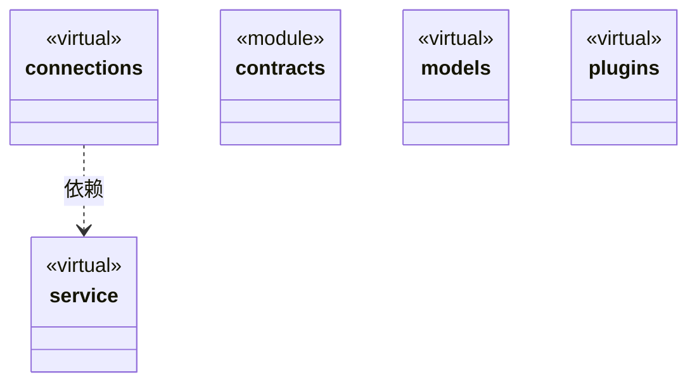

# 工作流资产库

## 设计意图

Resource 拥有可共享的资产定义和当前用户的本机资源。公共入口导出的 `resourceInventory` 按这两种范围登记资产。

| 归属 | 资产 | 使用范围 |
| --- | --- | --- |
| 能力资产 | 引擎插件定义、Agent 模板、组织架构（团队）模板、Skill | 通过本地或远端资产仓库保存与共享 |
| 业务资产 | 业务架构模板、工作区模板、Workflow | 通过本地或远端资产仓库保存与共享 |
| 本机资源 | 本地大模型配置，包括模型 ID、服务地址、协议及凭据引用 | 仅当前用户和设备；API Key 由本机凭据存储保管 |

仓库记录和 HTTP 共享接口使用 `resourceKindIds` 校验七类可共享资产。本机模型配置由 Resource 读写，API Key 经过宿主提供的凭据服务加密后随配置保存。Logic 负责模型匹配、能力探测和运行时选型。

Logic 读取模板、选择本机模型配置，并向 Framework 提供运行所需的配置。Office 使用组织和业务架构创建各自的 Organization 和 Project，派发时组合 Agent 的 Skill 与工作区的 Workflow。用户的实际工作目录和这些运行实例各自具有独立的生命周期。

## 主要组成

| 组成 | 定位 |
| --- | --- |
| [contracts](contracts.ts) | 定义资产种类、仓库身份和版本化快照。 |

<!-- architecture:generated:start -->

## 架构关系

标注为 `virtual` 的节点是直接子模块的虚拟类封装；内部设计沿下方入口阅读。

## 子模块

| 虚拟封装 | 整体职责 |
| --- | --- |
| [connections](connections/ARCHITECTURE.md) | 把资源仓库连接的静态定义、工作区授权和真实读取分开，避免登记连接即获得访问权限。 |
| [models](models/ARCHITECTURE.md) | 管理当前用户的供应商配置、默认选择和加密凭据。配置写入与运行时读取快照共用串行队列。 |
| [plugins](plugins/ARCHITECTURE.md) | 宿主提供可用产品目录和受信任的制品端口。管理器持久化已安装版本与启用状态，并在运行期间跟踪固定版本及其依赖的引用。 |
| [service](service/ARCHITECTURE.md) | 管理本地与 HTTP 资源仓库的版本化读写和共享生命周期，不依赖具体应用或 Bridge。 |

[上层设计](../ARCHITECTURE.md)

<!-- architecture:generated:end -->
