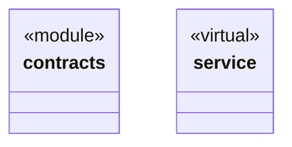

# 工作流资产库

## 设计意图

能力资产包括引擎插件、Agent 模板、团队架构模板和 Skill。业务资产包括业务架构模板、工作区模板和 Workflow。本地工作区是用户目录，模型 API 配置由用户在本机设置。应用通过同一资产库服务访问本地目录或远端 HTTP 仓库。Framework 管理运行实例的生命周期，工作区发布和导入由 Logic 编排。

## 主要组成

| 组成 | 定位 |
| --- | --- |
| [contracts](contracts.ts) | 定义资产种类、仓库身份和版本化快照。 |

<!-- architecture:generated:start -->

## 架构关系

标注为 `virtual` 的节点是直接子模块的虚拟类封装；内部设计沿下方入口阅读。

## 子模块

| 虚拟封装 | 整体职责 |
| --- | --- |
| [service](service/ARCHITECTURE.md) | 管理本地与 HTTP 资源仓库的版本化读写和共享生命周期，不依赖具体应用或 Bridge。 |

[上层设计](../ARCHITECTURE.md)

<!-- architecture:generated:end -->
