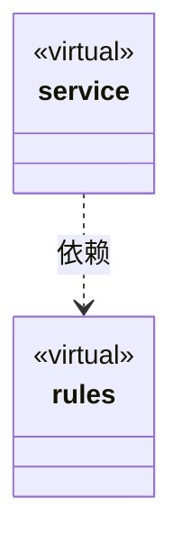

# src/resource/connections 架构

## 设计意图

把资源仓库连接的静态定义、工作区授权和真实读取分开，避免登记连接即获得访问权限。

`rules` 核实身份与注册结构，`service` 保存明确授权并执行只读连接核验。静态定义可以复用，工作区授权与运行中的取消归属仍需单独判断；仓库内容存储属于 resources。

## 主要组成

本层没有直接产品实现，由下方子模块组成；每个直接子模块作为一个虚拟封装，只在本层呈现整体职责与协作。

<!-- architecture:generated:start -->

## 架构关系

标注为 `virtual` 的节点是直接子模块的虚拟类封装；内部设计沿下方入口阅读。

## 子模块

| 虚拟封装 | 整体职责 |
| --- | --- |
| [rules](rules/ARCHITECTURE.md) | 定义工作区仓库连接、访问授权和 Agent 只读工具的数据契约。 |
| [service](service/ARCHITECTURE.md) | 管理工作区对资源仓库的显式只读连接授权，并在真实读取时核实版本、身份和取消范围。 |

[上层设计](../ARCHITECTURE.md)

<!-- architecture:generated:end -->
