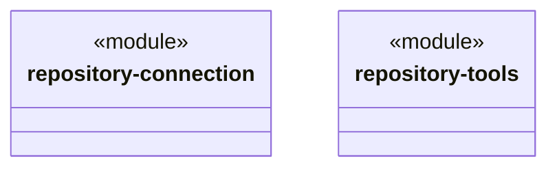

# src/resource/connections/rules 架构

## 设计意图

定义工作区仓库连接、访问授权和 Agent 只读工具的数据契约。

## 主要组成

| 组成 | 定位 |
| --- | --- |
| [repository-connection](repository-connection.ts) | 连接、授权与撤销协议。 |
| [repository-tools](repository-tools.ts) | 读取仓库目录和资源的工具协议。 |

<!-- architecture:generated:start -->

## 架构关系

[上层设计](../ARCHITECTURE.md)

<!-- architecture:generated:end -->
