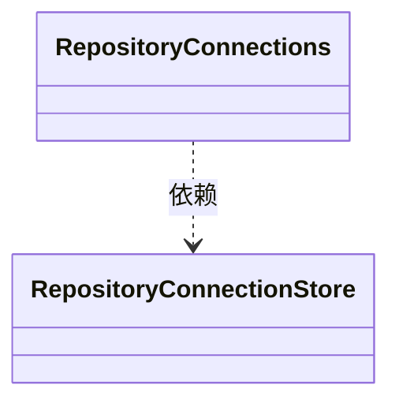

# src/resource/connections/service 架构

## 设计意图

管理工作区对资源仓库的显式只读连接授权，并在真实读取时核实版本、身份和取消范围。

`RepositoryConnectionStore` 保存授权和原命令回执，`RepositoryConnections` 组合知识登记、resources 仓库及工作区可用性检查。工作区退役会限制旧代际读取；连接定义、授权事实和当前 HTTP 核验结果各自保留。

## 主要组成

| 组成 | 定位 |
| --- | --- |
| [RepositoryConnectionStore](repository-connection-store.ts) | 在应用用户目录保存工作区资源仓库只读授权及原命令回执。 |
| [RepositoryConnections](repository-connections.ts) | 桌面资源仓库连接的知识预览/登记、独立本机授权和显式 HTTP 只读核验。 |

<!-- architecture:generated:start -->

## 架构关系

[上层设计](../ARCHITECTURE.md)

<!-- architecture:generated:end -->
