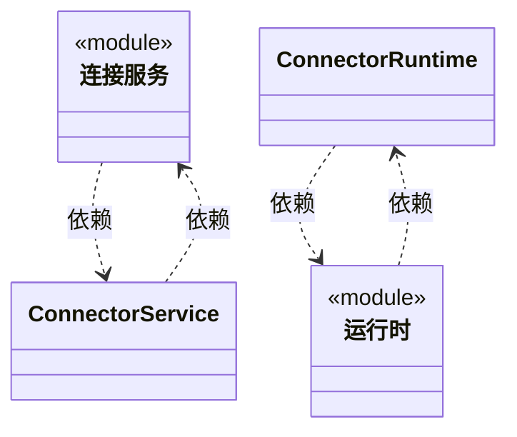

# 本机连接器运行时

## 设计意图

校验本机连接器包并固定活动版本，按 Office 任务取得连接器会话，在关闭后释放占用。协议及会话原语由框架提供。

## 主要组成

| 组成 | 定位 |
| --- | --- |
| [ConnectorRuntime](runtime.ts) | 管理活动版本及任务的会话租约。 |
| [ConnectorService](service.ts) | 按工具名路由调用。 |
| [运行时](runtime.ts) | 按任务建立和释放独立会话。 |
| [连接服务](service.ts) | 在同一连接上发现并调用工具。 |

<!-- architecture:generated:start -->

## 架构关系

[上层设计](../ARCHITECTURE.md)

<!-- architecture:generated:end -->
