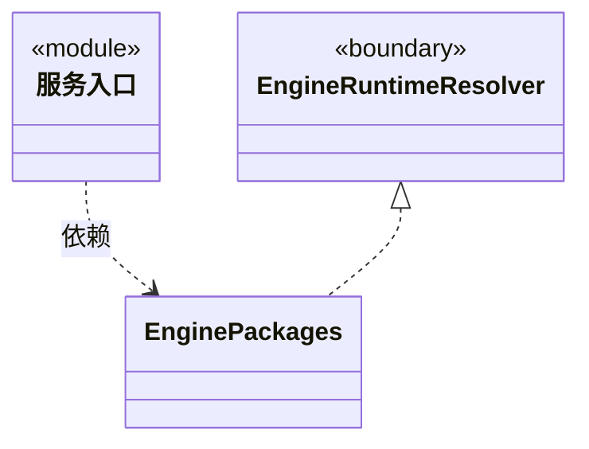

# 引擎包管理

## 设计意图

把官方引擎声明接到资源插件管理器，统一安装、活动版本、依赖和运行引用。执行取得固定包及 retain 释放函数，运行期间不重新选择最新版；制品准备通过注入端口完成。

## 主要组成

| 组成 | 定位 |
| --- | --- |
| [服务入口](index.ts) | 公开 EnginePackages。 |
| [EnginePackages](engine-packages.ts) | 组合 PluginManager，核验引擎制品并实现运行包解析端口。 |

<!-- architecture:generated:start -->

## 架构关系

外部继承／实现边界：[EngineRuntimeResolver](../../logic/execution/rules/engine-runtime.ts)。

[上层设计](../ARCHITECTURE.md)

<!-- architecture:generated:end -->
