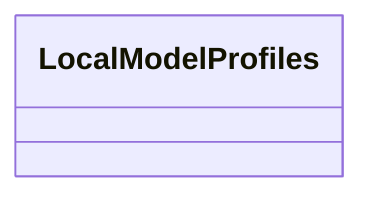

# 本机模型配置

## 设计意图

管理当前用户的供应商配置、默认选择和加密凭据。配置写入与运行时读取快照共用串行队列。

## 主要组成

| 组成 | 定位 |
| --- | --- |
| [LocalModelProfiles](local-profiles.ts) | 校验并原子保存本机配置，保护凭据并提供一致的读取快照。 |

<!-- architecture:generated:start -->

## 架构关系

[上层设计](../ARCHITECTURE.md)

<!-- architecture:generated:end -->
