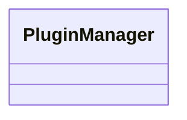

# 插件包管理

## 设计意图

宿主提供可用产品目录和受信任的制品端口。管理器持久化已安装版本与启用状态，并在运行期间跟踪固定版本及其依赖的引用。

## 主要组成

| 组成 | 定位 |
| --- | --- |
| [PluginManager](manager.ts) | 串行提交安装状态，解析固定依赖并跟踪使用中的制品。 |

## 登记兼容插件

在插件目录放置产品入口和 `plugin.json`。例如，连接器可使用以下清单，入口通过 `exports.connectorProduct` 导出产品工厂。

```json
{
  "kind": "design-tools",
  "version": "1.0.0",
  "entry": "main.cjs",
  "adapter": { "entry": "main.cjs", "version": "1.0.0", "protocol": 1 },
  "plugin": { "type": "connector" }
}
```

引擎包使用独立的产品 ID，将 `plugin` 声明为例如 `{ "type": "engine", "profile": "pi", "label": "Design Agent" }`。入口通过 `exports.engineAdapter` 导出适配器。其描述需要匹配声明的能力配置、产品 ID、显示名称和存储目录 `plugin-<产品 ID>`。

运行 `pnpm make:plugin <插件目录>` 生成归档与候选清单，再通过现有发布流程签名。宿主读取经过验证的清单后按产品 ID 发现插件。Agent 或 Workspace 可以引用连接器 ID，任务派发时获取对应会话。

<!-- architecture:generated:start -->

## 架构关系



[上层设计](../ARCHITECTURE.md)

<!-- architecture:generated:end -->
