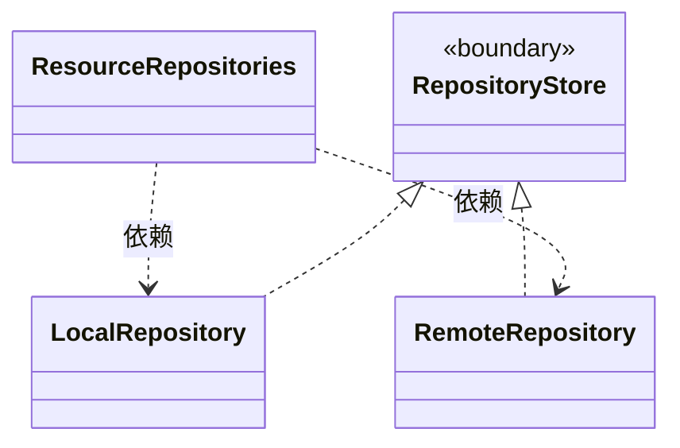

# src/resource/service 架构

## 设计意图

管理本地与 HTTP 资源仓库的版本化读写和共享生命周期，不依赖具体应用或 Bridge。

`ResourceRepositories` 选择仓库并持有共享状态，`LocalRepository` 校验本地身份与原子更新，`RemoteRepository` 适配 HTTP；共享服务沿同一仓库协议读取。宿主只注入目录边界，仓库退役、取消和未知写结果保留独立语义。

## 主要组成

| 组成 | 定位 |
| --- | --- |
| [RemoteRepository](resource-http.ts) | 将远端 HTTP 仓库适配为资源读写协议；同文件的 serveRepository 提供本机共享入口。 |
| [ResourceRepositories](resource-repository.ts) | 持有三类资源的仓库选择、账号占位及共享服务生命周期。 |
| [LocalRepository](resource-store.ts) | 实现本地仓库身份、版本核对及原子更新，供仓库管理和 HTTP 共享复用。 |

<!-- architecture:generated:start -->

## 架构关系

外部继承／实现边界：[RepositoryStore](resource-store.ts)。

[上层设计](../ARCHITECTURE.md)

<!-- architecture:generated:end -->
