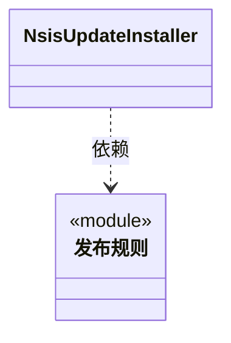

# Windows 桌面更新器

## 设计意图

桌面宿主通过更新器准备 Windows 安装包。确认安装且业务退出准备完成后，更新器调用 electron-updater，将文件替换和应用重启交给独立 NSIS 安装进程。版本检查和下载期间，适配器在宿主进程内运行。

## 主要组成

| 组成 | 职责 |
| --- | --- |
| [NsisUpdateInstaller](index.ts) | 校验候选版本与安装包身份，报告下载进度，支持取消和显式安装。 |
| [发布规则](release-policy.ts) | 校验稳定版本，生成固定仓库地址和安装包名称。 |

<!-- architecture:generated:start -->

## 架构关系

[上层设计](../ARCHITECTURE.md)

<!-- architecture:generated:end -->