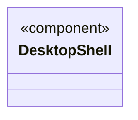

# 主窗口

## 设计意图

组合发现页与扩展区，管理工作区导航。

## 主要组成

| 组成 | 定位 |
| --- | --- |
| [DesktopShell](DesktopShell.tsx) | 组合发现页与扩展区，管理工作区导航。 |

<!-- architecture:generated:start -->

## 架构关系

[上层设计](../ARCHITECTURE.md)

<!-- architecture:generated:end -->
