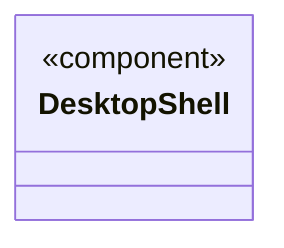
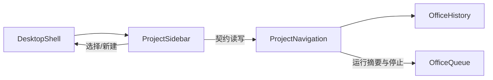

# 主窗口

## 设计意图

组合发现页与扩展区，管理工作区导航。

## 主要组成

| 组成 | 定位 |
| --- | --- |
| [DesktopShell](DesktopShell.tsx) | 组合发现页与扩展区，管理工作区导航。 |

<!-- architecture:generated:start -->

## 架构关系

[上层设计](../ARCHITECTURE.md)

<!-- architecture:generated:end -->

### 项目与对话导航

ProjectSidebar 独立管理项目树、对话行、搜索、折叠、菜单及确认对话框。ProjectNavigation 为名称、置顶、项目顺序、归档和可恢复移除的唯一状态来源；组件轮询刷新所有项目的对话与运行摘要，不依赖打开过哪些项目。折叠和宽度是本机显示偏好。DesktopShell 负责页面切换、上次会话恢复和手机抽屉，切换不会停止宿主队列。拖柄及菜单上下移用于项目排序；对话按置顶和最近活动排列，默认显示五条并保留当前及运行中的对话。

交互参考 [Cindy ProjectNode](https://github.com/makecindy/cindy/blob/4e4173743fc2c3cee83d0c4ae2f3aae79a4f2df4/apps/desktop/src/renderer/features/cc-agent/sidebar/sections/ProjectNode.tsx) 与同版本 SessionItem/SessionTaskMenu；仅映射 CBIM 已有本地项目与 Office 能力，不提供虚假的跨设备迁移或共享操作。

