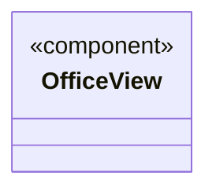

# Office 对话页

## 设计意图

让用户在项目内选择 Office 会话，查看记录并保存输入。

## 主要组成

| 组成 | 定位 |
| --- | --- |
| [OfficeView](OfficeView.tsx) | 展示当前会话及其输入框。 |

<!-- architecture:generated:start -->

## 架构关系

[上层设计](../ARCHITECTURE.md)

<!-- architecture:generated:end -->
