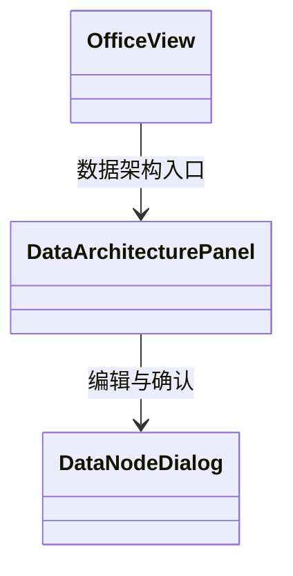
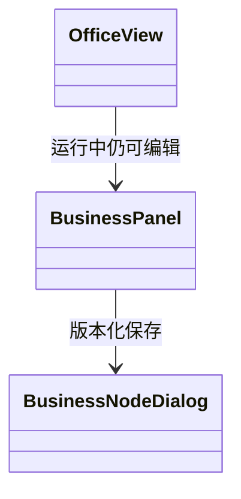
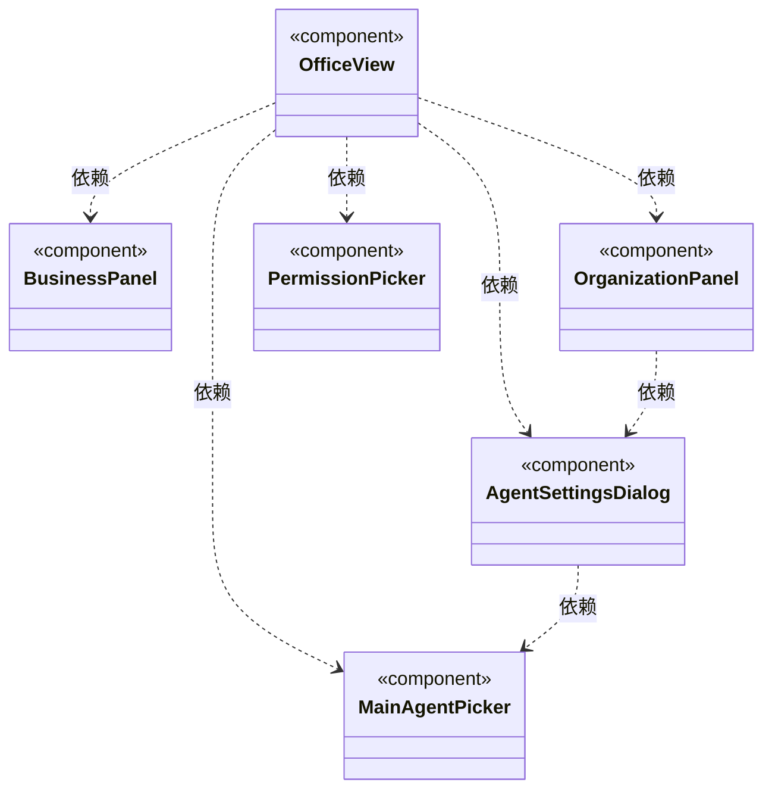
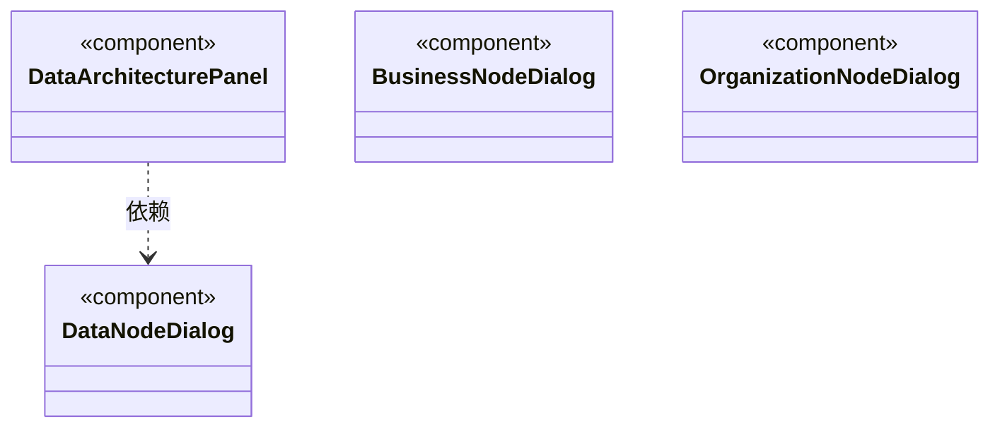

# Office 对话页

## 设计意图

让用户在项目内选择 Office 会话，查看记录并保存输入。

组织架构页面的成员 item 与对话的主 Agent 设置共用 AgentSettingsDialog；引擎/LLM、Skills 和连接器使用同一表单及保存协议。主配置按当前会话保存，成员配置按岗位保存。左下角「＋」包含文本附件、Skills、连接器；能力选择不会自动安装资源或提交任务。运行中主设置禁用，成员设置保存更新后续派发目录并通知活动主 Agent，已运行实例保留冻结配置。

## 主要组成

组织架构改为团队/成员层级树：折叠、搜索保留祖先、路径导航及节点详情。图标按钮提供 title 和可访问名称，资料编辑与成员能力设置分开；新增/编辑弹窗支持名称、职责、所属团队，移动排除自身和后代，保存冲突保留输入。删除在独立确认弹窗执行，非空团队不能删除；保存后显示最新树并选中新节点。所有结构操作经过宿主版本化命令，不由视图修改运行对象。

业务架构与组织架构都允许运行中编辑。BusinessPanel 读取版本化业务定义，BusinessNodeDialog 提供新增、编辑、父节点移动、来源范围与删除确认；操作不修改实际工作树。保存后更新项目共享树并通知活动主 Agent。刷新保留有效选择，错误保留快照，旧版本保存失败保留草稿；移动端层级与详情上下排列。OfficeView 在主任务运行中允许输入补充，用插入图标或 Ctrl/⌘+Enter 经 InsertOffice 进入同一个追加队列，原任务输入不被替换。接收与模型处理状态沿工作记录展示。

| 组成 | 定位 |
| --- | --- |
| [OfficeView](OfficeView.tsx) | 展示当前会话及其输入框。 |
| [BusinessPanel](BusinessPanel.tsx) | 当前业务树的层级导航、搜索、详情与编辑入口。 |
| [BusinessNodeDialog](BusinessNodeDialog.tsx) | 业务资料、来源范围、归属调整与删除确认。 |
| [OrganizationPanel](OrganizationPanel.tsx) | 组织树、查询、详情和图标操作，协调资料与能力编辑。 |
| [OrganizationNodeDialog](OrganizationNodeDialog.tsx) | 新增、编辑与删除确认，错误保留输入与版本。 |
| [AgentSettingsDialog](AgentSettingsDialog.tsx) | 两种角色共用的能力编辑、版本化保存及错误反馈。 |
| [MainAgentPicker](MainAgentPicker.tsx) | 保留原组件名，主与成员共用引擎可用性、兼容模型选择及安装入口。 |
| [PermissionPicker](PermissionPicker.tsx) | 使用书本、手掌、警示图标区分权限，提供说明、选中状态和键盘操作；选择仍交由 OfficeView 保存与发送。 |

数据架构入口与业务／组织并列。DataArchitecturePanel 浏览数据域、实体、字段，支持折叠、按名称／说明／类型查询并保留祖先、路径与下级导航；操作使用带标题及可访问名称的图标。DataNodeDialog 负责新增、编辑、归属调整和删除确认，字段支持逻辑类型、必填与联合主键，移动排除后代；非空节点不能删除。保存失败保留草稿，旧刷新回执不能覆盖新保存。页面明确区分本机结构定义与实际数据库，不暗示已建表或迁移。手机纵向布局沿用架构页面样式。

| 数据页面组成 | 定位 |
| --- | --- |
| [DataArchitecturePanel](DataArchitecturePanel.tsx) | 数据树、搜索、选择、刷新和 CRUD 导航。 |
| [DataNodeDialog](DataNodeDialog.tsx) | 定义草稿、字段约束及删除确认。 |

<!-- architecture:generated:start -->

## 架构关系

### 关系组 1：OfficeView

### 关系组 2：DataArchitecturePanel

### 跨图协作

按引用方归并目标，保留全部跨图关系；分图只用于阅读，不表示新增模块或依赖边界。

| 引用方 | 关系 | 目标 |
| --- | --- | --- |
| [OfficeView](OfficeView.tsx)（图 1） | 依赖 | [DataArchitecturePanel](DataArchitecturePanel.tsx)（图 2） |
| [BusinessPanel](BusinessPanel.tsx)（图 1） | 依赖 | [BusinessNodeDialog](BusinessNodeDialog.tsx)（图 2） |
| [OrganizationPanel](OrganizationPanel.tsx)（图 1） | 依赖 | [OrganizationNodeDialog](OrganizationNodeDialog.tsx)（图 2） |

[上层设计](../ARCHITECTURE.md)

<!-- architecture:generated:end -->

### Office 指令排队

OfficeView 默认提交到宿主队列，定期读取队列及完成记录；运行期间可选择下一条指令的引擎、模型，并从加号修改连接器。OfficeQueuePanel 展示顺序与配置摘要，支持鼠标/触屏拖柄、Alt+方向键、上下移图标、编辑、移除及单条立即插入。队列与当前任务输入分离，修改不追溯已有排队项。设计对照 Cindy 的 host-owned input queue 与 inline queue section（commit 4e4173743fc2c3cee83d0c4ae2f3aae79a4f2df4），由 CBIM 独立实现。

参考：[Cindy 队列契约](https://github.com/makecindy/cindy/blob/4e4173743fc2c3cee83d0c4ae2f3aae79a4f2df4/apps/desktop/src/shared/agentInputQueue.ts)、[移动端队列呈现](https://github.com/makecindy/cindy/blob/4e4173743fc2c3cee83d0c4ae2f3aae79a4f2df4/apps/mobile/src/session/InlineQueueSection.tsx)。
