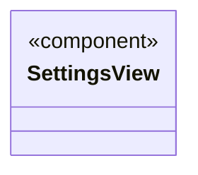

# 设置页

## 设计意图

在主窗口内提供独立的设置导航与分组内容。

## 主要组成

| 组成 | 定位 |
| --- | --- |
| [SettingsView](SettingsView.tsx) | 提供分类搜索、通用设置展示与外观选择。 |

<!-- architecture:generated:start -->

## 架构关系

[上层设计](../ARCHITECTURE.md)

<!-- architecture:generated:end -->
