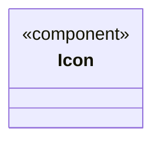

# 共享表现组件

## 设计意图

承载跨界面的图标、品牌及基础样式。

## 主要组成

| 组成 | 定位 |
| --- | --- |
| [Icon](Icon.tsx) | 承载跨界面的图标、品牌及基础样式。 |

<!-- architecture:generated:start -->

## 架构关系

[上层设计](../ARCHITECTURE.md)

<!-- architecture:generated:end -->
