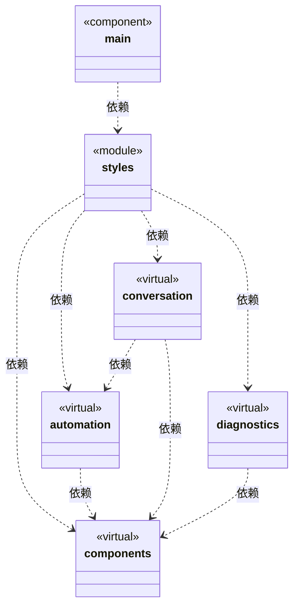
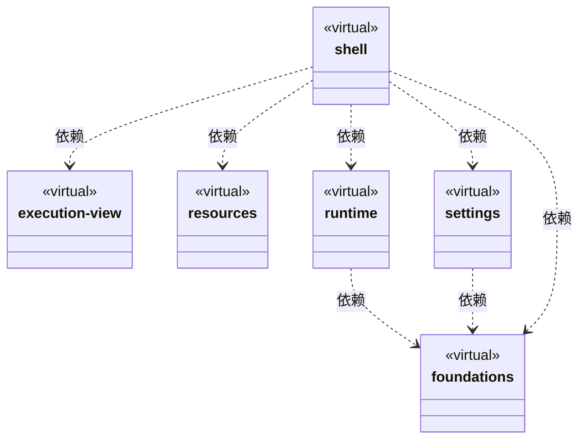
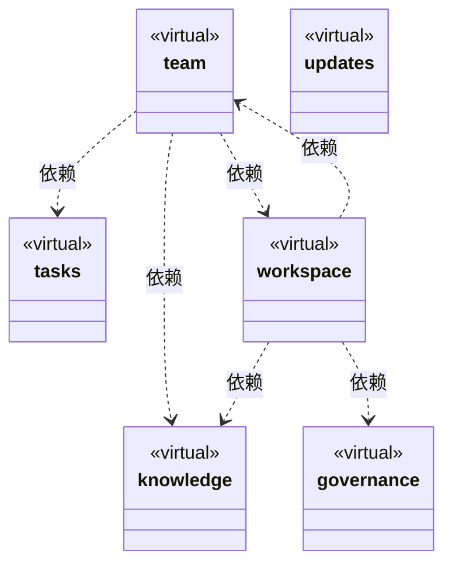

# src/view 架构

## 设计意图

以页面、局部控制器和共享展示组件呈现业务事实，让界面变化与后端状态机保持独立。

`main` 挂载 React，`styles` 装配样式，`shell` 组织导航及共享界面状态；各业务页面通过 Bridge 契约调用服务。`components`、`execution-view` 和 `foundations` 提供不同层次的复用。页面可保存草稿、选择和待确认命令，但不能把本地状态当作业务提交或执行许可。

## 主要组成

| 组成 | 定位 |
| --- | --- |
| [main](main.tsx) | 前端视图层的渲染进程入口，仅挂载 App 并加载外壳样式；通过 bridge 与本机后端通信。 |
| [styles](styles.ts) | 集中装配视图样式，业务页代码可延迟加载，样式保持首屏可用。 |

## 现状与目标边界

[main.tsx](main.tsx) 由根 [index.html](../../index.html) 指定，是 React 挂载与样式加载入口，转交 shell/App；[styles.ts](styles.ts) 集中加载页面样式以保持首屏可用。当前保留这两个已登记入口，它们不承担业务决策。后续若将样式装配下沉，须同步 HTML/构建引用及样式顺序，不能只移动文件而让首屏或延迟页面缺样式。

<!-- architecture:generated:start -->

## 架构关系

标注为 `virtual` 的节点是直接子模块的虚拟类封装；内部设计沿下方入口阅读。

### 关系组 1：styles

### 关系组 2：shell

### 关系组 3：team

### 跨图协作

按引用方归并目标，保留全部跨图关系；分图只用于阅读，不表示新增模块或依赖边界。

| 引用方 | 关系 | 目标 |
| --- | --- | --- |
| [main](main.tsx)（图 1） | 依赖 | [shell](shell/ARCHITECTURE.md)（图 2） |
| [styles](styles.ts)（图 1） | 依赖 | [execution-view](execution-view/ARCHITECTURE.md)（图 2）、[governance](governance/ARCHITECTURE.md)（图 3）、[knowledge](knowledge/ARCHITECTURE.md)（图 3）、[resources](resources/ARCHITECTURE.md)（图 2）、[runtime](runtime/ARCHITECTURE.md)（图 2）、[settings](settings/ARCHITECTURE.md)（图 2）、[shell](shell/ARCHITECTURE.md)（图 2）、[tasks](tasks/ARCHITECTURE.md)（图 3）、[team](team/ARCHITECTURE.md)（图 3）、[updates](updates/ARCHITECTURE.md)（图 3）、[workspace](workspace/ARCHITECTURE.md)（图 3） |
| [conversation](conversation/ARCHITECTURE.md)（图 1） | 依赖 | [execution-view](execution-view/ARCHITECTURE.md)（图 2）、[foundations](foundations/ARCHITECTURE.md)（图 2）、[shell](shell/ARCHITECTURE.md)（图 2）、[tasks](tasks/ARCHITECTURE.md)（图 3）、[team](team/ARCHITECTURE.md)（图 3） |
| [execution-view](execution-view/ARCHITECTURE.md)（图 2） | 依赖 | [components](components/ARCHITECTURE.md)（图 1） |
| [governance](governance/ARCHITECTURE.md)（图 3） | 依赖 | [components](components/ARCHITECTURE.md)（图 1） |
| [knowledge](knowledge/ARCHITECTURE.md)（图 3） | 依赖 | [components](components/ARCHITECTURE.md)（图 1）、[execution-view](execution-view/ARCHITECTURE.md)（图 2） |
| [resources](resources/ARCHITECTURE.md)（图 2） | 依赖 | [components](components/ARCHITECTURE.md)（图 1）、[knowledge](knowledge/ARCHITECTURE.md)（图 3） |
| [runtime](runtime/ARCHITECTURE.md)（图 2） | 依赖 | [components](components/ARCHITECTURE.md)（图 1）、[tasks](tasks/ARCHITECTURE.md)（图 3） |
| [settings](settings/ARCHITECTURE.md)（图 2） | 依赖 | [components](components/ARCHITECTURE.md)（图 1）、[tasks](tasks/ARCHITECTURE.md)（图 3）、[updates](updates/ARCHITECTURE.md)（图 3） |
| [shell](shell/ARCHITECTURE.md)（图 2） | 依赖 | [automation](automation/ARCHITECTURE.md)（图 1）、[components](components/ARCHITECTURE.md)（图 1）、[conversation](conversation/ARCHITECTURE.md)（图 1）、[diagnostics](diagnostics/ARCHITECTURE.md)（图 1）、[team](team/ARCHITECTURE.md)（图 3）、[updates](updates/ARCHITECTURE.md)（图 3）、[workspace](workspace/ARCHITECTURE.md)（图 3） |
| [tasks](tasks/ARCHITECTURE.md)（图 3） | 依赖 | [components](components/ARCHITECTURE.md)（图 1）、[execution-view](execution-view/ARCHITECTURE.md)（图 2）、[foundations](foundations/ARCHITECTURE.md)（图 2） |
| [team](team/ARCHITECTURE.md)（图 3） | 依赖 | [components](components/ARCHITECTURE.md)（图 1）、[execution-view](execution-view/ARCHITECTURE.md)（图 2）、[foundations](foundations/ARCHITECTURE.md)（图 2）、[resources](resources/ARCHITECTURE.md)（图 2） |
| [updates](updates/ARCHITECTURE.md)（图 3） | 依赖 | [components](components/ARCHITECTURE.md)（图 1） |
| [workspace](workspace/ARCHITECTURE.md)（图 3） | 依赖 | [components](components/ARCHITECTURE.md)（图 1）、[foundations](foundations/ARCHITECTURE.md)（图 2）、[resources](resources/ARCHITECTURE.md)（图 2） |

## 子模块

| 虚拟封装 | 整体职责 |
| --- | --- |
| [automation](automation/ARCHITECTURE.md) | 展示当前工作区的自动化定义与真实运行历史，并提供明确的编辑和保存入口。 |
| [components](components/ARCHITECTURE.md) | 提供跨页面复用的展示控件和交互边界，使页面可组合而不共享领域服务实例。 |
| [conversation](conversation/ARCHITECTURE.md) | 组织主会话正文、输入、附件、队列和话题浏览，保持用户输入与真实运行反馈的来源清楚。 |
| [diagnostics](diagnostics/ARCHITECTURE.md) | 只读呈现工作区运行状态与知识校验问题，为维护者提供可核对的诊断入口。 |
| [execution-view](execution-view/ARCHITECTURE.md) | 为主对话、成员任务和履历复用同一套执行正文与工具过程展示，保持表现与业务处置分离。 |
| [foundations](foundations/ARCHITECTURE.md) | 提供不依赖页面、React 或通信的视图侧基础能力，避免公共机制反向认识业务界面。 |
| [governance](governance/ARCHITECTURE.md) | 把模块知识治理转化为可审阅、可明确决定的界面，区分模型建议、人工意见和正式实施。 |
| [knowledge](knowledge/ARCHITECTURE.md) | 提供静态知识的语义编辑、文件预览和来源说明，让用户在明确基线下审阅修改。 |
| [resources](resources/ARCHITECTURE.md) | 展示资源仓库、连接授权与静态包交换，让用户分别选择查看、发布和应用。 |
| [runtime](runtime/ARCHITECTURE.md) | 提供跨工作区的只读运行总览，分别展示周期、人员、任务、占用与已报告消耗。 |
| [settings](settings/ARCHITECTURE.md) | 将应用设置组织为可导航的独立表单，使各领域继续通过自己的版本和保存入口管理配置。 |
| [shell](shell/ARCHITECTURE.md) | 组织窗口布局、工作区与会话导航及全局页面，提供共享界面状态的单一装配入口。 |
| [tasks](tasks/ARCHITECTURE.md) | 展示主会话任务与目标的真实投影，并为证据核实、人工决定和显式接续提供交互入口。 |
| [team](team/ARCHITECTURE.md) | 分别呈现静态团队能力、工作区岗位与角色履历，让配置、登记和执行历史各有入口。 |
| [updates](updates/ARCHITECTURE.md) | 展示应用版本、准备进度和明确重启安装入口，将更新状态与引擎包管理区分。 |
| [workspace](workspace/ARCHITECTURE.md) | 以业务模块树组织源码浏览与负责人管理，连接工作对象、责任关系和正式知识。 |

[上层设计](../ARCHITECTURE.md)

<!-- architecture:generated:end -->
