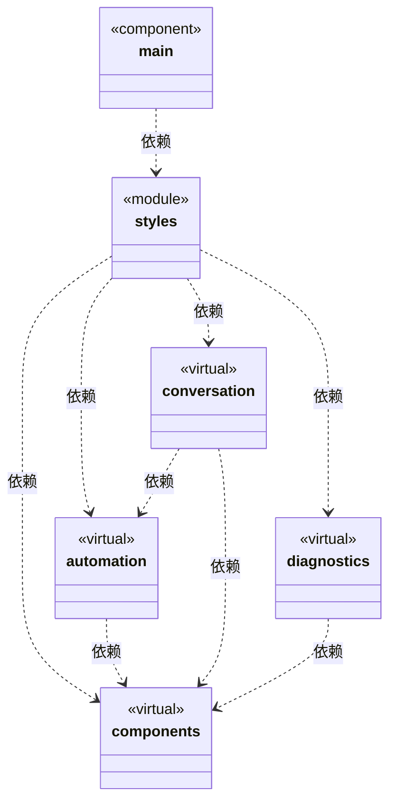
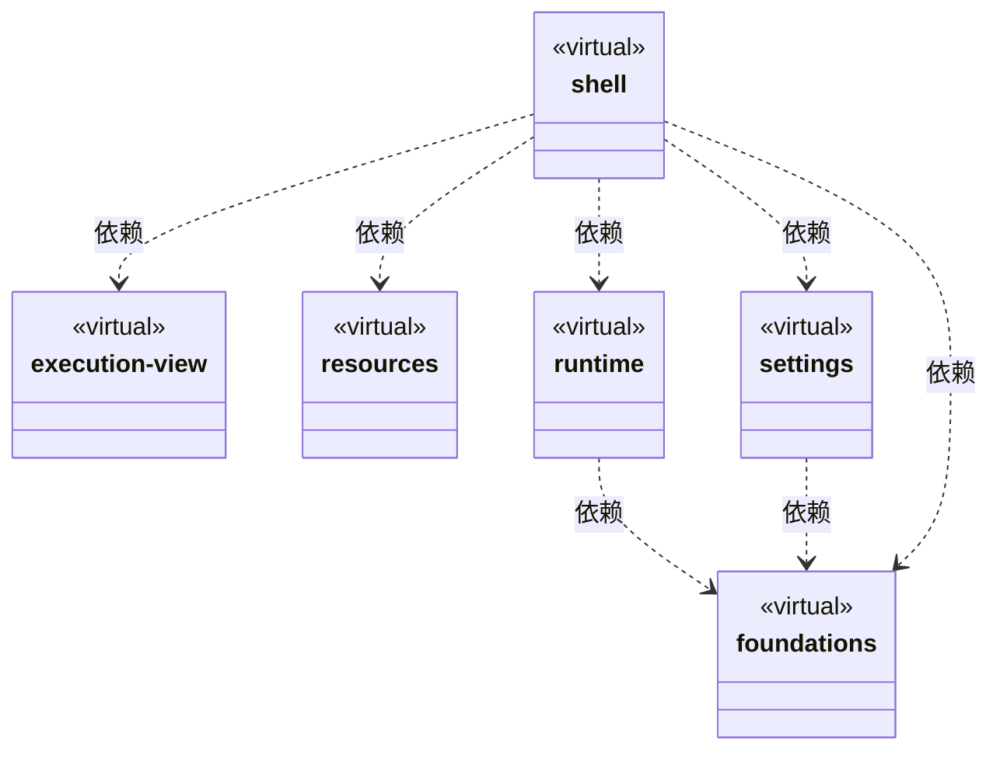
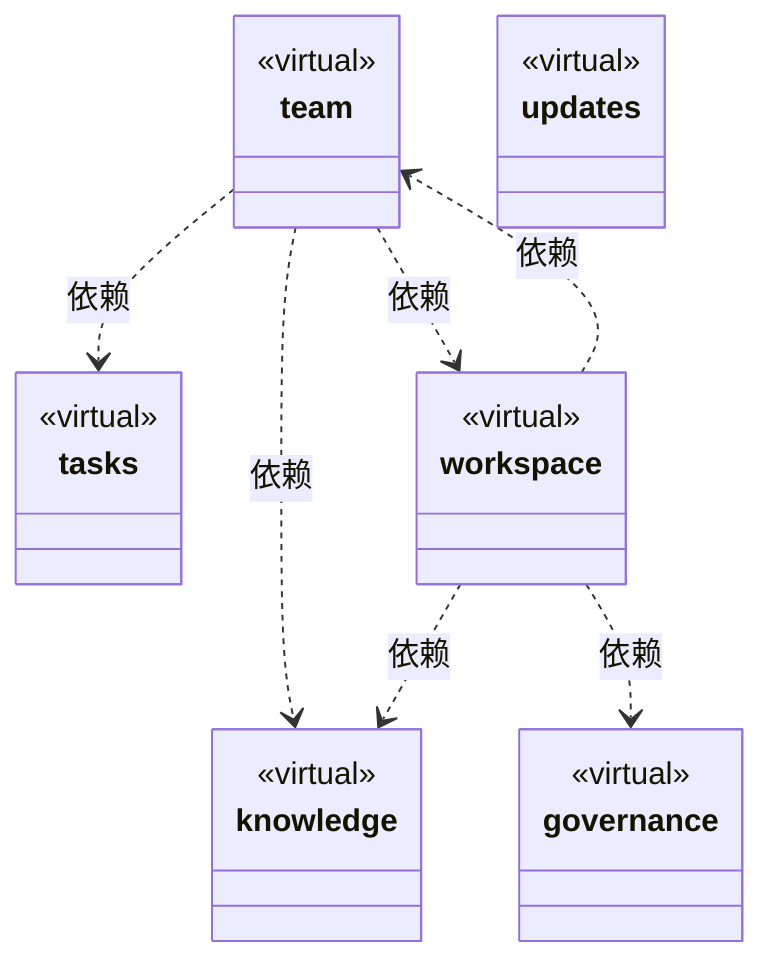

# src/view 架构

## 设计意图

以 React 页面和交互状态呈现工作区业务。shell 组织应用布局，各页面通过 Bridge 契约访问服务，共享展示与视图基础能力独立封装，不直接持有后端业务对象。

## 主要组成

| 组成 | 定位 |
| --- | --- |
| [main](main.tsx) | 前端视图层的渲染进程入口，仅挂载 App 并加载外壳样式；通过 bridge 与本机后端通信。 |
| [styles](styles.ts) | 集中装配视图样式，业务页代码可延迟加载，样式保持首屏可用。 |

<!-- architecture:generated:start -->

## 架构关系

标注为 `virtual` 的节点是直接子模块的虚拟类封装；内部设计沿下方入口阅读。

### 关系组 1

### 关系组 2

### 关系组 3

### 跨图协作

- [main](main.tsx)（图 1）→ [shell](shell/ARCHITECTURE.md)（图 2）：依赖。
- [styles](styles.ts)（图 1）→ [execution-view](execution-view/ARCHITECTURE.md)（图 2）：依赖。
- [styles](styles.ts)（图 1）→ [governance](governance/ARCHITECTURE.md)（图 3）：依赖。
- [styles](styles.ts)（图 1）→ [knowledge](knowledge/ARCHITECTURE.md)（图 3）：依赖。
- [styles](styles.ts)（图 1）→ [resources](resources/ARCHITECTURE.md)（图 2）：依赖。
- [styles](styles.ts)（图 1）→ [runtime](runtime/ARCHITECTURE.md)（图 2）：依赖。
- [styles](styles.ts)（图 1）→ [settings](settings/ARCHITECTURE.md)（图 2）：依赖。
- [styles](styles.ts)（图 1）→ [shell](shell/ARCHITECTURE.md)（图 2）：依赖。
- [styles](styles.ts)（图 1）→ [tasks](tasks/ARCHITECTURE.md)（图 3）：依赖。
- [styles](styles.ts)（图 1）→ [team](team/ARCHITECTURE.md)（图 3）：依赖。
- [styles](styles.ts)（图 1）→ [updates](updates/ARCHITECTURE.md)（图 3）：依赖。
- [styles](styles.ts)（图 1）→ [workspace](workspace/ARCHITECTURE.md)（图 3）：依赖。
- [conversation](conversation/ARCHITECTURE.md)（图 1）→ [execution-view](execution-view/ARCHITECTURE.md)（图 2）：依赖。
- [conversation](conversation/ARCHITECTURE.md)（图 1）→ [foundations](foundations/ARCHITECTURE.md)（图 2）：依赖。
- [conversation](conversation/ARCHITECTURE.md)（图 1）→ [shell](shell/ARCHITECTURE.md)（图 2）：依赖。
- [conversation](conversation/ARCHITECTURE.md)（图 1）→ [tasks](tasks/ARCHITECTURE.md)（图 3）：依赖。
- [conversation](conversation/ARCHITECTURE.md)（图 1）→ [team](team/ARCHITECTURE.md)（图 3）：依赖。
- [execution-view](execution-view/ARCHITECTURE.md)（图 2）→ [components](components/ARCHITECTURE.md)（图 1）：依赖。
- [governance](governance/ARCHITECTURE.md)（图 3）→ [components](components/ARCHITECTURE.md)（图 1）：依赖。
- [knowledge](knowledge/ARCHITECTURE.md)（图 3）→ [components](components/ARCHITECTURE.md)（图 1）：依赖。
- [knowledge](knowledge/ARCHITECTURE.md)（图 3）→ [execution-view](execution-view/ARCHITECTURE.md)（图 2）：依赖。
- [resources](resources/ARCHITECTURE.md)（图 2）→ [components](components/ARCHITECTURE.md)（图 1）：依赖。
- [resources](resources/ARCHITECTURE.md)（图 2）→ [knowledge](knowledge/ARCHITECTURE.md)（图 3）：依赖。
- [runtime](runtime/ARCHITECTURE.md)（图 2）→ [components](components/ARCHITECTURE.md)（图 1）：依赖。
- [runtime](runtime/ARCHITECTURE.md)（图 2）→ [tasks](tasks/ARCHITECTURE.md)（图 3）：依赖。
- [settings](settings/ARCHITECTURE.md)（图 2）→ [components](components/ARCHITECTURE.md)（图 1）：依赖。
- [settings](settings/ARCHITECTURE.md)（图 2）→ [tasks](tasks/ARCHITECTURE.md)（图 3）：依赖。
- [settings](settings/ARCHITECTURE.md)（图 2）→ [updates](updates/ARCHITECTURE.md)（图 3）：依赖。
- [shell](shell/ARCHITECTURE.md)（图 2）→ [automation](automation/ARCHITECTURE.md)（图 1）：依赖。
- [shell](shell/ARCHITECTURE.md)（图 2）→ [components](components/ARCHITECTURE.md)（图 1）：依赖。
- [shell](shell/ARCHITECTURE.md)（图 2）→ [conversation](conversation/ARCHITECTURE.md)（图 1）：依赖。
- [shell](shell/ARCHITECTURE.md)（图 2）→ [diagnostics](diagnostics/ARCHITECTURE.md)（图 1）：依赖。
- [shell](shell/ARCHITECTURE.md)（图 2）→ [team](team/ARCHITECTURE.md)（图 3）：依赖。
- [shell](shell/ARCHITECTURE.md)（图 2）→ [updates](updates/ARCHITECTURE.md)（图 3）：依赖。
- [shell](shell/ARCHITECTURE.md)（图 2）→ [workspace](workspace/ARCHITECTURE.md)（图 3）：依赖。
- [tasks](tasks/ARCHITECTURE.md)（图 3）→ [components](components/ARCHITECTURE.md)（图 1）：依赖。
- [tasks](tasks/ARCHITECTURE.md)（图 3）→ [execution-view](execution-view/ARCHITECTURE.md)（图 2）：依赖。
- [tasks](tasks/ARCHITECTURE.md)（图 3）→ [foundations](foundations/ARCHITECTURE.md)（图 2）：依赖。
- [team](team/ARCHITECTURE.md)（图 3）→ [components](components/ARCHITECTURE.md)（图 1）：依赖。
- [team](team/ARCHITECTURE.md)（图 3）→ [execution-view](execution-view/ARCHITECTURE.md)（图 2）：依赖。
- [team](team/ARCHITECTURE.md)（图 3）→ [foundations](foundations/ARCHITECTURE.md)（图 2）：依赖。
- [team](team/ARCHITECTURE.md)（图 3）→ [resources](resources/ARCHITECTURE.md)（图 2）：依赖。
- [updates](updates/ARCHITECTURE.md)（图 3）→ [components](components/ARCHITECTURE.md)（图 1）：依赖。
- [workspace](workspace/ARCHITECTURE.md)（图 3）→ [components](components/ARCHITECTURE.md)（图 1）：依赖。
- [workspace](workspace/ARCHITECTURE.md)（图 3）→ [foundations](foundations/ARCHITECTURE.md)（图 2）：依赖。
- [workspace](workspace/ARCHITECTURE.md)（图 3）→ [resources](resources/ARCHITECTURE.md)（图 2）：依赖。

## 子模块

| 虚拟封装 | 整体职责 |
| --- | --- |
| [automation](automation/ARCHITECTURE.md) | 当前工作区自动化列表、配置和运行历史；固定页签不接自选工作目录，真实运行通过原会话定位。 |
| [components](components/ARCHITECTURE.md) | 为页面提供可组合的通用控件与展示边界。组件接收公开数据和回调，领域服务、运行状态及页面导航由使用方持有。 |
| [conversation](conversation/ARCHITECTURE.md) | 组织主会话的消息、输入、附件与交互等待。页面组合共享执行展示，各控制器分别维护草稿、队列和停止状态；后端返回的运行事实仍是状态依据。 |
| [diagnostics](diagnostics/ARCHITECTURE.md) | 只读展示工作区运行状态和知识校验问题，不把工作区就绪视为知识校验通过。 |
| [execution-view](execution-view/ARCHITECTURE.md) | 提供主对话、成员任务和角色履历共用的执行展示。消息、工具轨道、状态与问答组件消费公开快照，业务查询和处置通过页面注入，不反向依赖具体页面。 |
| [foundations](foundations/ARCHITECTURE.md) | 视图侧独立适配库；单向组合 Core 公开技术能力，不依赖页面、Bridge 或 Logic，不持有业务状态与通信权限。 |
| [governance](governance/ARCHITECTURE.md) | 把模块知识治理组织为可审阅的界面。面板组合来源、差异和反馈展示，人工决定与正式实施分别操作，命令未知时核对原回执。 |
| [knowledge](knowledge/ARCHITECTURE.md) | 提供静态知识编辑、文件预览与来源说明。表单和预览围绕明确基线组合，提交由业务服务裁决；业务模块图由 workspace 页面负责。 |
| [resources](resources/ARCHITECTURE.md) | 呈现资源仓库连接、静态包发布和下载应用。仓库查看、连接管理与工作区导入分别封装，共用预览和版本身份，不在页面实现仓库存储。 |
| [runtime](runtime/ARCHITECTURE.md) | 全局只读运行管理。分别呈现目标周期、人员、任务、准入等待和已报告消耗；单次在途游标读取保留未变行，隐藏时退订，按真实身份定位既有会话而不执行任务。 |
| [settings](settings/ARCHITECTURE.md) | 组织应用设置的分类导航、搜索与独立表单。各表单通过原业务契约读写配置，预算控制器维护编辑状态；外观偏好和应用布局由 shell 持有。 |
| [shell](shell/ARCHITECTURE.md) | 组织应用窗口、工作区导航、会话区与扩展页面。App 持有共享界面状态，导航解析器把运行身份映射到已有视图，具体业务交互由页面模块承担。 |
| [tasks](tasks/ARCHITECTURE.md) | 展示主会话任务图、目标状态与核实处置入口。只读投影组织图和摘要，各控制器维护单类命令的交互与原回执；页面不把本地状态当作业务完成或执行授权。 |
| [team](team/ARCHITECTURE.md) | 展示静态团队、岗位与角色履历。团队图组织角色关系，岗位控制器维护登记命令及回执，历史视图复用执行展示；运行调度留在业务层。 |
| [updates](updates/ARCHITECTURE.md) | 侧栏应用 C/R 更新图标、版本 tooltip 和显式重启安装；独立引擎管理由对话下拉菜单负责。共享窗口级应用更新快照，不因引擎准备显示应用安装就绪。 |
| [workspace](workspace/ARCHITECTURE.md) | 展示工程、模块与各自 Workflow，并提供负责人管理和源码浏览。模块图负责组织关系，责任控制器管理明确命令，知识编辑与资源复用交给对应页面模块。 |

[上层设计](../ARCHITECTURE.md)

<!-- architecture:generated:end -->
