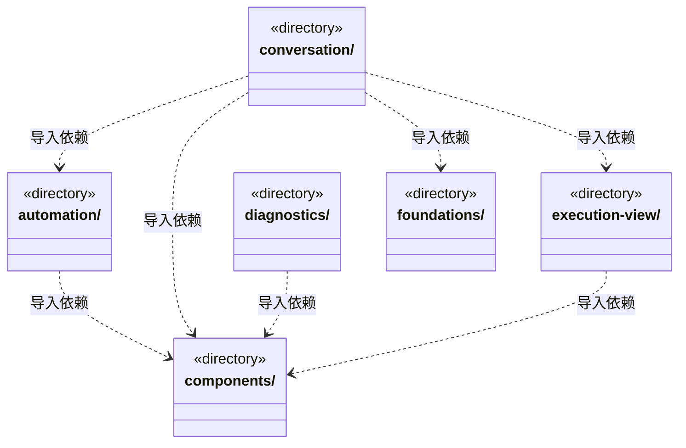
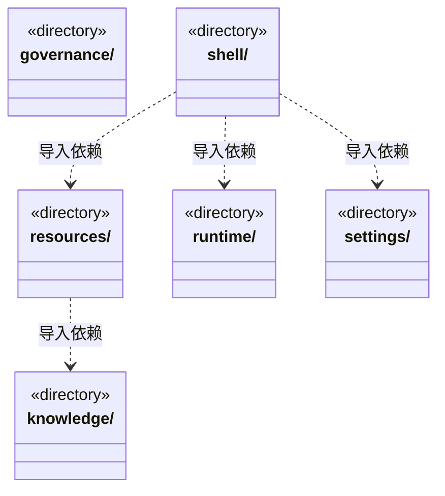
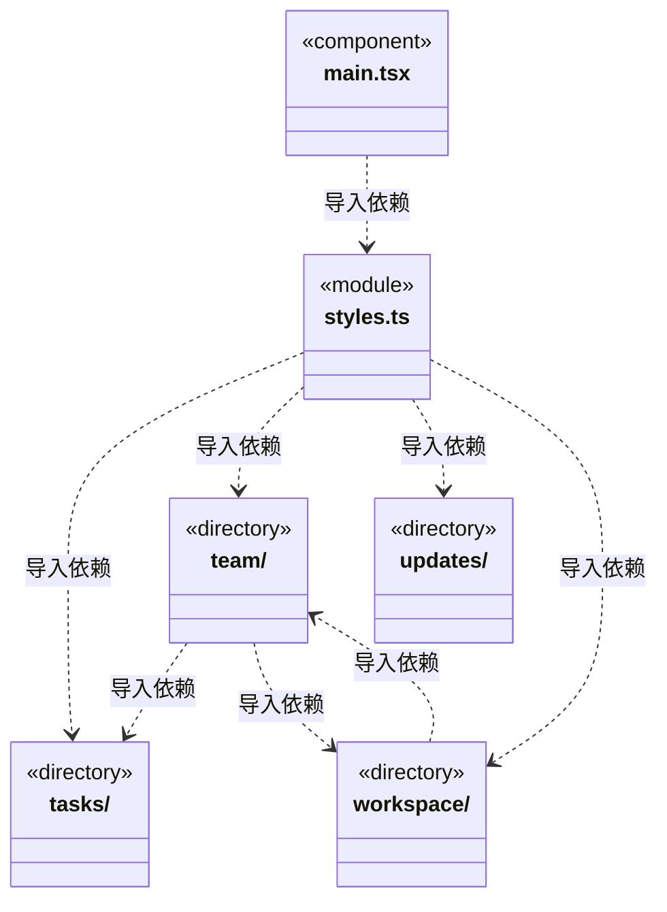
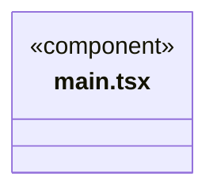
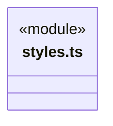

# src/view 架构

本目录只维护这一份说明。设计与契约直接编辑本文；文件清单、类图和导航由 [架构脚本](../../scripts/source-architecture.mjs) 更新，生成区域之外的人工说明会保留。

## 封装意图

React 桌面界面。页面消费 Bridge 通信契约、共享 Core 和自身视图适配；视图基础库不反向引用页面或通信契约，不依赖 Logic 服务、调度或主进程实现。

## 类与模块的设计意图

下表依据源码声明及文件头说明定位封装。字段表示该实例持有的状态或协作引用，不表示它拥有被引用服务的生命周期；实际资源责任和调用限制见下文契约及源码注释。

| 类／模块 | 实现形式与实例字段 | 封装依据 |
| --- | --- | --- |
| [main.tsx](main.tsx) | 组件模块 | 让进程启动与页面状态分离，最后加载统一界面令牌和控件规则，业务样式保留各页面布局。 |
| [styles.ts](styles.ts) | 函数／契约模块 | 避免动态页样式到达时间改变层叠顺序；外壳在前、业务布局居中、统一界面规则最后覆盖。 |

## 接口设计契约

### View 视图与交互

`styles.ts` 集中静态装配当前全部页面 CSS，顺序为外壳、业务布局、统一 interface 规则；页面 JavaScript 延迟加载不会再迟到注入样式改变覆盖关系。新增 CSS 文件须同步该清单。`main.tsx` 只导入该样式入口。App 与 ExtensionArea 的专业页面通过局部 deferredView 装配；样式仍首屏加载，不能把 JavaScript 按需加载称为全部资源按需。

原 frontend 的页面、控制器、订阅状态、hooks 和样式迁入本目录；行为与实例状态保持原实现。main.tsx 挂载 App，index.html 指向该入口。业务样式、外壳样式之后加载 components/interface.css，使所有页面共享主题令牌、控件焦点、字号下限及减少动效规则。

页面经 window.cbim 使用 Bridge 的受限调用契约；不导入 Logic 服务、Node 或 Electron。共享算法经 Core 便携公开入口使用；foundations/utility 保留视图专属比较、订阅、异步代次、分层和存储适配，不反向依赖页面、React 或通信。订阅与代次只管理实例机制，业务状态与取消仍由控制器持有。

execution-view 的只读渲染不能反向依赖任务/会话控制器；tasks 可组合渲染与组件，但不能穿透视图库私有实现。测试按控制器或状态模块登记，页面和通信联合行为继续登记为契约/集成。

## 开闭边界

本目录的职责及允许协作由[封装意图](#封装意图)限定，输入输出、状态与失败语义以[接口设计契约](#接口设计契约)为准。扩展从已有公开入口及实际装配位置进入；没有明确可替换契约的部分按真实影响修改和验证，不预建未使用的基类或插件入口。

<!-- architecture:generated:start -->

## 文件清单

| 文件 | 形式 | 当前职责 |
| --- | --- | --- |
| [ARCHITECTURE.md](ARCHITECTURE.md) | 说明文档 | 本目录的文件清单、真实声明、依赖与子封装导航。 |
| [main.tsx](main.tsx) | 组件模块 | 前端视图层的渲染进程入口，仅挂载 App 并加载外壳样式；通过 bridge 与本机后端通信。 |
| [styles.ts](styles.ts) | 源码模块 | 集中装配视图样式，业务页代码可延迟加载，样式保持首屏可用。 |

## 架构类图

成员标记：`+` 公开、`-` 私有、`#` 受保护、`$` 静态；`function` 为函数值成员，`get`／`set` 为访问器。调用／构造／索引签名按匿名签名列出，不虚构方法名；`global.` 表示全局声明补充，非运行时嵌套类。构造函数单独列出，运行时私有字段保留 `#`。文档和资源仅在文件清单中导航，不作为代码节点。

各图中的同名节点表示同一目录边界；跨组及完整直接依赖如下（无边不代表继承）：

- `automation` → `components`：导入。
- `conversation` → `components`：导入。
- `conversation` → `foundations`：导入。
- `conversation` → `tasks`：导入。
- `conversation` → `execution-view`：导入。
- `conversation` → `automation`：导入。
- `conversation` → `shell`：导入。
- `conversation` → `team`：导入。
- `diagnostics` → `components`：导入。
- `execution-view` → `components`：导入。
- `governance` → `components`：导入。
- `knowledge` → `components`：导入。
- `knowledge` → `execution-view`：导入。
- `main.tsx` → `shell`：导入。
- `main.tsx` → `styles.ts`：导入。
- `resources` → `components`：导入。
- `resources` → `knowledge`：导入。
- `runtime` → `foundations`：导入。
- `runtime` → `components`：导入。
- `runtime` → `tasks`：导入。
- `settings` → `components`：导入。
- `settings` → `updates`：导入。
- `settings` → `tasks`：导入。
- `settings` → `foundations`：导入。
- `shell` → `components`：导入。
- `shell` → `conversation`：导入。
- `shell` → `execution-view`：导入。
- `shell` → `resources`：导入。
- `shell` → `runtime`：导入。
- `shell` → `settings`：导入。
- `shell` → `updates`：导入。
- `shell` → `automation`：导入。
- `shell` → `diagnostics`：导入。
- `shell` → `team`：导入。
- `shell` → `workspace`：导入。
- `shell` → `foundations`：导入。
- `styles.ts` → `automation`：导入。
- `styles.ts` → `components`：导入。
- `styles.ts` → `conversation`：导入。
- `styles.ts` → `diagnostics`：导入。
- `styles.ts` → `execution-view`：导入。
- `styles.ts` → `governance`：导入。
- `styles.ts` → `knowledge`：导入。
- `styles.ts` → `resources`：导入。
- `styles.ts` → `runtime`：导入。
- `styles.ts` → `settings`：导入。
- `styles.ts` → `shell`：导入。
- `styles.ts` → `tasks`：导入。
- `styles.ts` → `team`：导入。
- `styles.ts` → `updates`：导入。
- `styles.ts` → `workspace`：导入。
- `tasks` → `foundations`：导入。
- `tasks` → `components`：导入。
- `tasks` → `execution-view`：导入。
- `team` → `tasks`：导入。
- `team` → `components`：导入。
- `team` → `execution-view`：导入。
- `team` → `knowledge`：导入。
- `team` → `resources`：导入。
- `team` → `foundations`：导入。
- `team` → `workspace`：导入。
- `updates` → `components`：导入。
- `workspace` → `team`：导入。
- `workspace` → `components`：导入。
- `workspace` → `foundations`：导入。
- `workspace` → `knowledge`：导入。
- `workspace` → `governance`：导入。
- `workspace` → `resources`：导入。

### main.tsx

[查看源码](main.tsx)。

直接依赖：[shell/App.tsx](shell/App.tsx)、[styles.ts](styles.ts)。

### styles.ts

[查看源码](styles.ts)。

直接依赖：[automation/automation.css](automation/automation.css)、[components/agent-model-form.css](components/agent-model-form.css)、[components/interface.css](components/interface.css)、[components/repository-scope.css](components/repository-scope.css)、[components/sidebar.css](components/sidebar.css)、[conversation/conversation-entries.css](conversation/conversation-entries.css)、[conversation/conversation-topics.css](conversation/conversation-topics.css)、[conversation/conversation.css](conversation/conversation.css)、[conversation/inline-conversation.css](conversation/inline-conversation.css)、[conversation/session-tabs.css](conversation/session-tabs.css)、[conversation/usage.css](conversation/usage.css)、[diagnostics/diagnostics.css](diagnostics/diagnostics.css)、[execution-view/knowledge-tool-view.css](execution-view/knowledge-tool-view.css)、[execution-view/message-queue.css](execution-view/message-queue.css)、[execution-view/questions.css](execution-view/questions.css)、[governance/module-governance.css](governance/module-governance.css)、[knowledge/architecture-editor.css](knowledge/architecture-editor.css)、[knowledge/knowledge-files.css](knowledge/knowledge-files.css)、[knowledge/knowledge-source.css](knowledge/knowledge-source.css)、[resources/repository-connections.css](resources/repository-connections.css)、[resources/workspace-transfer.css](resources/workspace-transfer.css)、[runtime/runtime-overview.css](runtime/runtime-overview.css)、[settings/appearance.css](settings/appearance.css)、[settings/budget-settings.css](settings/budget-settings.css)、[settings/models.css](settings/models.css)、[settings/settings.css](settings/settings.css)、[shell/extensions.css](shell/extensions.css)、[shell/shell.css](shell/shell.css)、[shell/workspace-list.css](shell/workspace-list.css)、[tasks/admission.css](tasks/admission.css)、[tasks/artifact-report.css](tasks/artifact-report.css)、[tasks/command-verification.css](tasks/command-verification.css)、[tasks/controlled-file.css](tasks/controlled-file.css)、[tasks/effect-observation.css](tasks/effect-observation.css)、[tasks/execution-report.css](tasks/execution-report.css)、[tasks/human-continuation.css](tasks/human-continuation.css)、[tasks/human-decisions.css](tasks/human-decisions.css)、[tasks/member-activity.css](tasks/member-activity.css)、[tasks/member-checkpoint.css](tasks/member-checkpoint.css)、[tasks/member-dependency.css](tasks/member-dependency.css)、[tasks/member-validation.css](tasks/member-validation.css)、[tasks/office-scene.css](tasks/office-scene.css)、[tasks/owner-execution.css](tasks/owner-execution.css)、[tasks/scope-goal.css](tasks/scope-goal.css)、[tasks/scope-replan.css](tasks/scope-replan.css)、[tasks/scope-usage.css](tasks/scope-usage.css)、[tasks/task-graph.css](tasks/task-graph.css)、[team/agent-history.css](team/agent-history.css)、[team/team-view.css](team/team-view.css)、[team/workspace-members.css](team/workspace-members.css)、[updates/software-updates.css](updates/software-updates.css)、[workspace/module-ownership.css](workspace/module-ownership.css)、[workspace/workspace-view.css](workspace/workspace-view.css)。

## 子目录导航

- [automation/](automation/ARCHITECTURE.md)：当前工作区自动化列表、配置和运行历史；固定页签不接自选工作目录，真实运行通过原会话定位。
- [components/](components/ARCHITECTURE.md)：通用展示组件，不持有领域服务与运行状态。 EngineModelPicker 使用官方静态引擎目录，按协议筛选统一模型，空目录仍可选择引擎。
- [conversation/](conversation/ARCHITECTURE.md)：中央主对话、目标摘要、输入、附件及队列；附件区明确显示目录清单、URL指针、网页摘录与仓库静态资料。两处插入口冻结原run，入队成功保留事实，停止锁独立于插入等待。进程准入等待与持久用户等待分别展示，纯等待不累计工作时长；未受理保留草稿。核实与重规划权限分离，可续聊头由后端核实。 双视图共享人工决定控制器，保存意见不清除聊天草稿或消费等待。 主对话栏读写工作区主 Agent 的统一执行配置，与团队配置页双向同步；模型按协议映射，Claude Code/Codex 只保留排队。 加号菜单分别请求 BUG 反馈和需求许愿 Skill，按原会话发送或排队，保留已有草稿及附件。 tasks/ToolActivity 在业务装配层组合原命令核实、影响观察及恢复；公共消息/状态已迁到 execution-view，队列操作名限制为实际四项。 目标摘要可跳转本周期原任务或替代成果，沿已有任务详情导航，不改草稿、附件或执行状态。 原工具记录显式核实保存事实，保留原失败；控制器按四重身份隔离迟到响应，轮询不重复读取，失败保留旧报告并提示时效。 主调用提供显式影响观察；未知不再凭勾选调用 ID 直接续跑，进入独立只读核实，普通草稿不受影响。 当前工作区实例传入成员详情用于补偿预览时效，主聊天草稿不受补偿控制器影响，挂载不触发文件读取或写入。 可信 GitHub submitted 工具回执之后隐藏追加结果文字；失败、未知及后续普通用户输入仍正常显示。 发送捕获原任务/运行，审批使用原审批任务；动态队列按操作解析。
- [diagnostics/](diagnostics/ARCHITECTURE.md)：只读展示工作区运行状态和知识校验问题，不把工作区就绪视为知识校验通过。
- [execution-view/](execution-view/ARCHITECTURE.md)：主对话、成员任务和团队履历共用的消息、工具轨道、状态、问答及输入展示。只依赖公开通信契约和通用组件；查询、恢复和处置控制器由页面组合，不反向依赖 conversation、tasks 或 team。主对话、成员与历史共用的消息、工具轨道及运行状态；只消费公开快照和最小展示插槽，不依赖任务或会话控制器。原核实与恢复由页面显式组合，Markdown 的用户链接点击继续通过固定 Bridge。
- [foundations/](foundations/ARCHITECTURE.md)：视图侧独立适配库；单向组合 Core 公开技术能力，不依赖页面、Bridge 或 Logic，不持有业务状态与通信权限。
- [governance/](governance/ARCHITECTURE.md)：静态业务模块的知识治理面板。展示真实来源、精确差异、补证/异议与回应评价。审阅绑定来源版本，未评价不补造理解，人工决定与实施分开；原命令先保存再发送，未知只查询。 IPC 名称从冻结的治理动作形成有限联合，保留原命令未知查询。 操作联合与表单请求经对应Schema配对，原命令回执控制器不变。
- [knowledge/](knowledge/ARCHITECTURE.md)：知识问题、预览提交、静态表单与共用来源说明。展示当前、退役、待采纳及待核实状态，不从路径或正文相同猜来源连续；来源组件无提交副作用。固定编辑基线，不要求真人维护声明，业务架构展示位于workspace。 Agent 编辑可保存本机默认引擎/模型，已有岗位不自动采纳。 动态架构表单先按对应IPC Schema核实；本地数据选择为封闭类别。
- [resources/](resources/ARCHITECTURE.md)：统一资源仓库的查看、编辑、静态包发布与下载应用。人才按团队/Agent/Skill复用，业务按整套架构应用；工作区身份及预览版本固定。设置通过统一入口打开。 连接操作名使用持久命令的动作联合，提交、未知与核实流程保持。 连接提交与回执查询按具体Schema形成操作元组。
- [runtime/](runtime/ARCHITECTURE.md)：全局只读运行管理。分别呈现目标周期、人员、任务、准入等待和已报告消耗；单次在途游标读取保留未变行，隐藏时退订，按真实身份定位既有会话而不执行任务。
- [settings/](settings/ARCHITECTURE.md)：设置中心的九类导航、关键词搜索与独立表单；按需挂载并保留跨页草稿。外观偏好由 App 唯一持有并保存在本机；账号页区分本地使用与 GitHub 反馈连接。资源共享、模型、引擎、并发、预算和网页仍走原版本化服务；关于页复用更新控制器与安装详情。
- [shell/](shell/ARCHITECTURE.md)：工作区侧栏、会话选择、用户栏与右侧扩展页签；会话区与项目级视图区分开。向会话传递活动页签状态，隐藏页签保留草稿/节点选择并降低成员与任务图同步频率。 用户栏更新图标显示版本和进度，仅就绪后显式安装；新版提醒打开详情，原页面与草稿保持挂载。 导航的操作桥按明确请求Schema解析，坏历史记录不能当完整运行。
- [tasks/](tasks/ARCHITECTURE.md)：主会话任务图、目标与准入状态；依赖追加/替换只读历史核对身份和节点修订，摘要按实际版本选择最新，图沿真实启用边排列，不补造结果。运行内补充按真实接收记录显示，未知优先旧审阅，同版摘要/详情核对后增量呈现。根停止使用独立在途标记，插入等待不锁住停止按钮。等待补充共享多来源草稿与导入锁，原等待选择代次阻止迟到导入；明确目录/链接/网页/授权仓库来源，普通聊天草稿独立。流程、验证、检查点、基线、人工决定与用量保留各自冻结身份和证据，不把历史当当前验收。 任务根和成员正文显式注入业务详情插槽，共用 execution-view 展示；资料准备与成员交互端口只列实际 IPC 操作。 成员卡片、节点详情和目标分配展示原岗位及模型；手动核实当前配置独立显示差异，迟到响应按原任务/修订隔离。 主对话、图和详情区分显式交接放弃与普通封存，保留原岗位和运行；审阅中的原/新任务仅按同周期真实节点导航。 成员详情可选择原调用并显式观察；处置先保存本机稳定请求，丢回包只查原命令。历史选择与后续关系按同一处置展示，迟到读取不覆盖其他来源；各面板共享根会话时效，PublicDispatchScope 真实提供新核实和修复来源，沿既有资格创建。 同一影响面板分别显示原工具失败和原知识事务阶段，明确处置继续绑定原观察，查询不取得写权限。 原调用卡分别显示工具/文件操作/补偿结果；显式预览读取当前文件，提交前保存固定本机请求，丢回复只查原命令；查询错误保留已知拒绝/终态，预览过期不能提交。 任务详情与续接动态端口按操作解析后进入关联桥，状态所有权不变。
- [team/](team/ARCHITECTURE.md)：工作区唯一的静态Team/组/Agent图、继承与人才复用，节点按Session查看只读履历。岗位面板独立登记、明确采纳和暂停退休；改名和模型更新保留原能力来源。来源屏障首次拒绝可重新编辑，未知仍查原命令；反查责任委托workspace，不启动模型。 岗位登记支持默认或明确引擎/模型，详情展示冻结引擎。 历史查询按操作关联请求和响应，分页状态与原迟到隔离保持；Markdown 复用 execution-view。 当前岗位启用不是运行许可，真正执行还核模块责任和原计划；编辑不会搬运历史。
- [updates/](updates/ARCHITECTURE.md)：侧栏应用 C/R 更新图标、版本 tooltip 和显式重启安装；独立引擎管理由对话下拉菜单负责。共享窗口级应用更新快照，不因引擎准备显示应用安装就绪。
- [workspace/](workspace/ARCHITECTURE.md)：工作区唯一的工程/模块图及自身Workflow。负责人面板展示来源和有界历史，支持同负责人明确采纳当前来源；原回执必须匹配同一关系、版本及owner，未知不换命令。知识编辑和整架构复用委托knowledge/resources；登记不移交旧任务。 一级负责人读取/预览只使用有限 InlineOwnerCall 操作，写入仍由独立命令控制器持有。 关联任务包含新旧协议节点，负责人变更不移交旧任务；实际领取重核原版本。 模块责任按是否给定memberId选择明确入口，内联岗位表单经过Schema配对。

[返回上层](../ARCHITECTURE.md)。

每次修改本目录代码，同步维护文件头、关键契约说明及本图。未实现的治理、证据验收和自动编排能力不列入当前类图。

<!-- architecture:generated:end -->
