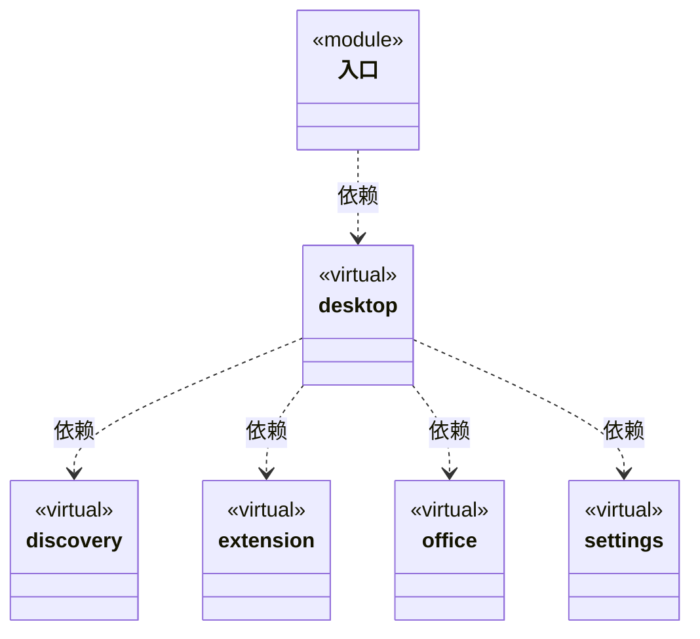
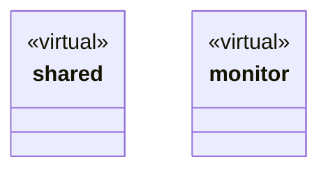

# 新版视图

## 设计意图

桌面主框架管理项目、Office 对话和页面导航，通过受限宿主接口读写项目与运行状态。index.html 只挂载本目录入口；旧 src/view 已整体退役，不再保留兼容渲染路径。

组织和业务架构的编辑以及 Office 输入队列由本目录展示，状态由 logic/projects 持有。此次删除旧界面不代表旧浏览器、终端和自动化面板已迁入新界面；后续能力通过新页面与宿主契约独立接入。

旧界面专属测试与浏览器夹具随实现退役。跨模块后端测试直接校验公共事件、附件快照、任务状态及持久化回执，不依赖 React 展示投影。

## 主要组成

| 组成 | 定位 |
| --- | --- |
| [入口](main.ts) | 加载外壳样式并挂载首页。 |

每个界面或窗口拥有独立模块。主窗口组合发现页和扩展面板，资源监视器由渲染入口独立挂载。各模块单向使用共享表现组件。

<!-- architecture:generated:start -->

## 架构关系

标注为 `virtual` 的节点是直接子模块的虚拟类封装；内部设计沿下方入口阅读。

### 关系组 1：desktop

### 关系组 2：shared

### 跨图协作

按引用方归并目标，保留全部跨图关系；分图只用于阅读，不表示新增模块或依赖边界。

| 引用方 | 关系 | 目标 |
| --- | --- | --- |
| [入口](main.ts)（图 1） | 依赖 | [monitor](monitor/ARCHITECTURE.md)（图 2）、[shared](shared/ARCHITECTURE.md)（图 2） |
| [desktop](desktop/ARCHITECTURE.md)（图 1） | 依赖 | [shared](shared/ARCHITECTURE.md)（图 2） |
| [discovery](discovery/ARCHITECTURE.md)（图 1） | 依赖 | [shared](shared/ARCHITECTURE.md)（图 2） |

## 子模块

| 虚拟封装 | 整体职责 |
| --- | --- |
| [desktop](desktop/ARCHITECTURE.md) | 组合发现页与扩展区，管理工作区导航。 |
| [discovery](discovery/ARCHITECTURE.md) | 统一管理四类资源的发布、版本下载和安装。 |
| [extension](extension/ARCHITECTURE.md) | 维护当前窗口的扩展标签。 |
| [monitor](monitor/ARCHITECTURE.md) | 独立渲染 Agent 和进程的资源占用。 |
| [office](office/ARCHITECTURE.md) | 让用户在项目内选择 Office 会话，查看记录并保存输入。办公室、组织架构与业务架构由桌面项目顶栏导航；OfficeView 接收页面选择，切换时保留会话与输入状态。对话内容区不再提供重复的架构或主 Agent 设置工具栏，主 Agent 的能力设置仅从输入区进入。 |
| [settings](settings/ARCHITECTURE.md) | 在主窗口内提供独立的设置导航与分组内容。 |
| [shared](shared/ARCHITECTURE.md) | Icon 的组织操作图形包含返回、新增团队和新增成员，复用既有线性图标风格；文字提示和可访问名称由使用它的按钮提供。 |

[上层设计](../ARCHITECTURE.md)

<!-- architecture:generated:end -->
