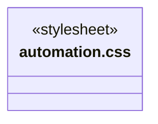
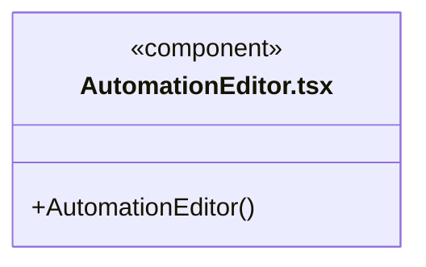
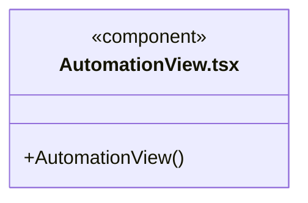
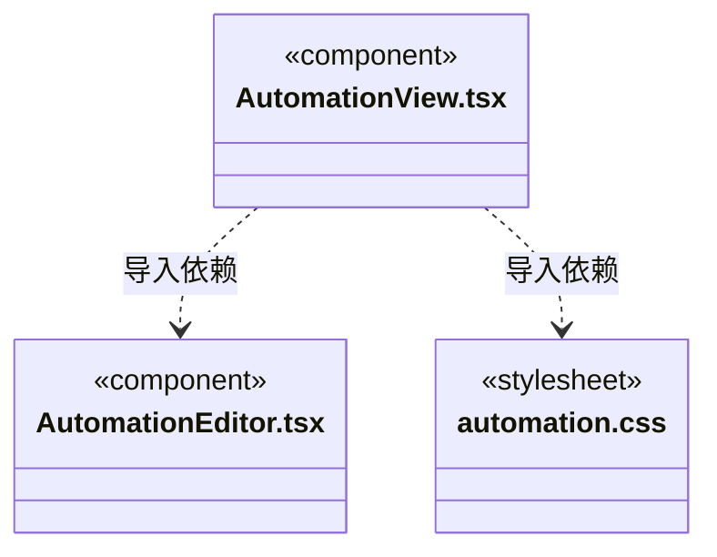

# src/view/automation 架构

本目录只维护这一份说明。设计与契约直接编辑本文；文件清单、类图和导航由 [架构脚本](../../../scripts/source-architecture.mjs) 更新，生成区域之外的人工说明会保留。

## 封装意图

当前工作区自动化列表、配置和运行历史；固定页签不接自选工作目录，真实运行通过原会话定位。

## 类与模块的设计意图

下表依据源码声明及文件头说明定位封装。字段表示该实例持有的状态或协作引用，不表示它拥有被引用服务的生命周期；实际资源责任和调用限制见下文契约及源码注释。

| 类／模块 | 实现形式与实例字段 | 封装依据 |
| --- | --- | --- |
| [AutomationEditor.tsx](AutomationEditor.tsx) | 组件模块 | 表单只保存显式配置，不启动模型；权限独立可见，日程固定时区，草稿不随后台轮询覆盖；取消编辑前核对是否有未保存修改。 |
| [AutomationView.tsx](AutomationView.tsx) | 组件模块 | 实例隔离异步回包；后台只读轮询不重试写操作。新定义固定 ID 供未知保存核实；历史打开原会话，执行结束不冒称业务验收。 |

## 接口设计契约

### 当前工作区自动化

扩展页签复用任务列表/设置/运行历史布局，参考 Cindy 的本地 scheduler 行为，但不提供工作区路径输入。菜单来自当前有效模块、模块自身 Workflow、已采纳启用岗位及其 Skill。默认主 Agent 与成员岗位分别读取既有配置，无第二份模型选型。

手动、间隔、每天与一次计划明确显示权限；保存不立即运行。配置变更只影响未来，暂停/删除会停止当前运行。定义新 ID 在提交前固定，写入未知不自动重试，可刷新清单核实同 ID。运行历史打开原 taskId 会话，不清原对话草稿；执行结束与业务验收区分。

只在活动页签轮询，实例重建卸载旧视图。表单保留编辑草稿，不接受轮询覆盖。后端会在保存和每次启动重新校验引用；列表不是执行授权。

自动化入口归右侧扩展区；中央交互区不挂载自动化。active 由扩展区可见性与选中页签共同决定，隐藏保留编辑状态并停止轮询，历史导航沿原 taskId 返回会话。

## 开闭边界

本目录的职责及允许协作由[封装意图](#封装意图)限定，输入输出、状态与失败语义以[接口设计契约](#接口设计契约)为准。扩展从已有公开入口及实际装配位置进入；没有明确可替换契约的部分按真实影响修改和验证，不预建未使用的基类或插件入口。

<!-- architecture:generated:start -->

## 文件清单

| 文件 | 形式 | 当前职责 |
| --- | --- | --- |
| [ARCHITECTURE.md](ARCHITECTURE.md) | 说明文档 | 本目录的文件清单、真实声明、依赖与子封装导航。 |
| [AutomationEditor.tsx](AutomationEditor.tsx) | 组件模块 | 编辑当前工作区自动化，Agent/模块/Workflow/Skill 来自后端有效目录。 |
| [AutomationView.tsx](AutomationView.tsx) | 组件模块 | 右侧扩展区的工作区自动化页签，展示任务列表、配置和真实运行历史。 |
| [automation.css](automation.css) | 样式 | 对应界面的布局与视觉样式。 |

## 架构类图

成员标记：`+` 公开、`-` 私有、`#` 受保护、`$` 静态；`function` 为函数值成员，`get`／`set` 为访问器。调用／构造／索引签名按匿名签名列出，不虚构方法名；`global.` 表示全局声明补充，非运行时嵌套类。构造函数单独列出，运行时私有字段保留 `#`。文档和资源仅在文件清单中导航，不作为代码节点。

### automation.css

[查看源码](automation.css)。

### AutomationEditor.tsx

[查看源码](AutomationEditor.tsx)。

直接依赖：[../../bridge/contracts/automation.ts](../../bridge/contracts/automation.ts)、[../components/Icon.tsx](../components/Icon.tsx)。

### AutomationView.tsx

[查看源码](AutomationView.tsx)。

直接依赖：[../../bridge/contracts/automation.ts](../../bridge/contracts/automation.ts)、[../../bridge/contracts/workspace.ts](../../bridge/contracts/workspace.ts)、[AutomationEditor.tsx](AutomationEditor.tsx)、[automation.css](automation.css)。

### 本目录调用边界

## 子目录导航

无子目录。

[返回上层](../ARCHITECTURE.md)。

每次修改本目录代码，同步维护文件头、关键契约说明及本图。未实现的治理、证据验收和自动编排能力不列入当前类图。

<!-- architecture:generated:end -->
