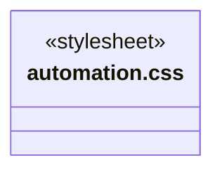
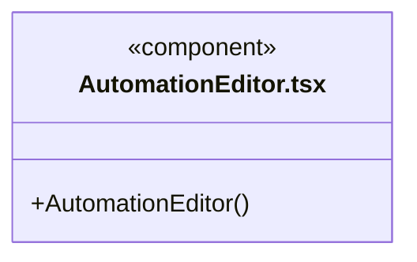
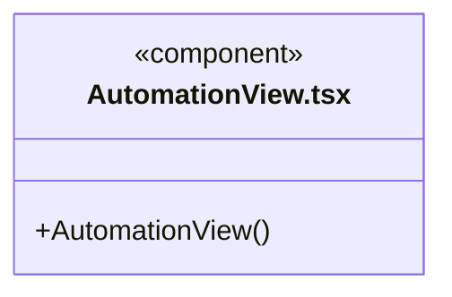
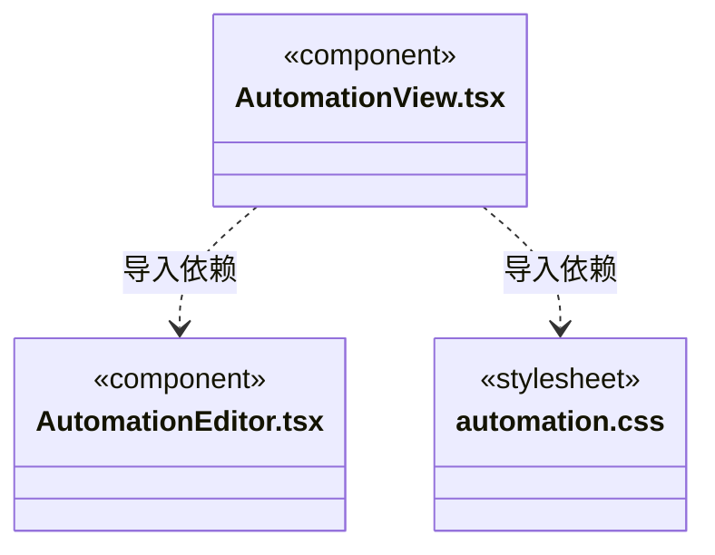

# src/view/automation 架构

## 目录定位

当前工作区自动化列表、配置和运行历史；固定页签不接自选工作目录，真实运行通过原会话定位。

本文描述当前实现。通过分析目录边界后维护的 [源码架构脚本](../../../scripts/source-architecture.mjs) 同步清单和声明；代码变更时仍须核对职责、关键成员与关系。

## 代码清单

| 文件 | 当前职责 |
| --- | --- |
| [automation.css](automation.css) | 对应界面的布局与视觉样式。 |
| [AutomationEditor.tsx](AutomationEditor.tsx) | 编辑当前工作区自动化，Agent/模块/Workflow/Skill 来自后端有效目录。 |
| [AutomationView.tsx](AutomationView.tsx) | 对话内固定工作区自动化页签，展示任务列表、配置和真实运行历史。 |

## 架构类图

### automation.css

### AutomationEditor.tsx

直接依赖：[../../bridge/contracts/automation.ts](../../bridge/contracts/automation.ts)。

### AutomationView.tsx

直接依赖：[../../bridge/contracts/workspace.ts](../../bridge/contracts/workspace.ts)、[../../bridge/contracts/automation.ts](../../bridge/contracts/automation.ts)、[AutomationEditor.tsx](AutomationEditor.tsx)、[automation.css](automation.css)。

### 本目录调用边界

## 子目录导航

无子目录。

[返回上层](../ARCHITECTURE.md)。

每次修改本目录代码，同步维护文件头、关键契约说明及本图。未实现的治理、证据验收和自动编排能力不列入当前类图。

## 设计契约 v1 与落地范围

以下内容区分已接通能力与后续设计；以各节的实现状态为准，不将目标图当作现状图。维护源：[CONTRACT.md](CONTRACT.md)；生成类图时同步附加，勿直接修改本附录。

# 当前工作区自动化

固定页签复用任务列表/设置/运行历史布局，参考 Cindy 的本地 scheduler 行为，但不提供工作区路径输入。菜单来自当前有效模块、模块自身 Workflow、已采纳启用岗位及其 Skill。默认主 Agent 与成员岗位分别读取既有配置，无第二份模型选型。

手动、间隔、每天与一次计划明确显示权限；保存不立即运行。配置变更只影响未来，暂停/删除会停止当前运行。定义新 ID 在提交前固定，写入未知不自动重试，可刷新清单核实同 ID。运行历史打开原 taskId 会话，不清原对话草稿；执行结束与业务验收区分。

只在活动页签轮询，实例重建卸载旧视图。表单保留编辑草稿，不接受轮询覆盖。后端会在保存和每次启动重新校验引用；列表不是执行授权。
