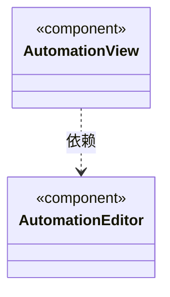

# src/view/automation 架构

## 设计意图

当前工作区自动化列表、配置和运行历史；固定页签不接自选工作目录，真实运行通过原会话定位。

## 主要组成

| 组成 | 定位 |
| --- | --- |
| [AutomationEditor](AutomationEditor.tsx) | 编辑当前工作区自动化，Agent/模块/Workflow/Skill 来自后端有效目录。 |
| [AutomationView](AutomationView.tsx) | 右侧扩展区的工作区自动化页签，展示任务列表、配置和真实运行历史。 |

<!-- architecture:generated:start -->

## 架构关系

[上层设计](../ARCHITECTURE.md)

<!-- architecture:generated:end -->
