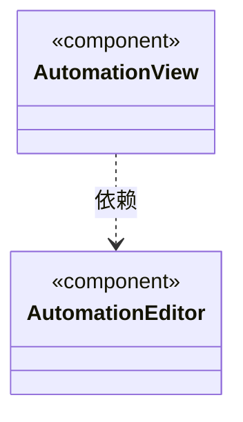

# src/view/automation 架构

## 设计意图

展示当前工作区的自动化定义与真实运行历史，并提供明确的编辑和保存入口。

`AutomationView` 组织列表与历史，`AutomationEditor` 从后端有效目录选择 Agent、模块和流程。界面不维护另一个定时器或自选工作目录，运行结果按原会话身份导航，提交仍由自动化服务校验。

## 主要组成

| 组成 | 定位 |
| --- | --- |
| [AutomationEditor](AutomationEditor.tsx) | 编辑当前工作区自动化，Agent/模块/Workflow/Skill 来自后端有效目录。 |
| [AutomationView](AutomationView.tsx) | 右侧扩展区的工作区自动化页签，展示任务列表、配置和真实运行历史。 |

<!-- architecture:generated:start -->

## 架构关系

[上层设计](../ARCHITECTURE.md)

<!-- architecture:generated:end -->
