# src/view/components 架构

本目录只维护这一份说明。设计与契约直接编辑本文；文件清单、类图和导航由 [架构脚本](../../../scripts/source-architecture.mjs) 更新，生成区域之外的人工说明会保留。

## 封装意图

通用展示组件，不持有领域服务与运行状态。 EngineModelPicker 使用官方静态引擎目录，按协议筛选统一模型，空目录仍可选择引擎。

## 类与模块的设计意图

下表依据源码声明及文件头说明定位封装。字段表示该实例持有的状态或协作引用，不表示它拥有被引用服务的生命周期；实际资源责任和调用限制见下文契约及源码注释。

| 类／模块 | 实现形式与实例字段 | 封装依据 |
| --- | --- | --- |
| [AgentModelForm.tsx](AgentModelForm.tsx) | 组件模块 | 多模型必填项完整后一次提交同一主 Agent 设置；编辑阶段不拆成多个保存，不改对话草稿或运行快照。 |
| [BrandMark.tsx](BrandMark.tsx) | 组件模块 | 直接引用 assets/branding 中的品牌矢量源，安装图标和官网也由同一源生成，避免各入口各画一份。 |
| [ViewLoadBoundary](DeferredView.tsx) | 实例类；持有 `state` | 捕获模块加载或该页渲染失败；不将未知错误推断为网络离线，也不自动重放业务请求。 |
| [Empty.tsx](Empty.tsx) | 组件模块 | 把展示样式与服务状态决策分开，具体文案和动作由调用视图提供。 |
| [EngineModelPicker.tsx](EngineModelPicker.tsx) | 组件模块 | 与后端共用供应商接口解析，兼容端点及模型范围共同决定可选项；区分未配置、协议不兼容和模型禁用，列表不触发联网。同引擎更换主模型保留额外角色；更换引擎清空旧选型。 |
| [Icon.tsx](Icon.tsx) | 组件模块 | 以已确认的 UX 图标母版统一 1.75px 笔画；保留现有调用名，未知名字显示信息标记而不伪装成文件夹。 |
| [InterfaceHelp.tsx](InterfaceHelp.tsx) | 组件模块 | 保留各业务按钮的标题与权限，统一延迟、边缘避让和关闭行为；触屏通过显式说明页查看相同信息。 |
| [ModalFrame.tsx](ModalFrame.tsx) | 组件模块 | 共享可访问性机制；是否允许关闭、草稿确认和在途操作仍由业务调用方决定。 |
| [RepositoryScopeDetails.tsx](RepositoryScopeDetails.tsx) | 组件模块 | 外部资料读取不能冒充业务文件操作；只解析公开身份字段，不从模型参数或资源正文猜测作用域，不将历史回执当成当前授权。 |
| [state-labels.ts](state-labels.ts) | 函数／契约模块 | 多个视图共享显示词汇，不把展示标签作为服务状态机。 |
| [TreeActions.tsx](TreeActions.tsx) | 组件模块 | 组织树与模块树共用键盘、关闭和图标行为，菜单不选择节点或拥有业务状态。 |
| [ViewTabs.tsx](ViewTabs.tsx) | 组件模块 | 只管理 tab 焦点；业务选择、面板挂载和草稿生命周期由调用方持有，不触发保存或网络操作。 |

## 接口设计契约

<a id="contract"></a>

<a id="contract-树行操作与身份图标"></a>

##### 树行操作与身份图标

TreeActions 只持有菜单开闭，业务回调由树宿主按真实节点绑定；Escape 和外部点击关闭菜单，不改变选择。Icon 区分模块、目录、文件与 Agent，不以同一文件夹表达所有业务对象。

<a id="contract-共享侧栏视觉"></a>

##### 共享侧栏视觉

sidebar.css 为首页和设置提供同一侧栏内边距、32px 标题/菜单行、30px 圆角搜索框、图标和分组间距、选中样式及调整边缘。它只处理展示，宽度和持久化归外壳 useSidebarWidth；两类导航的业务项、搜索与窄屏内容策略各自保留。

<a id="contract-通用展示组件"></a>

### 通用展示组件

<a id="contract-统一视觉与延迟入口"></a>

#### 统一视觉与延迟入口

Icon 使用统一的 24px / 1.75px 线性图形，同时保留当前引擎与树操作图标；名称来自调用者，不推断运行状态。InterfaceHelp 提供延迟提示及只读操作说明，不读取表单值。ModalFrame 使用原生 dialog 并在关闭时恢复入口焦点。界面 CSS 由 view/styles.ts 统一加载，业务布局之后应用 interface.css；最后统一侧栏标题/搜索/菜单为 36/36/38px，触屏控件至少 44px。

deferredView 在模块作用域定义，首次挂载调用 loader；显示局部 status，加载或渲染失败显示 alert 和显式重试。重试仅重建此页，可能丢失该页内部草稿，不刷新整个应用或自动重放业务操作。成功页面正常重绘与隐藏不重建；浏览器缓存的失败模块未必可通过重试恢复。

`Icon` 的垂直三点、编辑笔与删除桶是无状态矢量标识，工作区菜单和两处对话条目共用，不引入外壳或运行依赖。架构卡片图标按钮自带 title 与 aria-label，图标本身对辅助技术隐藏。

`RepositoryScopeDetails` 仅消费 Bridge 的严格公开仓库范围。主对话从运行授权/真实回执提供 scope，执行报告从后端已核实的工具条目提供同一协议；组件不读取模型参数中的 scope，也不访问服务。非法范围或旧日志缺范围时不补造仓库身份。

显示仓库、链接器、连接实例和操作，但不显示地址/令牌、不提供授权按钮。范围是该次调用的历史记录，不证明当前连接仍可用；资源资料不等于业务文件或验收证据。


<a id="contract-引擎与模型级联"></a>

##### 引擎与模型级联

模型空态分别提示未配置供应商、协议不兼容、兼容模型未启用；Claude Code 明确要求 Anthropic Messages 兼容端点并允许任意真实模型 ID。列表读取不联网、不以凭据有效性隐藏配置，连接诊断由模型设置的显式测试提供。

EngineModelPicker 供主 Agent、自定义 Agent 编辑及岗位登记复用。引擎项固定为三个内置引擎，空模型目录也可选择；模型按 providerSupportsEngine 与 enabled 筛选，主接口、官方预设、自定义接口及型号范围与后端启动一致。同一模型可出现在多个引擎下。切换引擎清除未提交模型，缺兼容模型时引导选择预设或添加同凭据接口；父表单负责完整选型的校验与保存。

<a id="contract-共享状态标签"></a>

##### 共享状态标签

state-labels.ts 只提供工作区与工具任务的展示词汇，由外壳和任务视图共同消费；标签不作为服务状态机，不从外壳控制器读取状态。

<a id="contract-模型选型保留附加角色"></a>

##### 模型选型保留附加角色

EngineModelPicker 同引擎切换 primary 时保留 value.modelRoles；引擎变化清空整个旧选型。此组件依据 `additionalModelRoles` 展示额外角色下拉，按角色 kind、required 和模型能力过滤选项；缺少可用模型时显示配置提示。

EngineModelPicker 按官方角色展示额外必填模型，切换引擎清旧角色，同引擎换主模型保留角色。AgentModelForm 将完整草稿一次保存；保存前用共享纯规则验证，取消不提交。


<a id="contract-统一排版2026-11-16"></a>

#### 统一排版（2026-11-16）

普通文字、按钮、状态和说明复用 components/interface.css 的 --font-ui 与 --weight-regular；结构短标题使用 --weight-medium。颜色和间距承担次要信息层级，不把说明文字缩小。代码使用 --font-code，真实 Markdown 标题保留语义层级。

interface.css 统一普通文字 15px/400、短标题 500、页面标题 20px、弹窗标题 18px 和独立代码 14px；Markdown 保留内容作者的强调语义。

## 开闭边界

本目录的职责及允许协作由[封装意图](#封装意图)限定，输入输出、状态与失败语义以[接口设计契约](#接口设计契约)为准。扩展从已有公开入口及实际装配位置进入；没有明确可替换契约的部分按真实影响修改和验证，不预建未使用的基类或插件入口。

<!-- architecture:generated:start -->

## 文件清单

| 文件 | 形式 | 当前职责 |
| --- | --- | --- |
| [ARCHITECTURE.md](ARCHITECTURE.md) | 说明文档 | 本目录的文件清单、真实声明、依赖与子封装导航。 |
| [AgentModelForm.tsx](AgentModelForm.tsx) | 组件模块 | 主对话中完整引擎与模型角色配置草稿，复用 Agent 页面选择器并支持窄屏纵向填写。 |
| [BrandMark.tsx](BrandMark.tsx) | 组件模块 | 引用 assets/branding 的无业务状态 CBIM 产品标识，供外壳与欢迎页复用。 |
| [DeferredView.tsx](DeferredView.tsx) | 组件模块 | 页面入口的延迟模块装配，提供局部加载与失败重试，不负责业务导航。 |
| [Empty.tsx](Empty.tsx) | 组件模块 | 各页面复用的空状态布局。 |
| [EngineModelPicker.tsx](EngineModelPicker.tsx) | 组件模块 | Agent 编辑和岗位登记共用的引擎/模型级联下拉菜单。 |
| [Icon.tsx](Icon.tsx) | 组件模块 | 全界面共用的 24px 线性图标，覆盖操作、状态、导航和角色。 |
| [InterfaceHelp.tsx](InterfaceHelp.tsx) | 组件模块 | 窗口级操作说明、可聚焦和可悬停的 Tooltip；只读取已渲染控件的说明。 |
| [ModalFrame.tsx](ModalFrame.tsx) | 组件模块 | View 层模态容器，为编辑与预览提供原生焦点约束和关闭后焦点返回。 |
| [RepositoryScopeDetails.tsx](RepositoryScopeDetails.tsx) | 组件模块 | 在主对话工具详情与执行核实报告中展示可信回执的资源仓库范围。 |
| [TreeActions.tsx](TreeActions.tsx) | 组件模块 | 树节点行尾的显式操作菜单；由宿主绑定真实对象和可用状态。 |
| [ViewTabs.tsx](ViewTabs.tsx) | 组件模块 | 同一页面内的可访问视图切换，统一图标、选中语义与键盘导航。 |
| [agent-model-form.css](agent-model-form.css) | 样式 | 主对话多角色模型表单的独立布局，随组件加载，不依赖设置页先打开。 |
| [interface.css](interface.css) | 样式 | 所有产品页面共用的主题、控件、排版和反馈动效。 |
| [repository-scope.css](repository-scope.css) | 样式 | 对应界面的布局与视觉样式。 |
| [sidebar.css](sidebar.css) | 样式 | 首页与设置中心共用的侧栏几何、标题、搜索、菜单和调整边缘样式。 |
| [state-labels.ts](state-labels.ts) | 源码模块 | 界面工作区与工具任务状态的中文标签。 |

## 架构类图

成员标记：`+` 公开、`-` 私有、`#` 受保护、`$` 静态；构造函数单独列出。文档和资源仅在文件清单中导航，不作为代码节点。

### agent-model-form.css

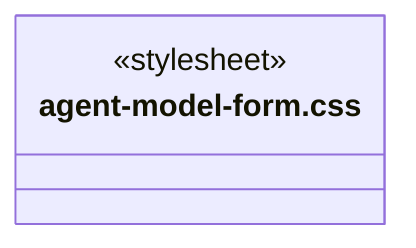

### AgentModelForm.tsx

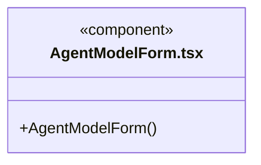

直接依赖：[../../bridge/contracts/agent-settings.ts](../../bridge/contracts/agent-settings.ts)、[../../bridge/contracts/engines.ts](../../bridge/contracts/engines.ts)、[../../bridge/contracts/models.ts](../../bridge/contracts/models.ts)、[EngineModelPicker.tsx](EngineModelPicker.tsx)、[agent-model-form.css](agent-model-form.css)。

### BrandMark.tsx

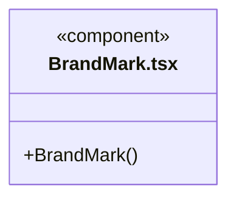


### DeferredView.tsx

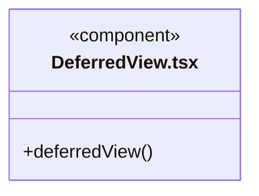

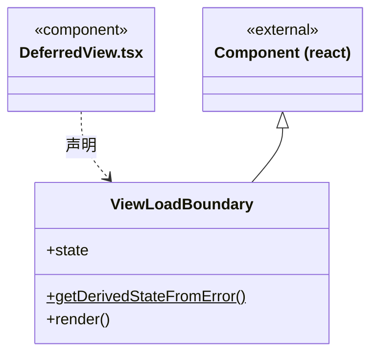

继承／实现来源：`Component` → `react`。

### Empty.tsx

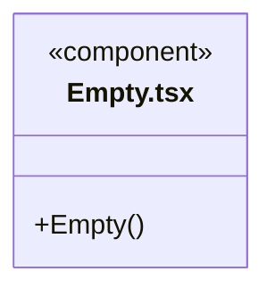

直接依赖：[Icon.tsx](Icon.tsx)。

### EngineModelPicker.tsx

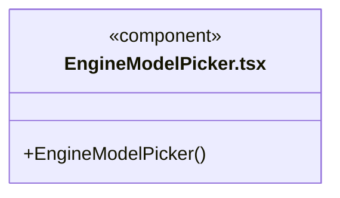

直接依赖：[../../bridge/contracts/agent-settings.ts](../../bridge/contracts/agent-settings.ts)、[../../bridge/contracts/engines.ts](../../bridge/contracts/engines.ts)、[../../bridge/contracts/models.ts](../../bridge/contracts/models.ts)。

### Icon.tsx

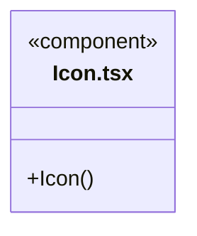


### interface.css

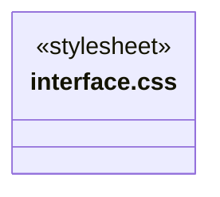

### InterfaceHelp.tsx

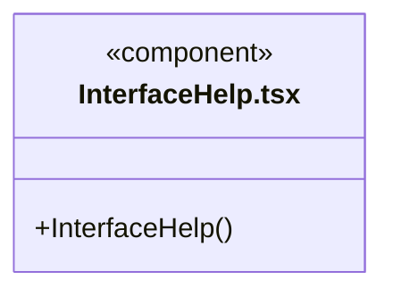

直接依赖：[Icon.tsx](Icon.tsx)。

### ModalFrame.tsx

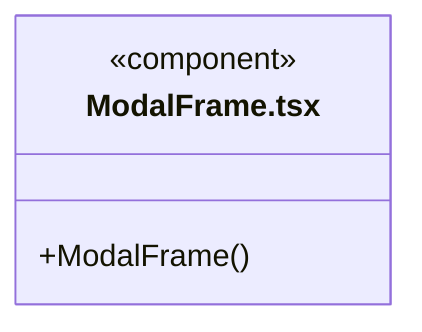


### repository-scope.css

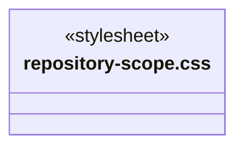

### RepositoryScopeDetails.tsx

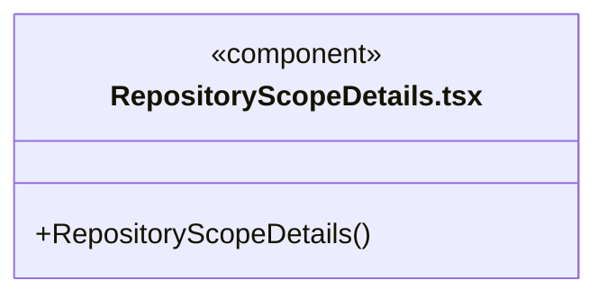

直接依赖：[../../bridge/contracts/execution.ts](../../bridge/contracts/execution.ts)、[repository-scope.css](repository-scope.css)。

### sidebar.css

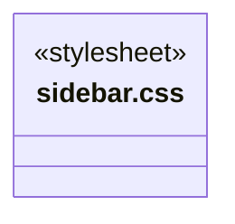

### state-labels.ts

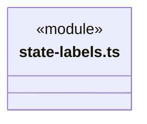

### TreeActions.tsx

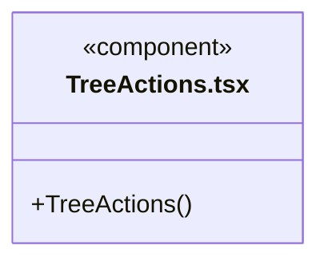

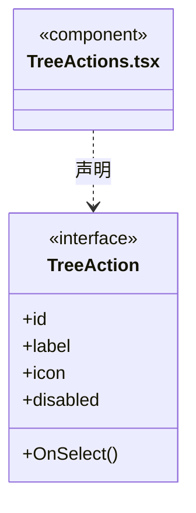

直接依赖：[Icon.tsx](Icon.tsx)。

### ViewTabs.tsx

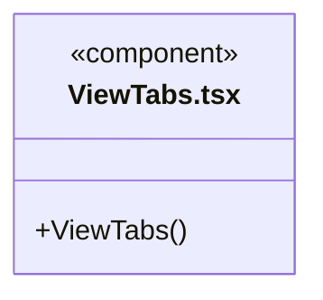

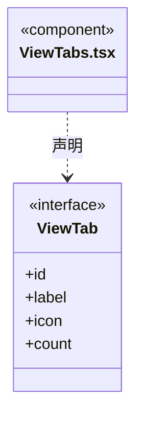

直接依赖：[Icon.tsx](Icon.tsx)。

### 本目录调用边界

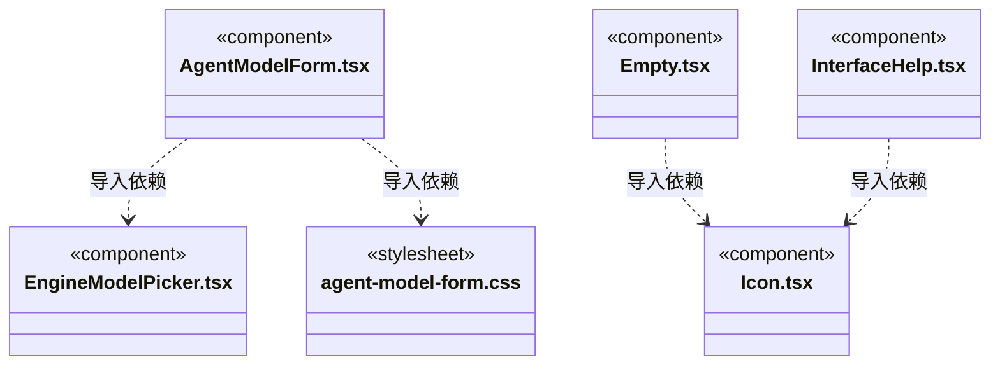

```mermaid
classDiagram
class N_src_view_components_RepositoryScopeDetails_tsx["RepositoryScopeDetails.tsx"] {
  <<component>>
}
class N_src_view_components_repository_scope_css["repository-scope.css"] {
  <<stylesheet>>
}
class N_src_view_components_TreeActions_tsx["TreeActions.tsx"] {
  <<component>>
}
class N_src_view_components_Icon_tsx["Icon.tsx"] {
  <<component>>
}
class N_src_view_components_ViewTabs_tsx["ViewTabs.tsx"] {
  <<component>>
}
N_src_view_components_RepositoryScopeDetails_tsx ..> N_src_view_components_repository_scope_css : 导入依赖
N_src_view_components_TreeActions_tsx ..> N_src_view_components_Icon_tsx : 导入依赖
N_src_view_components_ViewTabs_tsx ..> N_src_view_components_Icon_tsx : 导入依赖
```


## 子目录导航

无子目录。

[返回上层](../ARCHITECTURE.md)。

每次修改本目录代码，同步维护文件头、关键契约说明及本图。未实现的治理、证据验收和自动编排能力不列入当前类图。

<!-- architecture:generated:end -->
