# src/view/components 架构

## 目录定位

通用展示组件，不持有领域服务与运行状态。 EngineModelPicker 固定三引擎目录，按协议筛选统一模型，空目录仍可选择引擎。

本文描述当前实现。通过分析目录边界后维护的 [源码架构脚本](../../../scripts/source-architecture.mjs) 同步清单和声明；代码变更时仍须核对职责、关键成员与关系。

## 代码清单

| 文件 | 当前职责 |
| --- | --- |
| [agent-model-form.css](agent-model-form.css) | 主对话多角色模型表单的独立布局，随组件加载，不依赖设置页先打开。 |
| [AgentModelForm.tsx](AgentModelForm.tsx) | 主对话中完整引擎与模型角色配置草稿，复用 Agent 页面选择器并支持窄屏纵向填写。 |
| [BrandMark.tsx](BrandMark.tsx) | 无业务状态的 CBIM 产品标识，供外壳与欢迎页复用。 |
| [Empty.tsx](Empty.tsx) | 各页面复用的空状态布局。 |
| [EngineModelPicker.tsx](EngineModelPicker.tsx) | Agent 编辑和岗位登记共用的引擎/模型级联下拉菜单。 |
| [Icon.tsx](Icon.tsx) | 无业务状态的 SVG 图标组件。 |
| [repository-scope.css](repository-scope.css) | 对应界面的布局与视觉样式。 |
| [RepositoryScopeDetails.tsx](RepositoryScopeDetails.tsx) | 在主对话工具详情与执行核实报告中展示可信回执的资源仓库范围。 |
| [state-labels.ts](state-labels.ts) | 界面工作区与工具任务状态的中文标签。 |
| [TreeActions.tsx](TreeActions.tsx) | 树节点行尾的显式操作菜单；由宿主绑定真实对象和可用状态。 |

## 架构类图

### agent-model-form.css

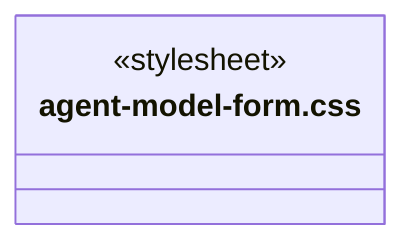

### AgentModelForm.tsx

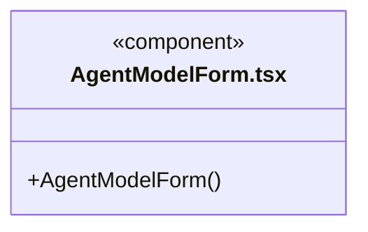

直接依赖：[../../bridge/contracts/agent-settings.ts](../../bridge/contracts/agent-settings.ts)、[../../bridge/contracts/models.ts](../../bridge/contracts/models.ts)、[../../bridge/contracts/engines.ts](../../bridge/contracts/engines.ts)、[EngineModelPicker.tsx](EngineModelPicker.tsx)、[agent-model-form.css](agent-model-form.css)。

### BrandMark.tsx

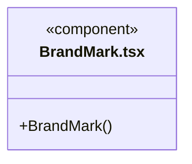

### Empty.tsx

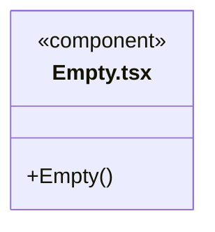

直接依赖：[Icon.tsx](Icon.tsx)。

### EngineModelPicker.tsx

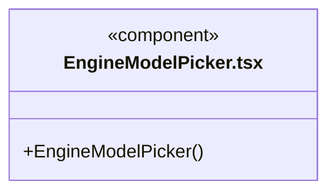

直接依赖：[../../bridge/contracts/engines.ts](../../bridge/contracts/engines.ts)、[../../bridge/contracts/agent-settings.ts](../../bridge/contracts/agent-settings.ts)、[../../bridge/contracts/models.ts](../../bridge/contracts/models.ts)。

### Icon.tsx

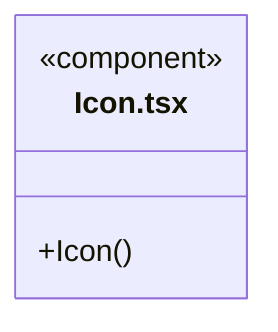

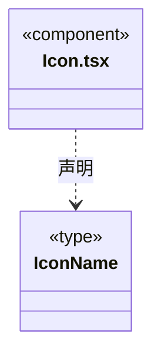

### repository-scope.css

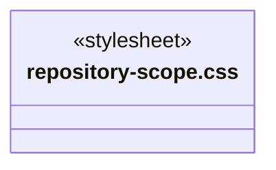

### RepositoryScopeDetails.tsx

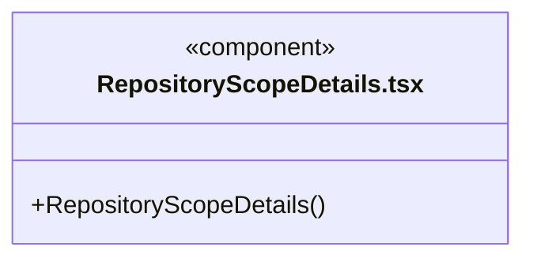

直接依赖：[../../bridge/contracts/execution.ts](../../bridge/contracts/execution.ts)、[repository-scope.css](repository-scope.css)。

### state-labels.ts

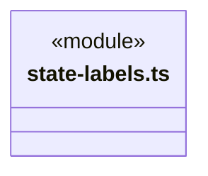

### TreeActions.tsx

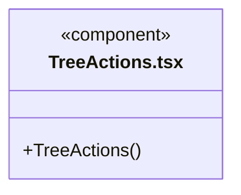

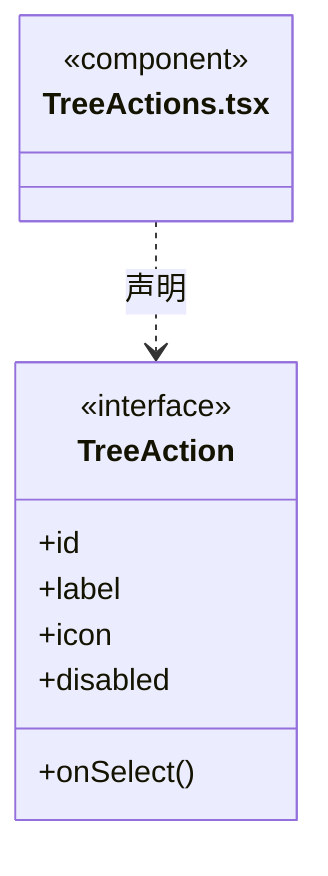

直接依赖：[Icon.tsx](Icon.tsx)。

### 本目录调用边界

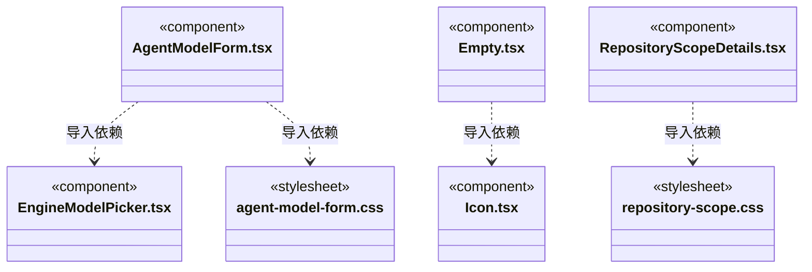

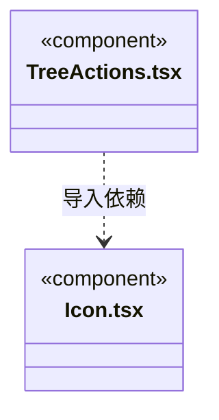

## 子目录导航

无子目录。

[返回上层](../ARCHITECTURE.md)。

每次修改本目录代码，同步维护文件头、关键契约说明及本图。未实现的治理、证据验收和自动编排能力不列入当前类图。

## 设计契约 v1 与落地范围

以下内容区分已接通能力与后续设计；以各节的实现状态为准，不将目标图当作现状图。维护源：[CONTRACT.md](CONTRACT.md)；生成类图时同步附加，勿直接修改本附录。

### 树行操作与身份图标

TreeActions 只持有菜单开闭，业务回调由树宿主按真实节点绑定；Escape 和外部点击关闭菜单，不改变选择。Icon 区分模块、目录、文件与 Agent，不以同一文件夹表达所有业务对象。

# 通用展示组件

`Icon` 的垂直三点、编辑笔与删除桶是无状态矢量标识，工作区菜单和两处对话条目共用，不引入外壳或运行依赖。架构卡片图标按钮自带 title 与 aria-label，图标本身对辅助技术隐藏。

`RepositoryScopeDetails` 仅消费 Bridge 的严格公开仓库范围。主对话从运行授权/真实回执提供 scope，执行报告从后端已核实的工具条目提供同一协议；组件不读取模型参数中的 scope，也不访问服务。非法范围或旧日志缺范围时不补造仓库身份。

显示仓库、链接器、连接实例和操作，但不显示地址/令牌、不提供授权按钮。范围是该次调用的历史记录，不证明当前连接仍可用；资源资料不等于业务文件或验收证据。

### 引擎与模型级联

模型空态分别提示未配置供应商、协议不兼容、兼容模型未启用；Claude Code 明确要求 Anthropic Messages 兼容端点并允许任意真实模型 ID。列表读取不联网、不以凭据有效性隐藏配置，连接诊断由模型设置的显式测试提供。

EngineModelPicker 供主 Agent、自定义 Agent 编辑及岗位登记复用。引擎项固定为三个内置引擎，空模型目录也可选择；模型按 providerSupportsEngine 与 enabled 筛选，主接口、官方预设、自定义接口及型号范围与后端启动一致。同一模型可出现在多个引擎下。切换引擎清除未提交模型，缺兼容模型时引导选择预设或添加同凭据接口；父表单负责完整选型的校验与保存。

### 共享状态标签

state-labels.ts 只提供工作区与工具任务的展示词汇，由外壳和任务视图共同消费；标签不作为服务状态机，不从外壳控制器读取状态。

### 模型选型保留附加角色

EngineModelPicker 同引擎切换 primary 时保留 value.modelRoles；引擎变化清空整个旧选型。此组件当前仍只显示主模型下拉，额外角色的完整编辑在后续界面切片接通。

EngineModelPicker 按官方角色展示额外必填模型，切换引擎清旧角色，同引擎换主模型保留角色。AgentModelForm 将完整草稿一次保存；保存前用共享纯规则验证，取消不提交。
