# src/view/components 架构

## 目录定位

通用展示组件，不持有领域服务与运行状态。 EngineModelPicker 固定三引擎目录，按协议筛选统一模型，空目录仍可选择引擎。

本文描述当前实现。通过分析目录边界后维护的 [源码架构脚本](../../../scripts/source-architecture.mjs) 同步清单和声明；代码变更时仍须核对职责、关键成员与关系。

## 代码清单

| 文件 | 当前职责 |
| --- | --- |
| [BrandMark.tsx](BrandMark.tsx) | 无业务状态的 CBIM 产品标识，供外壳与欢迎页复用。 |
| [DeferredView.tsx](DeferredView.tsx) | 页面入口的延迟模块装配，提供局部加载与失败重试，不负责业务导航。 |
| [Empty.tsx](Empty.tsx) | 各页面复用的空状态布局。 |
| [EngineModelPicker.tsx](EngineModelPicker.tsx) | Agent 编辑和岗位登记共用的引擎/模型级联下拉菜单。 |
| [Icon.tsx](Icon.tsx) | 全界面共用的 24px 线性图标，覆盖操作、状态、导航和角色。 |
| [interface.css](interface.css) | 所有产品页面共用的主题、控件、排版和反馈动效。 |
| [InterfaceHelp.tsx](InterfaceHelp.tsx) | 窗口级操作说明、可聚焦和可悬停的 Tooltip；只读取已渲染控件的说明。 |
| [ModalFrame.tsx](ModalFrame.tsx) | View 层模态容器，为编辑与预览提供原生焦点约束和关闭后焦点返回。 |
| [repository-scope.css](repository-scope.css) | 对应界面的布局与视觉样式。 |
| [RepositoryScopeDetails.tsx](RepositoryScopeDetails.tsx) | 在主对话工具详情与执行核实报告中展示可信回执的资源仓库范围。 |
| [state-labels.ts](state-labels.ts) | 界面工作区与工具任务状态的中文标签。 |
| [ViewTabs.tsx](ViewTabs.tsx) | 同一页面内的可访问视图切换，统一图标、选中语义与键盘导航。 |

## 架构类图

### BrandMark.tsx

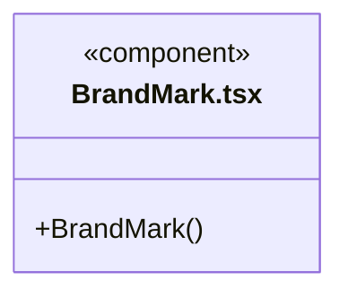

### DeferredView.tsx

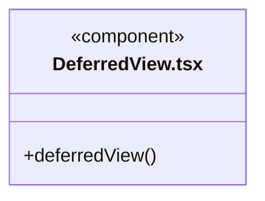

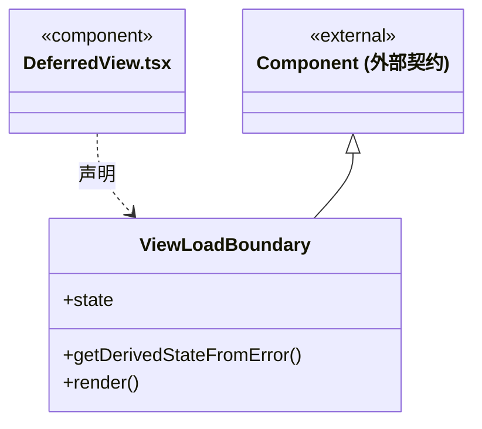

### Empty.tsx

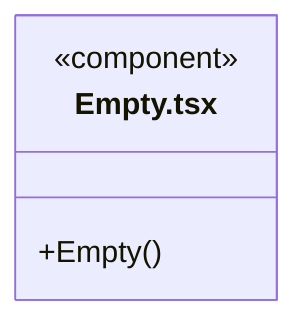

直接依赖：[Icon.tsx](Icon.tsx)。

### EngineModelPicker.tsx

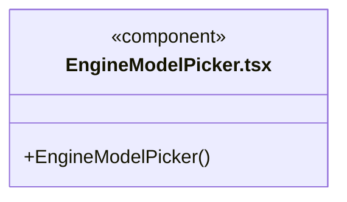

直接依赖：[../../bridge/contracts/models.ts](../../bridge/contracts/models.ts)。

### Icon.tsx

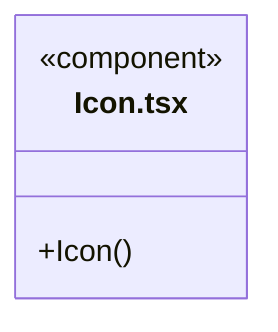

### interface.css

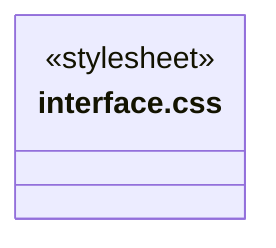

### InterfaceHelp.tsx

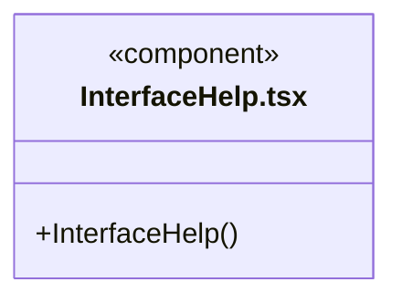

直接依赖：[Icon.tsx](Icon.tsx)。

### ModalFrame.tsx

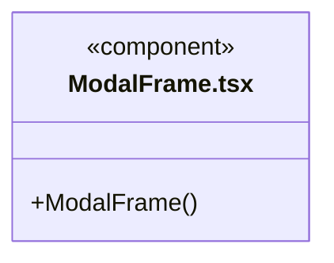

### repository-scope.css

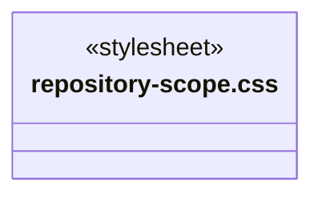

### RepositoryScopeDetails.tsx

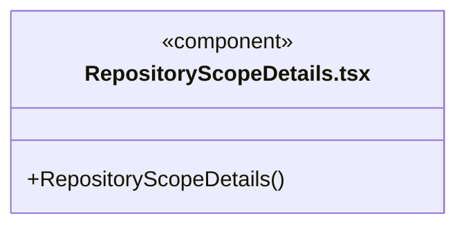

直接依赖：[../../bridge/contracts/execution.ts](../../bridge/contracts/execution.ts)、[repository-scope.css](repository-scope.css)。

### state-labels.ts

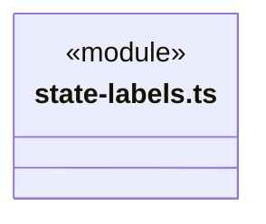

### ViewTabs.tsx

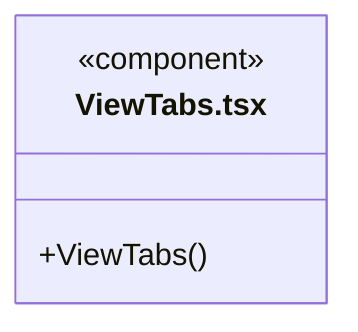

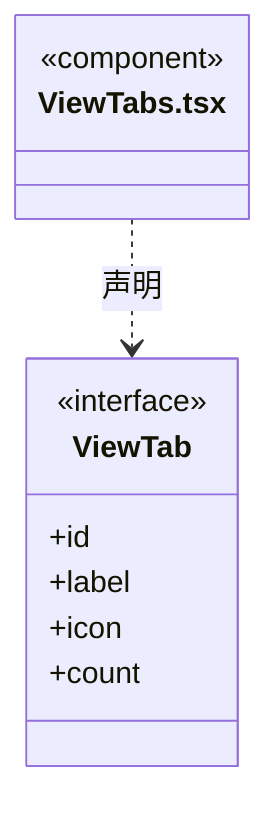

直接依赖：[Icon.tsx](Icon.tsx)。

### 本目录调用边界

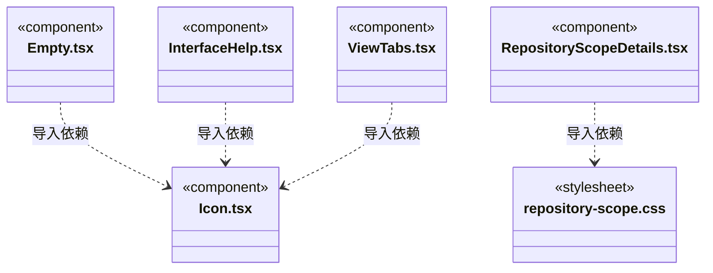

## 子目录导航

无子目录。

[返回上层](../ARCHITECTURE.md)。

每次修改本目录代码，同步维护文件头、关键契约说明及本图。未实现的治理、证据验收和自动编排能力不列入当前类图。

## 设计契约 v1 与落地范围

以下内容区分已接通能力与后续设计；以各节的实现状态为准，不将目标图当作现状图。维护源：[CONTRACT.md](CONTRACT.md)；生成类图时同步附加，勿直接修改本附录。

# 通用展示组件

## 延迟页面边界

`deferredView` 在模块作用域声明页面入口，首次挂载才调用 loader；加载期间显示带页面名称的 status。失败在当前页面显示 alert 和显式重试，不刷新整个窗口、不自动重放业务请求。重试重新建立当前页面实例，页面内部未提交状态可能丢失；其它页面不重建。错误可能来自代码下载或页面渲染，不推断为离线；浏览器缓存的失败或持续错误仍可能重试失败。正常父层重绘、隐藏面板不重建成功页面。导航、业务实例、草稿与后端生命周期仍归调用方。

## 全界面视觉与帮助

`Icon` 包含设计中的 70 个线性图形、7 个既有专用图形及队列拖动手柄 grip，保留 chat/flow/plus/plug/arrow/check/trash/clock 别名。24px 网格、1.75px 圆角线条、currentColor；SVG 对辅助技术隐藏且不可聚焦。调用者提供可见文案或 aria-label。未知名称显示 info，不伪装为文件夹。stateIconNames 仅映射图形，completed 对应 history，不代表业务验收。

`interface.css` 由 main 最后加载：统一明暗语义令牌、36px 桌面控件、44px 触屏控件、可见焦点、弹层进入及 reduced-motion。业务页面保留布局和状态，次要字号最低 12px；品牌源文件不改色。

`InterfaceHelp` 由外壳单实例挂载。只读按钮/链接/summary 的 title、aria-label 或 data-help，不读取表单输入值。鼠标延迟 450ms、离开延迟 120ms，提示可悬停；聚焦显示，Escape 优先关闭提示，滚动/尺寸改变关闭。已有 aria-describedby 的控件保留自身提示，临时移除原生 title 后在关闭时恢复；卸载释放监听和计时器。操作说明对话框使用原生 showModal，关闭返回入口，列出当前可见控件的说明，包括不可聚焦的禁用按钮；不触发业务回调。该清单不代替正文中的错误和禁用原因。

显式关闭按钮与原生 cancel/Escape 共用 closeHelp，立即返回入口焦点；onClose 只作为额外保障，避免后台窗口延迟派发 close 事件时焦点仍留在已关闭弹窗。

`Icon` 的垂直三点、编辑笔与删除桶是无状态矢量标识，工作区菜单和两处对话条目共用，不引入外壳或运行依赖。架构卡片图标按钮自带 title 与 aria-label，图标本身对辅助技术隐藏。

`RepositoryScopeDetails` 仅消费 Bridge 的严格公开仓库范围。主对话从运行授权/真实回执提供 scope，执行报告从后端已核实的工具条目提供同一协议；组件不读取模型参数中的 scope，也不访问服务。非法范围或旧日志缺范围时不补造仓库身份。

显示仓库、链接器、连接实例和操作，但不显示地址/令牌、不提供授权按钮。范围是该次调用的历史记录，不证明当前连接仍可用；资源资料不等于业务文件或验收证据。

### 引擎与模型级联

模型空态分别提示未配置供应商、协议不兼容、兼容模型未启用；Claude Code 明确要求 Anthropic Messages 兼容端点并允许任意真实模型 ID。列表读取不联网、不以凭据有效性隐藏配置，连接诊断由模型设置的显式测试提供。

EngineModelPicker 供主 Agent、自定义 Agent 编辑及岗位登记复用。引擎项固定为三个内置引擎，空模型目录也可选择；模型按 providerSupportsEngine 与 enabled 筛选，主接口、官方预设、自定义接口及型号范围与后端启动一致。同一模型可出现在多个引擎下。切换引擎清除未提交模型，缺兼容模型时引导选择预设或添加同凭据接口；父表单负责完整选型的校验与保存。

### 共享状态标签

state-labels.ts 只提供工作区与工具任务的展示词汇，由外壳和任务视图共同消费；标签不作为服务状态机，不从外壳控制器读取状态。

## 原生编辑模态

ModalFrame 将编辑内容放入原生 dialog 顶层，挂载时 showModal，卸载时关闭并返回仍存在的原入口。Escape 只调用 onRequestClose，不替业务关闭；调用方处理 busy、草稿确认和权限。点击遮罩不关闭。资源编辑/目标选择、架构及知识文件编辑、资源应用、治理、主 Agent 配置共用此机制。容器不提交表单或触发 IPC。

## 页面内分区导航

ViewTabs 提供统一的 tab/panel 标识、选中语义与方向键、Home/End 导航；调用方持有选择及面板，组件不读写业务、不保存草稿。interface.css 提供分区、上下文、操作栏和粘性表单底栏；减少动效不隐藏反馈。
