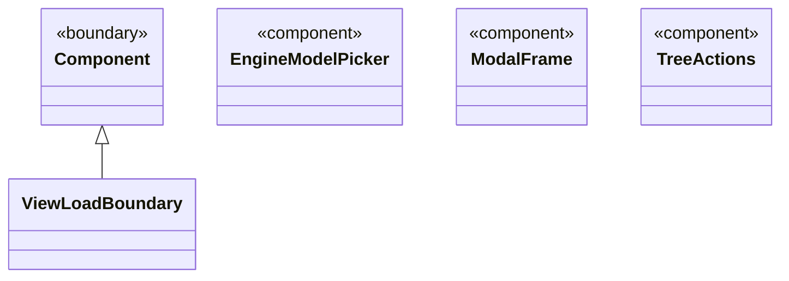

# src/view/components 架构

## 设计意图

提供跨页面复用的展示控件和交互边界，使页面可组合而不共享领域服务实例。

延迟加载边界隔离页面加载失败，模型选择器消费公开配置，模态与树操作组件负责焦点及显式交互；图标和提示统一表现。业务导航、可用权限和提交结果由调用页面传入，通用控件不拥有运行账本。

## 主要组成

| 组成 | 定位 |
| --- | --- |
| [ViewLoadBoundary](DeferredView.tsx) | 页面入口的延迟模块装配，提供局部加载与失败重试，不负责业务导航。 |
| [EngineModelPicker](EngineModelPicker.tsx) | Agent 编辑和岗位登记共用的引擎/模型级联下拉菜单。 |
| [ModalFrame](ModalFrame.tsx) | View 层模态容器，为编辑与预览提供原生焦点约束和关闭后焦点返回。 |
| [TreeActions](TreeActions.tsx) | 树节点行尾的显式操作菜单；由宿主绑定真实对象和可用状态。 |

<!-- architecture:generated:start -->

## 架构关系

外部继承／实现边界：`Component`。

[上层设计](../ARCHITECTURE.md)

<!-- architecture:generated:end -->
