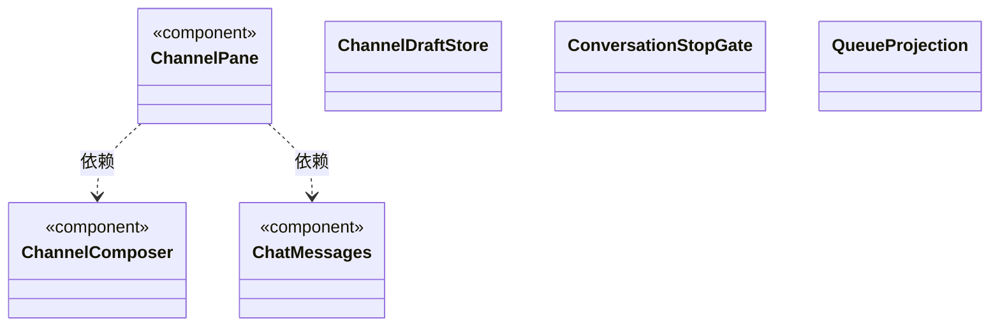
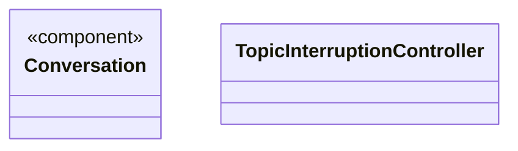

# src/view/conversation 架构

## 设计意图

组织主会话的消息、输入、附件与交互等待。页面组合共享执行展示，各控制器分别维护草稿、队列和停止状态；后端返回的运行事实仍是状态依据。

## 主要组成

| 组成 | 定位 |
| --- | --- |
| [ChannelDraftStore](channel-draft.ts) | 按频道保存独立草稿，使切换视图不丢失尚未发送的输入。 |
| [ConversationStopGate](conversation-stop.ts) | 单独维护停止操作的在途状态，不与消息插入等待共用锁。 |
| [QueueProjection](queue-sync.ts) | 把公开队列快照组织为会话可消费的增量视图。 |
| [TopicInterruptionController](topic-interruption-state.ts) | 管理指定话题补充的冻结请求、持久恢复和只读回执查询，独立于聊天草稿及 React。 |
| [Conversation](Conversation.tsx) | 会话固定页签入口（对话/本会话任务/当前工作区自动化），默认主 Agent 普通对话、启动与继续大脑、展示流式 Markdown 正文和按生命周期合并的工具证据，移植 Cindy 输入组件并适配上下文附件、权限审批及本次运行全部通过、结构化选项提问、持久化消息队列及任务用时、生成速度、价值和上下文计量。 |
| [ChannelPane](ChannelPane.tsx) | 中央交互区内的频道子窗，独立滚动与草稿，主会话仍只装配一个执行控制器。 |
| [ChannelComposer](ChannelComposer.tsx) | 根据原频道状态呈现补充、续接或关联后续任务；草稿归频道，执行仍归主 Agent。 |
| [ChatMessages](ChatMessages.tsx) | 交互区的用户/主 Agent 聊天正文；只投影公开消息和发送失败，不挂载执行审阅控件。 |

<!-- architecture:generated:start -->

## 架构关系

### 关系组 1

### 关系组 2

### 跨图协作

- [Conversation](Conversation.tsx)（图 2）→ [ConversationStopGate](conversation-stop.ts)（图 1）：依赖。

[上层设计](../ARCHITECTURE.md)

<!-- architecture:generated:end -->
