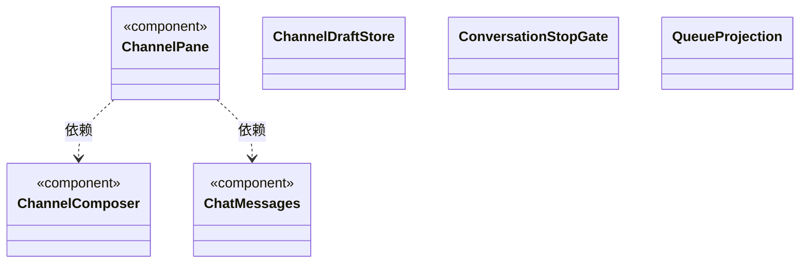
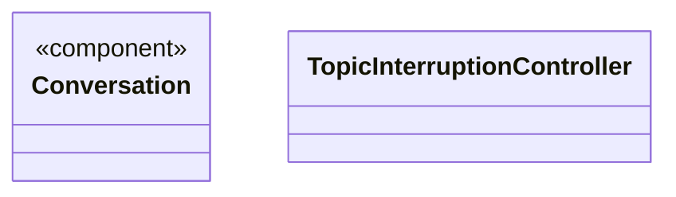

# src/view/conversation 架构

## 设计意图

组织主会话正文、输入、附件、队列和话题浏览，保持用户输入与真实运行反馈的来源清楚。

`Conversation` 组合当前执行与共享展示，频道组件各自持有草稿和滚动位置；草稿存储、停止门闩、队列投影与话题补充控制器分别维护局部状态。工具展开使用 execution-view，执行和补充以后端回执为准，切换频道不会创建第二个主执行器。

## 主要组成

| 组成 | 定位 |
| --- | --- |
| [ChannelDraftStore](channel-draft.ts) | 按频道保存独立草稿，使切换视图不丢失尚未发送的输入。 |
| [ConversationStopGate](conversation-stop.ts) | 单独维护停止操作的在途状态，不与消息插入等待共用锁。 |
| [QueueProjection](queue-sync.ts) | 把公开队列快照组织为会话可消费的增量视图。 |
| [TopicInterruptionController](topic-interruption-state.ts) | 管理指定话题补充的冻结请求、持久恢复和只读回执查询，独立于聊天草稿及 React。 |
| [Conversation](Conversation.tsx) | 主会话的界面装配入口，组合正文、工具、输入、待答、队列与任务投影；统一连接主执行状态。 |
| [ChannelPane](ChannelPane.tsx) | 中央交互区内的频道子窗，独立滚动与草稿，主会话仍只装配一个执行控制器。 |
| [ChannelComposer](ChannelComposer.tsx) | 根据原频道状态呈现补充、续接或关联后续任务；草稿归频道，执行仍归主 Agent。 |
| [ChatMessages](ChatMessages.tsx) | 交互区的用户/主 Agent 聊天正文；只投影公开消息和发送失败，不挂载执行审阅控件。 |

<!-- architecture:generated:start -->

## 架构关系

### 关系组 1：ChannelPane

### 关系组 2：Conversation

### 跨图协作

按引用方归并目标，保留全部跨图关系；分图只用于阅读，不表示新增模块或依赖边界。

| 引用方 | 关系 | 目标 |
| --- | --- | --- |
| [Conversation](Conversation.tsx)（图 2） | 依赖 | [ConversationStopGate](conversation-stop.ts)（图 1） |

[上层设计](../ARCHITECTURE.md)

<!-- architecture:generated:end -->
