# src/view/conversation 架构

## 目录定位

中央主对话、目标摘要、输入、附件及队列；附件区明确显示目录清单、URL指针、网页摘录与仓库静态资料。两处插入口冻结原run，入队成功保留事实，停止锁独立于插入等待。进程准入等待与持久用户等待分别展示，纯等待不累计工作时长；未受理保留草稿。核实与重规划权限分离，可续聊头由后端核实。 双视图共享人工决定控制器，保存意见不清除聊天草稿或消费等待。 主对话栏读写工作区主 Agent 的统一执行配置，与团队配置页双向同步；模型按协议映射，Claude Code/Codex 只保留排队。 加号菜单分别请求 BUG 反馈和需求许愿 Skill，按原会话发送或排队，保留已有草稿及附件。 tasks/ToolActivity 在业务装配层组合原命令核实、影响观察及恢复；公共消息/状态已迁到 execution-view，队列操作名限制为实际四项。 目标摘要可跳转本周期原任务或替代成果，沿已有任务详情导航，不改草稿、附件或执行状态。 原工具记录显式核实保存事实，保留原失败；控制器按四重身份隔离迟到响应，轮询不重复读取，失败保留旧报告并提示时效。 主调用提供显式影响观察；未知不再凭勾选调用 ID 直接续跑，进入独立只读核实，普通草稿不受影响。 当前工作区实例传入成员详情用于补偿预览时效，主聊天草稿不受补偿控制器影响，挂载不触发文件读取或写入。 可信 GitHub submitted 工具回执之后隐藏追加结果文字；失败、未知及后续普通用户输入仍正常显示。 发送捕获原任务/运行，审批使用原审批任务；动态队列按操作解析。

本文描述当前实现。通过分析目录边界后维护的 [源码架构脚本](../../../scripts/source-architecture.mjs) 同步清单和声明；代码变更时仍须核对职责、关键成员与关系。

## 代码清单

| 文件 | 当前职责 |
| --- | --- |
| [AttachmentMenu.tsx](AttachmentMenu.tsx) | 对话加号菜单，提供附件入口以及 BUG 反馈、需求许愿内置 Skill 入口。 |
| [brain-status.ts](brain-status.ts) | 将公开运行事件投影为输入框左上角的大脑状态。 |
| [channel-draft.ts](channel-draft.ts) | 按工作区/主会话/频道持有未提交的文本和附件草稿，独立于主聊天及执行命令账本。 |
| [ChannelComposer.tsx](ChannelComposer.tsx) | 根据原频道状态呈现补充、续接或关联后续任务；草稿归频道，执行仍归主 Agent。 |
| [ChannelDraftInput.tsx](ChannelDraftInput.tsx) | 频道专属文本/附件输入；只有外层状态允许时可编辑，不拥有发送或停止权限。 |
| [ChannelPane.tsx](ChannelPane.tsx) | 中央交互区内的频道子窗，独立滚动与草稿，主会话仍只装配一个执行控制器。 |
| [ChatMessages.tsx](ChatMessages.tsx) | 交互区的用户/主 Agent 聊天正文；只投影公开消息和发送失败，不挂载执行审阅控件。 |
| [ComposerCard.tsx](ComposerCard.tsx) | 从 Cindy ComposerCard 移植的统一输入卡片与内容间距。 |
| [ComposerPicker.tsx](ComposerPicker.tsx) | Cindy 风格的权限和模型 chip，向上展开可搜索、键盘可操作的选择面板。 |
| [conversation-activity.ts](conversation-activity.ts) | 将应用级当前运行快照投影为各工作区的活跃主会话 ID。 |
| [conversation-entries.css](conversation-entries.css) | 历史和侧栏对话、可直接选择的 Agent 条目的共享布局与运行提示。 |
| [conversation-state.ts](conversation-state.ts) | 把主模型运行、开放调度周期和普通消息队列转换为输入区操作状态。 |
| [conversation-stop.ts](conversation-stop.ts) | 为会话停止操作提供独立于发送/插入锁的在途去重标记。 |
| [conversation-topics.css](conversation-topics.css) | 话题摘要、成员审阅标题与阅读区域的响应式排版。 |
| [conversation-topics.ts](conversation-topics.ts) | 将主会话公开运行和派发任务投影为话题内容，供群聊导航使用。 |
| [conversation.css](conversation.css) | 对齐 Cindy 的消息列、工作记录折叠行及一体式底部输入框。 |
| [Conversation.tsx](Conversation.tsx) | 持有主 Agent 多角色草稿版本的会话固定页签入口（对话/办公室），默认主 Agent 普通对话、启动与继续大脑、展示流式 Markdown 正文；工具证据归办公室与成员工作审阅，移植 Cindy 输入组件并适配上下文附件、权限审批及本次运行全部通过、结构化选项提问、持久化消息队列及任务用时、生成速度、价值和上下文计量。 |
| [ConversationEntries.tsx](ConversationEntries.tsx) | 侧栏与历史菜单共用的对话条目、重命名和移除入口。 |
| [ConversationToolCall.tsx](ConversationToolCall.tsx) | 在原工具位置组合其完整执行轨道与已验证派发任务的最新公开状态。 |
| [ConversationTopics.tsx](ConversationTopics.tsx) | 主 Session 的纯聊天与频道入口列表，以及独立的频道正文投影。 |
| [ConversationTurn.tsx](ConversationTurn.tsx) | 按真实事件顺序组合一轮主对话的来源、流式文字与内联工具，系统交接不冒充用户或模型调用。 |
| [inline-conversation.css](inline-conversation.css) | 对应界面的布局与视觉样式。 |
| [inline-task-state.ts](inline-task-state.ts) | 用原主运行的成功派发回执，将内联工具条目关联到同会话的真实任务节点。 |
| [InteractionModeToggle.tsx](InteractionModeToggle.tsx) | 嵌入当前对话、办公室或成员审阅标题行右侧的单一视图切换按钮；图标表达当前视图，文字提示目标视图。 |
| [MemberConversation.tsx](MemberConversation.tsx) | 展示一个长期子 Session 在各话题中的派发、公开输出及工具记录，标题行承载父级视图切换。 |
| [MessageCard.tsx](MessageCard.tsx) | 复用 Cindy ChatBubble 的用户气泡/助手裸正文布局，承载消息时间和复制操作。 |
| [pasted-images.ts](pasted-images.ts) | 将当前粘贴事件中的图片 File 转为有界上传字节，不读取全局剪贴板。 |
| [queue-insertion.ts](queue-insertion.ts) | 冻结会话插入动作的主运行身份，共用新草稿入队后插入与已有队列项插入。 |
| [queue-sync.ts](queue-sync.ts) | 把主进程队列增量合并为稳定的消息数组，供轮询与操作后刷新共同使用。 |
| [ReadingPane.tsx](ReadingPane.tsx) | 每个聊天/成员审阅窗独立持有滚动位置与跟随末尾状态。 |
| [SendButton.tsx](SendButton.tsx) | 从 Cindy SendButton 移植发送/停止的固定 28px 按钮和按下动作身份保护。 |
| [session-tabs.css](session-tabs.css) | 对话/审阅标题行内的单按钮两态图标切换与任务记录排版。 |
| [ThreadHistoryNotice.tsx](ThreadHistoryNotice.tsx) | 显示主会话中无法读取的历史轮次，并只按后端确认的运行头提供续接记录。 |
| [topic-interruption-state.ts](topic-interruption-state.ts) | 管理指定话题补充的冻结请求、持久恢复和只读回执查询，独立于聊天草稿及 React。 |
| [TopicInterruptionForm.tsx](TopicInterruptionForm.tsx) | 当前话题内的显式补充入口，展示冻结原文、全员暂停含义和原请求查询。 |
| [usage.css](usage.css) | 输入框旁计量条、上下文环与明细弹层的排版。 |
| [usage.ts](usage.ts) | 保留对话界面的用量统计入口，经桥接契约使用 Logic 执行规则的纯计量函数。 |
| [UsageStatus.tsx](UsageStatus.tsx) | Cindy 风格的输入框上方时间/速度与底部任务价值、上下文占用显示。 |
| [useChannelDraft.ts](useChannelDraft.ts) | 装配一个频道草稿与文件选择器，提供独立输入和在途导入状态。 |
| [useMessageQueue.ts](useMessageQueue.ts) | 会话队列的独立增量刷新入口，覆盖轮询和用户操作后的即时同步。 |

## 架构类图

### AttachmentMenu.tsx

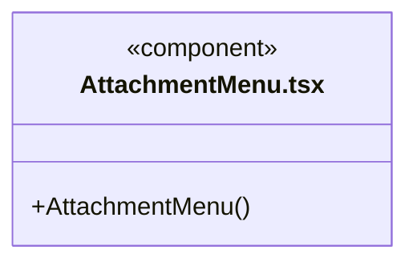

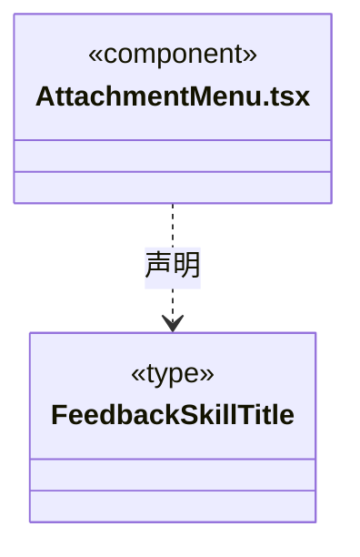

直接依赖：[../components/Icon.tsx](../components/Icon.tsx)、[../../bridge/contracts/chat.ts](../../bridge/contracts/chat.ts)。

### brain-status.ts

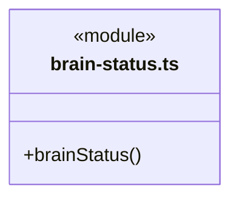

直接依赖：[../../bridge/contracts/execution.ts](../../bridge/contracts/execution.ts)。

### channel-draft.ts

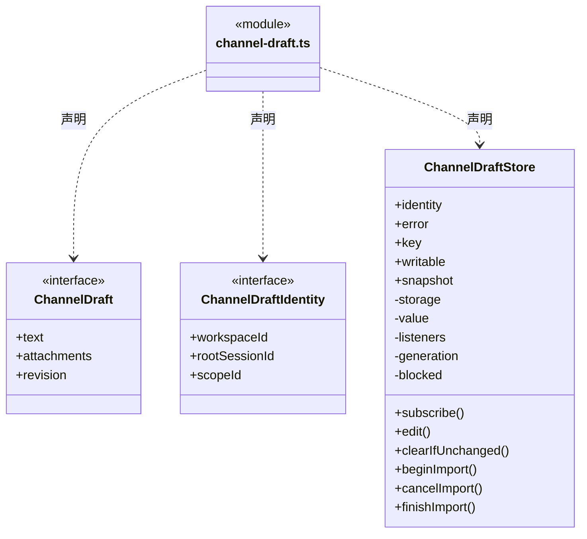

直接依赖：[../../bridge/contracts/chat.ts](../../bridge/contracts/chat.ts)、[../tasks/continuation-attachments.ts](../tasks/continuation-attachments.ts)、[../foundations/utility/index.ts](../foundations/utility/index.ts)。

### ChannelComposer.tsx

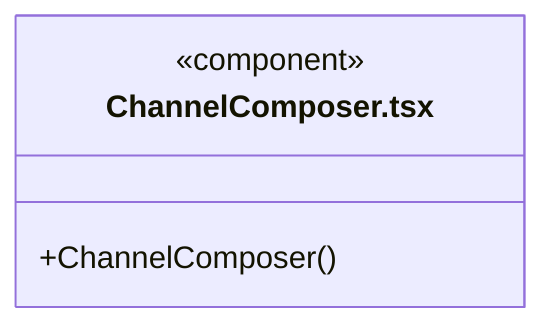

直接依赖：[../../bridge/contracts/dispatch.ts](../../bridge/contracts/dispatch.ts)、[../tasks/useScopeContinuation.ts](../tasks/useScopeContinuation.ts)、[../tasks/ScopeContinuationForm.tsx](../tasks/ScopeContinuationForm.tsx)、[TopicInterruptionForm.tsx](TopicInterruptionForm.tsx)、[ChannelDraftInput.tsx](ChannelDraftInput.tsx)、[useChannelDraft.ts](useChannelDraft.ts)、[channel-draft.ts](channel-draft.ts)。

### ChannelDraftInput.tsx

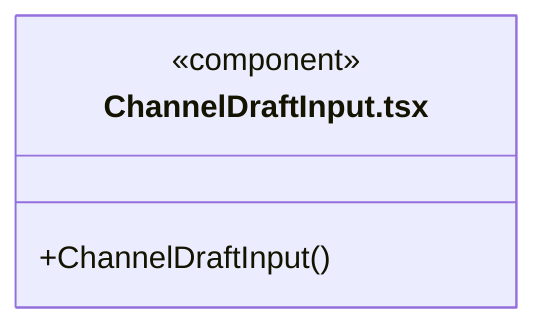

直接依赖：[useChannelDraft.ts](useChannelDraft.ts)、[../execution-view/ComposerAttachments.tsx](../execution-view/ComposerAttachments.tsx)。

### ChannelPane.tsx

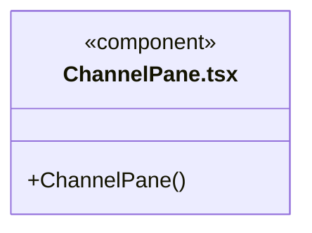

直接依赖：[conversation-topics.ts](conversation-topics.ts)、[ConversationTopics.tsx](ConversationTopics.tsx)、[ChatMessages.tsx](ChatMessages.tsx)、[ChannelComposer.tsx](ChannelComposer.tsx)、[ReadingPane.tsx](ReadingPane.tsx)。

### ChatMessages.tsx

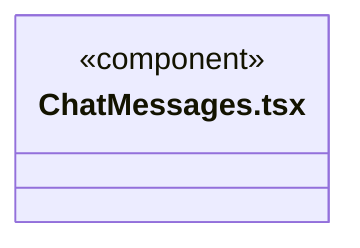
直接依赖：[../../bridge/contracts/execution.ts](../../bridge/contracts/execution.ts)、[../execution-view/transcript.ts](../execution-view/transcript.ts)、[../execution-view/MarkdownMessage.tsx](../execution-view/MarkdownMessage.tsx)、[MessageCard.tsx](MessageCard.tsx)。

### ComposerCard.tsx

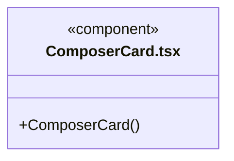


### ComposerPicker.tsx

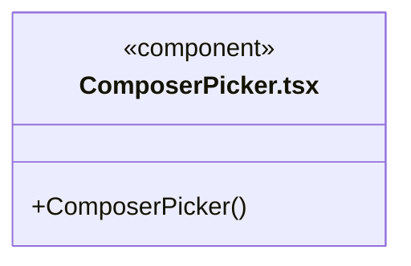

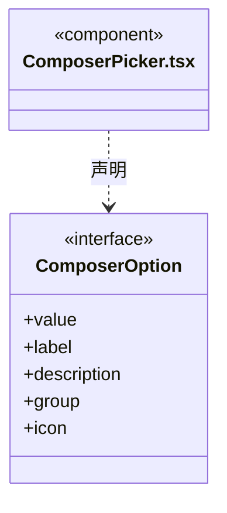

直接依赖：[../components/Icon.tsx](../components/Icon.tsx)。

### conversation-activity.ts

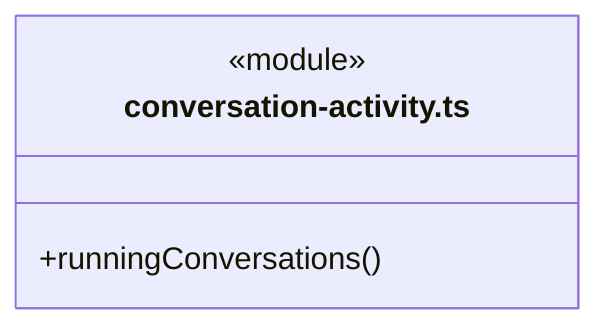

直接依赖：[../../bridge/contracts/runtime.ts](../../bridge/contracts/runtime.ts)。

### conversation-entries.css

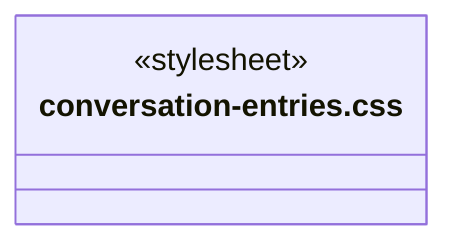

### conversation-state.ts

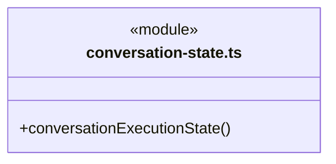

直接依赖：[../../bridge/contracts/execution.ts](../../bridge/contracts/execution.ts)、[../../bridge/contracts/dispatch.ts](../../bridge/contracts/dispatch.ts)。

### conversation-stop.ts

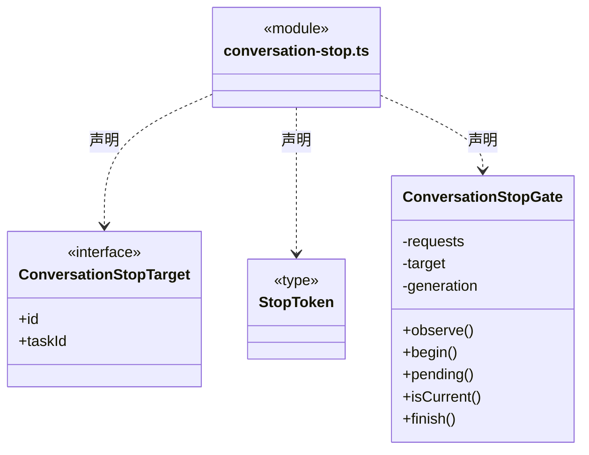


### conversation-topics.css

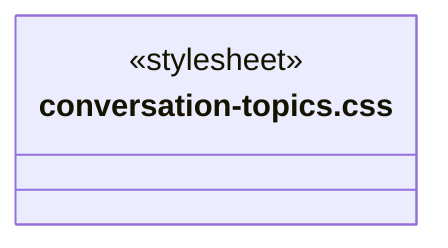

### conversation-topics.ts

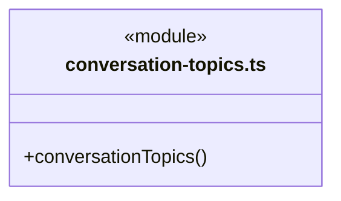

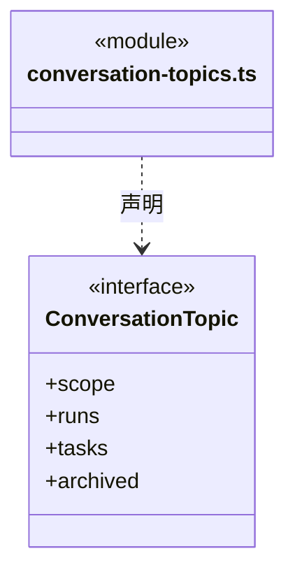

直接依赖：[../../bridge/contracts/dispatch.ts](../../bridge/contracts/dispatch.ts)、[../../bridge/contracts/execution.ts](../../bridge/contracts/execution.ts)。

### conversation.css

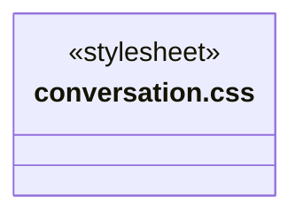

### Conversation.tsx

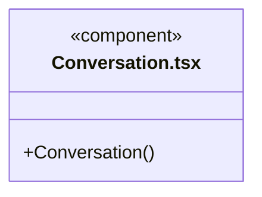

```mermaid
classDiagram
class N_src_view_conversation_Conversation_tsx["Conversation.tsx"] {
  <<component>>
}
class N_src_view_conversation_Conversation_tsx_HistoryItem["HistoryItem"] {
  <<interface>>
  +status
}
N_src_view_conversation_Conversation_tsx ..> N_src_view_conversation_Conversation_tsx_HistoryItem : 声明
```

直接依赖：[InteractionModeToggle.tsx](InteractionModeToggle.tsx)、[../../bridge/contracts/ipc-call.ts](../../bridge/contracts/ipc-call.ts)、[../../bridge/contracts/workspace.ts](../../bridge/contracts/workspace.ts)、[../../bridge/contracts/execution.ts](../../bridge/contracts/execution.ts)、[../../bridge/contracts/engines.ts](../../bridge/contracts/engines.ts)、[../../bridge/contracts/models.ts](../../bridge/contracts/models.ts)、[../components/AgentModelForm.tsx](../components/AgentModelForm.tsx)、[../../bridge/contracts/agent-settings.ts](../../bridge/contracts/agent-settings.ts)、[../shell/tabs.ts](../shell/tabs.ts)、[../shell/runtime-navigation.ts](../shell/runtime-navigation.ts)、[ChatMessages.tsx](ChatMessages.tsx)、[ChannelPane.tsx](ChannelPane.tsx)、[ReadingPane.tsx](ReadingPane.tsx)、[channel-draft.ts](channel-draft.ts)、[ConversationTopics.tsx](ConversationTopics.tsx)、[conversation-topics.ts](conversation-topics.ts)、[MemberConversation.tsx](MemberConversation.tsx)、[../execution-view/team-conversations.ts](../execution-view/team-conversations.ts)、[../tasks/SessionTaskView.tsx](../tasks/SessionTaskView.tsx)、[../tasks/useSessionGraph.ts](../tasks/useSessionGraph.ts)、[session-tabs.css](session-tabs.css)、[../execution-view/MessageQueue.tsx](../execution-view/MessageQueue.tsx)、[useMessageQueue.ts](useMessageQueue.ts)、[../execution-view/QuestionCard.tsx](../execution-view/QuestionCard.tsx)、[UsageStatus.tsx](UsageStatus.tsx)、[../components/Icon.tsx](../components/Icon.tsx)、[conversation.css](conversation.css)、[../team/useMainAgentSettings.ts](../team/useMainAgentSettings.ts)、[ConversationEntries.tsx](ConversationEntries.tsx)、[ComposerCard.tsx](ComposerCard.tsx)、[SendButton.tsx](SendButton.tsx)、[AttachmentMenu.tsx](AttachmentMenu.tsx)、[ComposerPicker.tsx](ComposerPicker.tsx)、[../execution-view/ComposerAttachments.tsx](../execution-view/ComposerAttachments.tsx)、[../../bridge/contracts/chat.ts](../../bridge/contracts/chat.ts)、[pasted-images.ts](pasted-images.ts)、[conversation-state.ts](conversation-state.ts)、[conversation-stop.ts](conversation-stop.ts)、[../tasks/useScopeContinuation.ts](../tasks/useScopeContinuation.ts)、[../tasks/useExecutionRecovery.ts](../tasks/useExecutionRecovery.ts)、[../tasks/useScopeReplan.ts](../tasks/useScopeReplan.ts)、[../tasks/useHumanDecisions.ts](../tasks/useHumanDecisions.ts)、[../tasks/useHumanContinuation.ts](../tasks/useHumanContinuation.ts)、[ThreadHistoryNotice.tsx](ThreadHistoryNotice.tsx)、[../tasks/useAdmission.ts](../tasks/useAdmission.ts)、[../tasks/admission-state.ts](../tasks/admission-state.ts)、[../tasks/AdmissionNotice.tsx](../tasks/AdmissionNotice.tsx)。

### ConversationEntries.tsx

```mermaid
classDiagram
class N_src_view_conversation_ConversationEntries_tsx["ConversationEntries.tsx"] {
  <<component>>
  +ConversationEntries()
}
```

```mermaid
classDiagram
class N_src_view_conversation_ConversationEntries_tsx["ConversationEntries.tsx"] {
  <<component>>
}
class N_src_view_conversation_ConversationEntries_tsx_ConversationEntry["ConversationEntry"] {
  <<interface>>
  +id
  +title
  +running
  +children
}
N_src_view_conversation_ConversationEntries_tsx ..> N_src_view_conversation_ConversationEntries_tsx_ConversationEntry : 声明
```

直接依赖：[../components/Icon.tsx](../components/Icon.tsx)、[conversation-entries.css](conversation-entries.css)。

### ConversationToolCall.tsx

```mermaid
classDiagram
class N_src_view_conversation_ConversationToolCall_tsx["ConversationToolCall.tsx"] {
  <<component>>
  +ConversationToolCall()
}
```

直接依赖：[../../bridge/contracts/execution.ts](../../bridge/contracts/execution.ts)、[../tasks/useExecutionRecovery.ts](../tasks/useExecutionRecovery.ts)、[../tasks/MemberActivity.tsx](../tasks/MemberActivity.tsx)、[../tasks/ToolActivity.tsx](../tasks/ToolActivity.tsx)、[inline-task-state.ts](inline-task-state.ts)。

### ConversationTopics.tsx

```mermaid
classDiagram
class N_src_view_conversation_ConversationTopics_tsx["ConversationTopics.tsx"] {
  <<component>>
  +ConversationTopics()
  +ConversationChannel()
}
```

直接依赖：[../../bridge/contracts/execution.ts](../../bridge/contracts/execution.ts)、[conversation-topics.ts](conversation-topics.ts)、[conversation-topics.css](conversation-topics.css)。

### ConversationTurn.tsx

```mermaid
classDiagram
class N_src_view_conversation_ConversationTurn_tsx["ConversationTurn.tsx"] {
  <<component>>
}
```
直接依赖：[../../bridge/contracts/execution.ts](../../bridge/contracts/execution.ts)、[../tasks/useExecutionRecovery.ts](../tasks/useExecutionRecovery.ts)、[../components/Icon.tsx](../components/Icon.tsx)、[../execution-view/transcript.ts](../execution-view/transcript.ts)、[../execution-view/MarkdownMessage.tsx](../execution-view/MarkdownMessage.tsx)、[MessageCard.tsx](MessageCard.tsx)、[../execution-view/WorkStatus.tsx](../execution-view/WorkStatus.tsx)、[ConversationToolCall.tsx](ConversationToolCall.tsx)、[inline-task-state.ts](inline-task-state.ts)、[inline-conversation.css](inline-conversation.css)。

### inline-conversation.css

```mermaid
classDiagram
class N_src_view_conversation_inline_conversation_css["inline-conversation.css"] {
  <<stylesheet>>
}
```

### inline-task-state.ts

```mermaid
classDiagram
class N_src_view_conversation_inline_task_state_ts["inline-task-state.ts"] {
  <<module>>
  +inlineDispatchedTask()
  +inlineDependencies()
  +inlineHandoffTasks()
}
```

直接依赖：[../../bridge/contracts/dispatch.ts](../../bridge/contracts/dispatch.ts)、[../../bridge/contracts/execution.ts](../../bridge/contracts/execution.ts)、[../tasks/command-verification-state.ts](../tasks/command-verification-state.ts)。

### InteractionModeToggle.tsx

```mermaid
classDiagram
class N_src_view_conversation_InteractionModeToggle_tsx["InteractionModeToggle.tsx"] {
  <<component>>
  +InteractionModeToggle()
}
```

直接依赖：[../components/Icon.tsx](../components/Icon.tsx)。

### MemberConversation.tsx

```mermaid
classDiagram
class N_src_view_conversation_MemberConversation_tsx["MemberConversation.tsx"] {
  <<component>>
  +MemberConversation()
}
```

直接依赖：[../../bridge/contracts/dispatch.ts](../../bridge/contracts/dispatch.ts)、[../tasks/useMemberRun.ts](../tasks/useMemberRun.ts)、[../tasks/MemberRunTranscript.tsx](../tasks/MemberRunTranscript.tsx)、[../tasks/MemberActivity.tsx](../tasks/MemberActivity.tsx)、[../execution-view/ToolTimeline.tsx](../execution-view/ToolTimeline.tsx)、[../execution-view/team-conversations.ts](../execution-view/team-conversations.ts)、[conversation-topics.css](conversation-topics.css)。

### MessageCard.tsx

```mermaid
classDiagram
class N_src_view_conversation_MessageCard_tsx["MessageCard.tsx"] {
  <<component>>
  +MessageCard()
}
```


### pasted-images.ts

```mermaid
classDiagram
class N_src_view_conversation_pasted_images_ts["pasted-images.ts"] {
  <<module>>
  +pastedImage()
}
```


### queue-insertion.ts

```mermaid
classDiagram
class N_src_view_conversation_queue_insertion_ts["queue-insertion.ts"] {
  <<module>>
  +captureQueueInsertTarget()
  +insertQueuedMessage()
  +enqueueConversationMessage()
}
```

```mermaid
classDiagram
class N_src_view_conversation_queue_insertion_ts["queue-insertion.ts"] {
  <<module>>
}
class N_src_view_conversation_queue_insertion_ts_QueueInsertTarget["QueueInsertTarget"] {
  <<type>>

}
N_src_view_conversation_queue_insertion_ts ..> N_src_view_conversation_queue_insertion_ts_QueueInsertTarget : 声明
class N_src_view_conversation_queue_insertion_ts_QueuedReceipt["QueuedReceipt"] {
  <<type>>
  +taskId
  +id
}
N_src_view_conversation_queue_insertion_ts ..> N_src_view_conversation_queue_insertion_ts_QueuedReceipt : 声明
class N_src_view_conversation_queue_insertion_ts_InsertPort["InsertPort"] {
  <<type>>

}
N_src_view_conversation_queue_insertion_ts ..> N_src_view_conversation_queue_insertion_ts_InsertPort : 声明
```

直接依赖：[../../bridge/contracts/execution.ts](../../bridge/contracts/execution.ts)。

### queue-sync.ts

```mermaid
classDiagram
class N_src_view_conversation_queue_sync_ts["queue-sync.ts"] {
  <<module>>
}
class N_src_view_conversation_queue_sync_ts_QueueProjection["QueueProjection"] {
  +cursor
  +items
  +apply()
}
N_src_view_conversation_queue_sync_ts ..> N_src_view_conversation_queue_sync_ts_QueueProjection : 声明
```

直接依赖：[../../bridge/contracts/execution.ts](../../bridge/contracts/execution.ts)。

### ReadingPane.tsx

```mermaid
classDiagram
class N_src_view_conversation_ReadingPane_tsx["ReadingPane.tsx"] {
  <<component>>
  +ReadingPane()
}
```


### SendButton.tsx

```mermaid
classDiagram
class N_src_view_conversation_SendButton_tsx["SendButton.tsx"] {
  <<component>>
}
class N_src_view_conversation_SendButton_tsx_SendButtonProps["SendButtonProps"] {
  <<interface>>
  +disabled
  +onClick
  +isStreaming
  +queued
  +continuing
  +stopLabel
}
N_src_view_conversation_SendButton_tsx ..> N_src_view_conversation_SendButton_tsx_SendButtonProps : 声明
```


### session-tabs.css

```mermaid
classDiagram
class N_src_view_conversation_session_tabs_css["session-tabs.css"] {
  <<stylesheet>>
}
```

### ThreadHistoryNotice.tsx

```mermaid
classDiagram
class N_src_view_conversation_ThreadHistoryNotice_tsx["ThreadHistoryNotice.tsx"] {
  <<component>>
  +threadResumeRun()
  +threadRecoveryReason()
  +ThreadRecoveryNotice()
  +ThreadHistoryNotice()
}
```

直接依赖：[../../bridge/contracts/execution.ts](../../bridge/contracts/execution.ts)。

### topic-interruption-state.ts

```mermaid
classDiagram
class N_src_view_conversation_topic_interruption_state_ts["topic-interruption-state.ts"] {
  <<module>>
  +checkedTopicInterruptionReceipt()
}
```

成员 1/2（同名节点为同一声明，跨图合并阅读）。

```mermaid
classDiagram
class N_src_view_conversation_topic_interruption_state_ts["topic-interruption-state.ts"] {
  <<module>>
}
class N_src_view_conversation_topic_interruption_state_ts_TopicInterruptionTarget["TopicInterruptionTarget"] {
  <<type>>

}
N_src_view_conversation_topic_interruption_state_ts ..> N_src_view_conversation_topic_interruption_state_ts_TopicInterruptionTarget : 声明
class N_src_view_conversation_topic_interruption_state_ts_TopicInterruptionPorts["TopicInterruptionPorts"] {
  <<interface>>
  +storage
  +uuid
  +submit
  +lookup
}
N_src_view_conversation_topic_interruption_state_ts ..> N_src_view_conversation_topic_interruption_state_ts_TopicInterruptionPorts : 声明
class N_src_view_conversation_topic_interruption_state_ts_TopicInterruptionState["TopicInterruptionState"] {
  <<interface>>
  +ready
  +pending
  +request
  +receipt
  +error
}
N_src_view_conversation_topic_interruption_state_ts ..> N_src_view_conversation_topic_interruption_state_ts_TopicInterruptionState : 声明
class N_src_view_conversation_topic_interruption_state_ts_TopicInterruptionController["TopicInterruptionController"] {
  +target
  +snapshot
  +subscribe()
  +restore()
  +submit()
  +query()
  +retry()
  -ports
  -value
  -records
  -listeners
  -inFlight
  -blocked
  -publish()
  -validate()
  -run()
}
N_src_view_conversation_topic_interruption_state_ts ..> N_src_view_conversation_topic_interruption_state_ts_TopicInterruptionController : 声明
```

成员 2/2（同名节点为同一声明，跨图合并阅读）。

```mermaid
classDiagram
class N_src_view_conversation_topic_interruption_state_ts["topic-interruption-state.ts"] {
  <<module>>
}
class N_src_view_conversation_topic_interruption_state_ts_TopicInterruptionController["TopicInterruptionController"] {
  -accept()
  -lookup()
}
N_src_view_conversation_topic_interruption_state_ts ..> N_src_view_conversation_topic_interruption_state_ts_TopicInterruptionController : 声明
```

直接依赖：[../../bridge/contracts/dispatch.ts](../../bridge/contracts/dispatch.ts)、[../foundations/utility/index.ts](../foundations/utility/index.ts)。

### TopicInterruptionForm.tsx

```mermaid
classDiagram
class N_src_view_conversation_TopicInterruptionForm_tsx["TopicInterruptionForm.tsx"] {
  <<component>>
  +TopicInterruptionForm()
}
```

直接依赖：[../../bridge/contracts/dispatch.ts](../../bridge/contracts/dispatch.ts)、[ChannelDraftInput.tsx](ChannelDraftInput.tsx)、[useChannelDraft.ts](useChannelDraft.ts)、[topic-interruption-state.ts](topic-interruption-state.ts)。

### usage.css

```mermaid
classDiagram
class N_src_view_conversation_usage_css["usage.css"] {
  <<stylesheet>>
}
```

### usage.ts

```mermaid
classDiagram
class N_src_view_conversation_usage_ts["usage.ts"] {
  <<module>>
  +conversationUsage()
}
```

直接依赖：[../../bridge/contracts/usage.ts](../../bridge/contracts/usage.ts)、[../../bridge/contracts/execution.ts](../../bridge/contracts/execution.ts)。

### UsageStatus.tsx

```mermaid
classDiagram
class N_src_view_conversation_UsageStatus_tsx["UsageStatus.tsx"] {
  <<component>>
  +UsageStatus()
}
```

```mermaid
classDiagram
class N_src_view_conversation_UsageStatus_tsx["UsageStatus.tsx"] {
  <<component>>
}
class N_src_view_conversation_UsageStatus_tsx_ConversationActivity["ConversationActivity"] {
  <<interface>>
  +label
  +active
  +tone
  +waitingSince
}
N_src_view_conversation_UsageStatus_tsx ..> N_src_view_conversation_UsageStatus_tsx_ConversationActivity : 声明
```

直接依赖：[../../bridge/contracts/execution.ts](../../bridge/contracts/execution.ts)、[brain-status.ts](brain-status.ts)、[../components/Icon.tsx](../components/Icon.tsx)、[usage.ts](usage.ts)、[usage.css](usage.css)。

### useChannelDraft.ts

```mermaid
classDiagram
class N_src_view_conversation_useChannelDraft_ts["useChannelDraft.ts"] {
  <<module>>
  +useChannelDraft()
}
```

```mermaid
classDiagram
class N_src_view_conversation_useChannelDraft_ts["useChannelDraft.ts"] {
  <<module>>
}
class N_src_view_conversation_useChannelDraft_ts_ChannelDraftView["ChannelDraftView"] {
  <<type>>

}
N_src_view_conversation_useChannelDraft_ts ..> N_src_view_conversation_useChannelDraft_ts_ChannelDraftView : 声明
```

直接依赖：[channel-draft.ts](channel-draft.ts)。

### useMessageQueue.ts

```mermaid
classDiagram
class N_src_view_conversation_useMessageQueue_ts["useMessageQueue.ts"] {
  <<module>>
  +useMessageQueue()
}
```

直接依赖：[queue-sync.ts](queue-sync.ts)、[../../bridge/contracts/execution.ts](../../bridge/contracts/execution.ts)。

### 本目录调用边界

```mermaid
classDiagram
class N_src_view_conversation_ChannelComposer_tsx["ChannelComposer.tsx"] {
  <<component>>
}
class N_src_view_conversation_TopicInterruptionForm_tsx["TopicInterruptionForm.tsx"] {
  <<component>>
}
class N_src_view_conversation_ChannelDraftInput_tsx["ChannelDraftInput.tsx"] {
  <<component>>
}
class N_src_view_conversation_useChannelDraft_ts["useChannelDraft.ts"] {
  <<module>>
}
class N_src_view_conversation_channel_draft_ts["channel-draft.ts"] {
  <<module>>
}
N_src_view_conversation_ChannelComposer_tsx ..> N_src_view_conversation_TopicInterruptionForm_tsx : 导入依赖
N_src_view_conversation_ChannelComposer_tsx ..> N_src_view_conversation_ChannelDraftInput_tsx : 导入依赖
N_src_view_conversation_ChannelComposer_tsx ..> N_src_view_conversation_useChannelDraft_ts : 导入依赖
N_src_view_conversation_ChannelComposer_tsx ..> N_src_view_conversation_channel_draft_ts : 导入依赖
```

```mermaid
classDiagram
class N_src_view_conversation_ChannelDraftInput_tsx["ChannelDraftInput.tsx"] {
  <<component>>
}
class N_src_view_conversation_useChannelDraft_ts["useChannelDraft.ts"] {
  <<module>>
}
class N_src_view_conversation_ChannelPane_tsx["ChannelPane.tsx"] {
  <<component>>
}
class N_src_view_conversation_conversation_topics_ts["conversation-topics.ts"] {
  <<module>>
}
class N_src_view_conversation_ConversationTopics_tsx["ConversationTopics.tsx"] {
  <<component>>
}
class N_src_view_conversation_ChatMessages_tsx["ChatMessages.tsx"] {
  <<component>>
}
N_src_view_conversation_ChannelDraftInput_tsx ..> N_src_view_conversation_useChannelDraft_ts : 导入依赖
N_src_view_conversation_ChannelPane_tsx ..> N_src_view_conversation_conversation_topics_ts : 导入依赖
N_src_view_conversation_ChannelPane_tsx ..> N_src_view_conversation_ConversationTopics_tsx : 导入依赖
N_src_view_conversation_ChannelPane_tsx ..> N_src_view_conversation_ChatMessages_tsx : 导入依赖
```

```mermaid
classDiagram
class N_src_view_conversation_ChannelPane_tsx["ChannelPane.tsx"] {
  <<component>>
}
class N_src_view_conversation_ChannelComposer_tsx["ChannelComposer.tsx"] {
  <<component>>
}
class N_src_view_conversation_ReadingPane_tsx["ReadingPane.tsx"] {
  <<component>>
}
class N_src_view_conversation_ChatMessages_tsx["ChatMessages.tsx"] {
  <<component>>
}
class N_src_view_conversation_MessageCard_tsx["MessageCard.tsx"] {
  <<component>>
}
class N_src_view_conversation_Conversation_tsx["Conversation.tsx"] {
  <<component>>
}
class N_src_view_conversation_InteractionModeToggle_tsx["InteractionModeToggle.tsx"] {
  <<component>>
}
N_src_view_conversation_ChannelPane_tsx ..> N_src_view_conversation_ChannelComposer_tsx : 导入依赖
N_src_view_conversation_ChannelPane_tsx ..> N_src_view_conversation_ReadingPane_tsx : 导入依赖
N_src_view_conversation_ChatMessages_tsx ..> N_src_view_conversation_MessageCard_tsx : 导入依赖
N_src_view_conversation_Conversation_tsx ..> N_src_view_conversation_InteractionModeToggle_tsx : 导入依赖
```

```mermaid
classDiagram
class N_src_view_conversation_Conversation_tsx["Conversation.tsx"] {
  <<component>>
}
class N_src_view_conversation_ChatMessages_tsx["ChatMessages.tsx"] {
  <<component>>
}
class N_src_view_conversation_ChannelPane_tsx["ChannelPane.tsx"] {
  <<component>>
}
class N_src_view_conversation_ReadingPane_tsx["ReadingPane.tsx"] {
  <<component>>
}
class N_src_view_conversation_channel_draft_ts["channel-draft.ts"] {
  <<module>>
}
N_src_view_conversation_Conversation_tsx ..> N_src_view_conversation_ChatMessages_tsx : 导入依赖
N_src_view_conversation_Conversation_tsx ..> N_src_view_conversation_ChannelPane_tsx : 导入依赖
N_src_view_conversation_Conversation_tsx ..> N_src_view_conversation_ReadingPane_tsx : 导入依赖
N_src_view_conversation_Conversation_tsx ..> N_src_view_conversation_channel_draft_ts : 导入依赖
```

```mermaid
classDiagram
class N_src_view_conversation_Conversation_tsx["Conversation.tsx"] {
  <<component>>
}
class N_src_view_conversation_ConversationTopics_tsx["ConversationTopics.tsx"] {
  <<component>>
}
class N_src_view_conversation_conversation_topics_ts["conversation-topics.ts"] {
  <<module>>
}
class N_src_view_conversation_MemberConversation_tsx["MemberConversation.tsx"] {
  <<component>>
}
class N_src_view_conversation_session_tabs_css["session-tabs.css"] {
  <<stylesheet>>
}
N_src_view_conversation_Conversation_tsx ..> N_src_view_conversation_ConversationTopics_tsx : 导入依赖
N_src_view_conversation_Conversation_tsx ..> N_src_view_conversation_conversation_topics_ts : 导入依赖
N_src_view_conversation_Conversation_tsx ..> N_src_view_conversation_MemberConversation_tsx : 导入依赖
N_src_view_conversation_Conversation_tsx ..> N_src_view_conversation_session_tabs_css : 导入依赖
```

```mermaid
classDiagram
class N_src_view_conversation_Conversation_tsx["Conversation.tsx"] {
  <<component>>
}
class N_src_view_conversation_useMessageQueue_ts["useMessageQueue.ts"] {
  <<module>>
}
class N_src_view_conversation_UsageStatus_tsx["UsageStatus.tsx"] {
  <<component>>
}
class N_src_view_conversation_conversation_css["conversation.css"] {
  <<stylesheet>>
}
class N_src_view_conversation_ConversationEntries_tsx["ConversationEntries.tsx"] {
  <<component>>
}
N_src_view_conversation_Conversation_tsx ..> N_src_view_conversation_useMessageQueue_ts : 导入依赖
N_src_view_conversation_Conversation_tsx ..> N_src_view_conversation_UsageStatus_tsx : 导入依赖
N_src_view_conversation_Conversation_tsx ..> N_src_view_conversation_conversation_css : 导入依赖
N_src_view_conversation_Conversation_tsx ..> N_src_view_conversation_ConversationEntries_tsx : 导入依赖
```

```mermaid
classDiagram
class N_src_view_conversation_Conversation_tsx["Conversation.tsx"] {
  <<component>>
}
class N_src_view_conversation_ComposerCard_tsx["ComposerCard.tsx"] {
  <<component>>
}
class N_src_view_conversation_SendButton_tsx["SendButton.tsx"] {
  <<component>>
}
class N_src_view_conversation_AttachmentMenu_tsx["AttachmentMenu.tsx"] {
  <<component>>
}
class N_src_view_conversation_ComposerPicker_tsx["ComposerPicker.tsx"] {
  <<component>>
}
N_src_view_conversation_Conversation_tsx ..> N_src_view_conversation_ComposerCard_tsx : 导入依赖
N_src_view_conversation_Conversation_tsx ..> N_src_view_conversation_SendButton_tsx : 导入依赖
N_src_view_conversation_Conversation_tsx ..> N_src_view_conversation_AttachmentMenu_tsx : 导入依赖
N_src_view_conversation_Conversation_tsx ..> N_src_view_conversation_ComposerPicker_tsx : 导入依赖
```

```mermaid
classDiagram
class N_src_view_conversation_Conversation_tsx["Conversation.tsx"] {
  <<component>>
}
class N_src_view_conversation_pasted_images_ts["pasted-images.ts"] {
  <<module>>
}
class N_src_view_conversation_conversation_state_ts["conversation-state.ts"] {
  <<module>>
}
class N_src_view_conversation_conversation_stop_ts["conversation-stop.ts"] {
  <<module>>
}
class N_src_view_conversation_ThreadHistoryNotice_tsx["ThreadHistoryNotice.tsx"] {
  <<component>>
}
N_src_view_conversation_Conversation_tsx ..> N_src_view_conversation_pasted_images_ts : 导入依赖
N_src_view_conversation_Conversation_tsx ..> N_src_view_conversation_conversation_state_ts : 导入依赖
N_src_view_conversation_Conversation_tsx ..> N_src_view_conversation_conversation_stop_ts : 导入依赖
N_src_view_conversation_Conversation_tsx ..> N_src_view_conversation_ThreadHistoryNotice_tsx : 导入依赖
```

```mermaid
classDiagram
class N_src_view_conversation_ConversationEntries_tsx["ConversationEntries.tsx"] {
  <<component>>
}
class N_src_view_conversation_conversation_entries_css["conversation-entries.css"] {
  <<stylesheet>>
}
class N_src_view_conversation_ConversationToolCall_tsx["ConversationToolCall.tsx"] {
  <<component>>
}
class N_src_view_conversation_inline_task_state_ts["inline-task-state.ts"] {
  <<module>>
}
class N_src_view_conversation_ConversationTopics_tsx["ConversationTopics.tsx"] {
  <<component>>
}
class N_src_view_conversation_conversation_topics_ts["conversation-topics.ts"] {
  <<module>>
}
class N_src_view_conversation_conversation_topics_css["conversation-topics.css"] {
  <<stylesheet>>
}
N_src_view_conversation_ConversationEntries_tsx ..> N_src_view_conversation_conversation_entries_css : 导入依赖
N_src_view_conversation_ConversationToolCall_tsx ..> N_src_view_conversation_inline_task_state_ts : 导入依赖
N_src_view_conversation_ConversationTopics_tsx ..> N_src_view_conversation_conversation_topics_ts : 导入依赖
N_src_view_conversation_ConversationTopics_tsx ..> N_src_view_conversation_conversation_topics_css : 导入依赖
```

```mermaid
classDiagram
class N_src_view_conversation_ConversationTurn_tsx["ConversationTurn.tsx"] {
  <<component>>
}
class N_src_view_conversation_MessageCard_tsx["MessageCard.tsx"] {
  <<component>>
}
class N_src_view_conversation_ConversationToolCall_tsx["ConversationToolCall.tsx"] {
  <<component>>
}
class N_src_view_conversation_inline_task_state_ts["inline-task-state.ts"] {
  <<module>>
}
class N_src_view_conversation_inline_conversation_css["inline-conversation.css"] {
  <<stylesheet>>
}
N_src_view_conversation_ConversationTurn_tsx ..> N_src_view_conversation_MessageCard_tsx : 导入依赖
N_src_view_conversation_ConversationTurn_tsx ..> N_src_view_conversation_ConversationToolCall_tsx : 导入依赖
N_src_view_conversation_ConversationTurn_tsx ..> N_src_view_conversation_inline_task_state_ts : 导入依赖
N_src_view_conversation_ConversationTurn_tsx ..> N_src_view_conversation_inline_conversation_css : 导入依赖
```

```mermaid
classDiagram
class N_src_view_conversation_MemberConversation_tsx["MemberConversation.tsx"] {
  <<component>>
}
class N_src_view_conversation_conversation_topics_css["conversation-topics.css"] {
  <<stylesheet>>
}
class N_src_view_conversation_TopicInterruptionForm_tsx["TopicInterruptionForm.tsx"] {
  <<component>>
}
class N_src_view_conversation_ChannelDraftInput_tsx["ChannelDraftInput.tsx"] {
  <<component>>
}
class N_src_view_conversation_useChannelDraft_ts["useChannelDraft.ts"] {
  <<module>>
}
class N_src_view_conversation_topic_interruption_state_ts["topic-interruption-state.ts"] {
  <<module>>
}
N_src_view_conversation_MemberConversation_tsx ..> N_src_view_conversation_conversation_topics_css : 导入依赖
N_src_view_conversation_TopicInterruptionForm_tsx ..> N_src_view_conversation_ChannelDraftInput_tsx : 导入依赖
N_src_view_conversation_TopicInterruptionForm_tsx ..> N_src_view_conversation_useChannelDraft_ts : 导入依赖
N_src_view_conversation_TopicInterruptionForm_tsx ..> N_src_view_conversation_topic_interruption_state_ts : 导入依赖
```

```mermaid
classDiagram
class N_src_view_conversation_UsageStatus_tsx["UsageStatus.tsx"] {
  <<component>>
}
class N_src_view_conversation_brain_status_ts["brain-status.ts"] {
  <<module>>
}
class N_src_view_conversation_usage_ts["usage.ts"] {
  <<module>>
}
class N_src_view_conversation_usage_css["usage.css"] {
  <<stylesheet>>
}
class N_src_view_conversation_useChannelDraft_ts["useChannelDraft.ts"] {
  <<module>>
}
class N_src_view_conversation_channel_draft_ts["channel-draft.ts"] {
  <<module>>
}
N_src_view_conversation_UsageStatus_tsx ..> N_src_view_conversation_brain_status_ts : 导入依赖
N_src_view_conversation_UsageStatus_tsx ..> N_src_view_conversation_usage_ts : 导入依赖
N_src_view_conversation_UsageStatus_tsx ..> N_src_view_conversation_usage_css : 导入依赖
N_src_view_conversation_useChannelDraft_ts ..> N_src_view_conversation_channel_draft_ts : 导入依赖
```

```mermaid
classDiagram
class N_src_view_conversation_useMessageQueue_ts["useMessageQueue.ts"] {
  <<module>>
}
class N_src_view_conversation_queue_sync_ts["queue-sync.ts"] {
  <<module>>
}
N_src_view_conversation_useMessageQueue_ts ..> N_src_view_conversation_queue_sync_ts : 导入依赖
```


## 子目录导航

无子目录。

[返回上层](../ARCHITECTURE.md)。

每次修改本目录代码，同步维护文件头、关键契约说明及本图。未实现的治理、证据验收和自动编排能力不列入当前类图。

## 设计契约 v1 与落地范围

以下内容区分已接通能力与后续设计；以各节的实现状态为准，不将目标图当作现状图。维护源：[CONTRACT.md](CONTRACT.md)；生成类图时同步附加，勿直接修改本附录。

### 单按钮切换交互视图

InteractionModeToggle 不创建独立工具栏，由 Conversation 只向当前可见的对话、办公室或成员审阅标题行右侧装配一个按钮；成员身份缺失时仍在占位区域保留切换入口。以当前视图图标及目标视图提示切换；办公室返回成员时称为工作审阅。两块内容保持挂载，草稿、附件、话题及滚动归原会话，切换不触发任务。面板使用独立 region 标签，不再使用双 tab 语义。

### 办公室成员对话

`teamConversations` 用已验证的长期 `TeamSession` 汇总同角色任务，主 Agent 保持主入口；不同执行实例不生成重复人物。缺登记旧数据不合成身份。`ConversationEntries` 在主条目下以成员名称直接选择，不再展开二级“查看对话”入口；按钮保留选中状态、执行指示和键盘可达性。沿原回调只切换查看身份，对话模式显示成员工作审阅，办公室模式定位对应成员，不创建/改名/删除子 Session。

`MemberConversation` 从该办公室、角色和选中话题筛选任务，显示主 Agent 派发、成员公开正文、工具及交付候选。一次只挂载一个真实 task/run 的读取，历史轮次可选择；切换身份丢弃迟到响应。输入仍由外层原主 Session 的发送流程处理，界面注明收件人为主 Agent，不能直接启动成员。当前切片不把选择视为插入指令或暂停操作。

### 话题列表与正文归属

`conversationTopics` 只把同工作区、同主 Session 的聊天运行投影到原话题。优先使用摘要的持久 `mainRunIds`，旧记录仅在来源显式包含 scopeId 或全部回注任务同属一个话题时关联；未知、缺任务和冲突保留未分类，不按时间或当前选择推测。归属身份不复制正文或触发执行。

`ConversationTopics` 主列表仅显示话题摘要；打开后渲染该话题的原 `ConversationTurn`，任务入口仍定位真实任务。完成及撤销进入默认折叠历史，失败和中断继续可见；未分类历史独立折叠。主页面保留当前目标控制，阅读选择与执行状态分离。

### 输入框粘贴

仅对话 textarea 的粘贴事件触发导入；图片 File 经 pastedImage 有界读取后调用 chat.image，无路径截图不再走依赖磁盘路径的 preload importFiles。非图片 File 和拖放保持原导入。纯路径列表调用 chat.paths，失败将原文字保留到当前草稿；混合文字不自动导入。导入锁/12项/图片20 MiB限制与发送门禁共用，导入不会自动发送。剪贴板读取只来自本次事件，不轮询系统剪贴板。

# 会话执行与持久等待交互

## 供应商兼容接口选型

主对话模型菜单按 providerSupportsEngine、启用状态和适用型号筛选，供应商的主接口、官方预设与自定义兼容接口和后端启动保持一致。切换引擎优先保留原供应商及原型号；不兼容时再选兼容默认/首项，没有可用模型时保留待选引擎并阻止发送。配置变化仅作用下一轮，旧日志和排队消息不改写。

## 第三方来源与许可

源自 Cindy 的会话组件在各文件头保留来源与改动说明；许可正文和 NOTICE 随应用资源分发，统一位于仓库根目录 [legal/cindy-LICENSE](../../../legal/cindy-LICENSE) 和 [legal/cindy-NOTICE](../../../legal/cindy-NOTICE)。它们不属于 `docs/` 的概念设计，也不参与界面运行时读取。

## GitHub 成功提交的静默显示

`transcript` 只在真实 `tool.finished` 的固定反馈工具、成功回执和 `github-feedback` 范围同时成立后，隐藏后续追加的结果文字及其流式片段。工具证据保留；失败、未知、拒绝或缺少可信回执时正常显示说明。新的用户插入或工具调用恢复普通投影，之后再次成功提交才重新静默。这里不把模型自述当成提交事实，也不影响私有运行日志。

## 加号菜单的产品反馈 Skill

`AttachmentMenu` 的「BUG 反馈」「需求许愿」经 `onSkill` 向 `Conversation` 发送明确的流程调用请求，提示一句描述即可、其余自愿。主 Agent 分别读取 `cbim_skill_bug_feedback`、`cbim_skill_feature_wish`；仅在用户需要时提供可选格式，不为缺项追问。首次点击不提交现有草稿或附件，不打开网页，也不创建 GitHub Issue。

调用沿用当前会话的模型、权限、发送／排队和安全续接条件。菜单关闭后按正常消息显示调用请求；已有任务开放时仅排队，不插入或恢复等待中的目标。受理成功、失败及刷新历史均不清空本次未发送的草稿与附件。附件已达 12 项仍可调用 Skill；模型缺失、加载中、停止中或操作在途时禁用。保留原共享请求锁，双击不能并发发送。

```mermaid
classDiagram
class AttachmentMenu { <<component>>
  +onSkill(FeedbackSkillTitle)
}
class Conversation { <<component>>
  +send(insert, skill)
}
class ChatLoop { <<backend boundary>> }
AttachmentMenu --> Conversation : 明确选择两项 Skill 之一
Conversation --> ChatLoop : 独立调用消息，空附件
note for Conversation "已有草稿与附件保留；开放任务只排队"
```

原主工具轨道为八项已接入的调度写命令提供“核实原命令”。`MainCommandVerification` 通过唯一 `dispatch.commandReport` 入口传原 workspace/root/run/call 身份；主实例绑定必须与日志一致，成员轨道与无可信主绑定旧日志不猜测入口。工具失败与原事务已保存分别展示，查询不修改原日志、未确认项、验收、恢复资格或普通草稿。

`CommandVerificationController` 仅显式点击读取，同身份在途点击合并；轮询、挂载和展开不查询。严格核对报告 Schema、四重身份和原工具名，切换/卸载忽略迟到响应；失败保留旧报告并标明时效。`throughSeq` 早于当前日志仅提示有更新，不撤回已保存事实或自动刷新。界面只展示有界公共结果、序号和摘要，不导入后端命令算法，不显示 Prepared/native/私有事务。查无回执仍然未知，不能据此重新执行；本卡不提供重试或恢复按钮。

目标摘要中的原任务/替代成果沿 `viewMember` 切到同一主会话任务页并选择已有节点；`ScopeGoalPanel` 先核对所选周期与图、节点归属。只读定位不重新派发、不迁移旧负责人、不清除普通草稿/附件，也不修改原审阅或绘制额外执行边。

全局运行页通过一次性 `RuntimeNavigationRequest` 定位原会话。`Conversation` 等待原图完成读取后核对工作区实例、主根、周期和节点，只切到任务视图并选中真实对象；缺失或图读取失败显示定位错误，不补造节点、执行任务或退回最新周期。消费后通知外壳清除请求，用户主动切换会话内容/节点同样取消待处理导航，不被迟到同步反复覆盖；原草稿、附件与执行选项不变。

仓库工具在轨道中显示“查询仓库资源/读取仓库资料”，输入区状态沿真实 started/updated 事件更新。`ToolActivity` 只将运行授权或回执中的 scope 交给共享纯展示组件，不读取模型 input.scope。完整原始结果与运行回执分别可展开；历史仓库身份不代表当前连接仍可用，资料不是业务实现或验收证据。

人工决定与普通发送、目标补充相互独立。`Conversation` 只创建一个 `useHumanDecisions` 控制器，向摘要卡和任务根传递同一份视图；组件切换不产生新命令，保存不清理普通草稿和附件、不改模型权限、不中断等待或消费队列。保存接受/拒绝/补证及精确依据以后，另由 `useHumanContinuation` 共享控制器提供“按以上决定继续”，不自动调用。

按人工决定继续使用输入区实际模型与权限，只读周期仍强制 read；首次点击冻结当前等待的最新决定全集与执行配置。`transcript` 对 `human_decisions` 展示系统来源，不将内部续执行提示伪装成用户输入。普通草稿、附件和队列保持独立；已受理不是已完成，实际状态来自周期增量。

全局准入票据独立于目标状态。`Conversation` 共享窗口级 `useAdmission`，在两个会话页签上方显示当前 root 的等待原因；只有有票且无实际占用时停止工作动画，并用请求时间冻结等待期间显示。读取失败不据旧票据断言已经停止。新聊天的容量拒绝发生在受理前，原发送流程只在成功后清空草稿，因而拒绝时保留正文与附件。

`Conversation` 只接收当前工作区和主会话的运行、队列及目标投影。`conversationExecutionState` 把主模型执行、开放周期与持久等待分开；历史周期选择不改变当前状态；补充发送必须先返回当前等待详情并核对身份，停止、排队及计时仍由当前目标决定。

- `mainRunning` 只表示可插入消息的主运行。后端已提交 `waiting` 时，另一条轮询暂未追齐的 running 日志不能重新开启插入能力。
- `executing` 驱动当前工作时间刷新与生成动画；持久等待没有后台模型工作，不计入等待时间。
- `taskOpen` 包含执行和持久等待；普通发送均走 `loop.enqueue`，既有队列不变成补充或人工验收。暂停中的话题不被队列越过。
- `busy` 仍只表示用户操作正在提交，等待本身不会锁住附件、模型、权限选择或队列编辑。

等待时输入区说明普通发送排队为新任务，并导航到原话题的显式“补充并继续”表单。Skill 入口同样按新任务排队；取消仍针对当前开放话题。界面不提供原生单轮 steer 快捷键或队列插入按钮，保留编辑、排序和删除。

`UsageStatus.waitingSince` 只使用可信目标摘要的等待时间。它优先于尚未追齐的运行日志，停止生成动画，并限制尚显示 running 的旧记录计时不会越过等待检查点；不改写已有 token、费用或执行日志。

当前等待目标卡片提供“补充并继续”表单。`Conversation` 装配唯一 `useScopeContinuation`，对话卡与任务根共享独立草稿、提交锁和回执。切换到隐藏会话取消未完成资料导入，不撤销已受理命令。普通聊天草稿不自动转交；未知回执沿原请求查询/重试。提交冻结有效模型、权限和附件，后续界面设置不改原请求。

普通排队消息、问题回答、工具批准及“继续队列”均不能恢复目标。显式补充不是人工验收；已受理只代表恢复意图持久化，实际运行/等待/结束继续由目标增量流显示。通信结果未知时保留原命令，重开只查询，不自动再次执行；表单仅在当前 waiting 身份和版本一致时可以首次提交或原请求重试，历史只读。

## 异常历史与新核实上下文

主对话轮询及发送后的刷新使用 `loop.threadView`。完整运行仍按真实日志显示，`ThreadHistoryNotice` 为无法读取的轮次提供独立只读问题占位，不伪造 `RunSummary`，不因为某条旧日志损坏而隐藏全部新对话。普通续聊、消息插入和当前脑状态使用后端 `resumeRunId` 指向的运行；无可信头时禁止回退到过滤后 `runs.at(-1)`。当前开放周期仍可以排队与停止。

从成员报告发起的新只读核实周期经 `SessionTaskView` 装配专用表单。主会话只传实际模型与真实开放周期，权限由表单固定 read；核实周期进入 waiting 后，目标补充仍保持 read。普通输入区草稿、附件、模型和权限不被表单改写，历史选择也不改变当前工作对象。

已完成的核实周期另有正式业务新目标入口，`Conversation` 装配唯一 `useScopeReplan`，办公室任务根 `ScopeGoalPanel` 使用该视图。它仅共享实际模型身份，表单权限独立默认 ask，execute 必须明确选择。显式条件核验不运行模型，最终创建新业务周期才发送稳定命令；未知命令查询/重试不引用当前聊天输入。旧核实周期仍为只读，新业务目标不清空原草稿、附件或队列，历史选择不会替换真实开放周期或主会话身份。

`UsageStatus.currentRun` 为 null 时明确没有安全运行头，不猜脑状态与上下文；有可信头则只取该轮上下文，即使历史时间排序把它排在较前。`conversationUsage` 仍累计所有可读运行已报告的费用和 token，旧异常 running 时长截于最后已知事件，不把它持续当成后台工作。存在历史问题时费用标为“已知部分”，不声称完整总消耗，也不估算缺失日志。

```mermaid
classDiagram
class Conversation { <<component>> }
class ConversationState { <<module>> }
class SessionGraphState { <<tasks boundary>> }
class ScopeContinuation { <<tasks boundary>> }
class ScopeReplan { <<tasks boundary>> }
class MessageQueue { <<component>> }
class UsageStatus { <<component>> }
Conversation --> SessionGraphState : 当前开放目标与历史选择分离
Conversation --> ScopeContinuation : 两处卡片共享显式补充状态
Conversation --> ScopeReplan : 两处卡片共享业务新目标与条件核验
Conversation --> ConversationState : 计算发送与执行状态
Conversation --> MessageQueue : 等待只禁启动不禁整理
Conversation --> UsageStatus : 真实等待检查点与状态
```

## 绑定原主运行的队列插入与停止

`queue-insertion.ts` 保留原生单轮插入的绑定工具与回归覆盖，当前 Conversation 不装配该入口。普通发送只做一次真实入队，成功后清空已发送草稿，刷新失败不回填或重复入队。整话题暂停与重新调度采用独立入口。

`ConversationStopGate` 使用与普通操作分离的在途标记。插入、附件或原生回包等待期间，输入区和任务根的停止仍可提交；同会话重复停止不再次发送。停止未结束时禁止新的发送、插入与继续队列，草稿和编辑仍保留。完成仅释放原停止标记，不清除仍在途的发送 busy；会话切换的视图代次保证迟到结果不会刷新别的会话或覆盖新的错误。停止与插入是否已接受以后台实际记录为准，不把按钮操作解释为回滚。

## 异常影响入口与原运行续接

原工具轨道缺少完整任务身份时仍展示真实状态和错误，主核实入口明确缺省；不因为新增影响面板而读取缺失字段崩溃，也不根据角色名称补造身份。

Conversation 经 ConversationTurn / ConversationToolCall / tasks/ToolActivity 传递真实主会话的恢复上下文；共享 ToolTimeline 只接收展示插槽。每项主调用可明确核实影响，九类主写命令仍保留独立原命令核实卡。不会以业务TaskNode冒充主来源；任务根与对话轨道使用同一真实run和本机处置控制器。展开、挂载与轮询不读取业务文件或自动启动核实。

unknown 提示不再提供勾选ID解锁旧native的入口。普通无未决工具的对话仍可续聊，有unknown则沿明确观察/新只读核实处理；后端Runtime/Manager另行强制门禁。新核实、修复目标及处置不读写普通草稿、附件、队列或当前模型/权限选择。
### 文件补偿的当前工作区身份

对话向会话任务视图传递当前已打开工作区 `instanceId`，供成员原调用的显式补偿核验。历史run/task/root仍由原任务图和日志提供，不以新实例替换旧身份。这个透传不启动文件读取、补偿或模型，不影响聊天草稿、附件、权限和队列。

## 原前置修订命令核实

原工具卡复用显式 CommandVerificationPanel，已保存结果显示原目标、退役/新增数量及当时 queued/waiting。查询与普通草稿、原工具成功/失败和当前图分离，展开或重开不自动请求，不提供重发或恢复动作。
# 对话条目与展示状态

`ConversationEntries` 供侧栏及历史菜单共用，`Conversation` 将上层本机布局的选择、重命名和移除回调接入历史列表。显示名称不是任务目标；移除仅影响本机条目，真实记录及运行由后端保留。`conversation-activity` 从当前监管运行绑定关联主会话，成员运行也能点亮原会话，运行灯不以静态角色或旧日志推断。条目样式共用主题危险色呼吸动画，并尊重 `prefers-reduced-motion`。

### 完整工作记录中的内联执行过程

完整工作记录渲染器 `ConversationTurn` 按 `transcript` 的事件及明确调用关联排列文字与工具。同一 toolCallId 的申请、启动、更新和结束更新原位置，不把全部工具搬到正文前。Pi 的 HTTP 门禁可能先于 stdout 回复落盘；完整 message 的 toolCallIds 只将本段正文放回其原调用之前，不重排前一段、重写日志或猜测旧记录。交错工具事件不打断同一消息的增量替换。工具参数、原回执和失败由共享 `ToolTimeline` 展示，显式核实由 `tasks/ToolActivity` 组合；轮尾 `WorkStatus` 只显示用时与运行状态。原独立进展框和底部成员动态区已移除，目标补充/审阅控制与办公室详情保留；聊天正文使用 ChatMessages。

`inline-task-state` 只关联真实主运行、成功运行回执和严格派发输出：workspace/root/run/call、主实例及图 stream/seq 必须匹配。原工具输出与图上的最新任务状态分开，旧缺证据日志只保留原工具记录；全部任务仍可从任务视图进入。前置“已接收”只取边上实际 resultId，候选仍未验收。成员过程展开才读取、折叠停止观察，不为每个历史任务常驻轮询。系统回注用工具式条目明确标记来源，不生成新的工具日志或用户消息。

历史容器的 ResizeObserver 跟随展开内容；用户上翻时不抢滚动。导航回调保持引用稳定并在点击时消费最新定位请求，保留 #20 的逐键输入隔离。无新增执行、模型请求或业务写入。


### 自动与团队协作模式

协作模式与执行权限并列：新对话默认 Auto，历史无偏好的对话 Team；按 tab 本机保存，并随真实发送／排队进入后端。活动或等待中的目标禁用切换，防止界面显示与冻结执行规则不一致。模型／权限和审批的原流程不变。

模式选项的说明与当前调度契约一致：Auto 允许主 Agent 直接执行并按需分工；Team 优先自定义负责岗位，没有负责 Agent 的模块仍由主会话执行，不再提示创建内置默认执行员或等待登记。

### 长对话输入与历史渲染

`ConversationTurn` 按真实运行快照、工作区、计时时刻和完整恢复上下文隔离历史轮次；原草稿仍逐键更新外壳并持久化，没有延迟提交、截断或第二份草稿。终态用时取原日志，不随当前轮墙钟重绘。`transcript` 只在该轮快照替换后重算；`MarkdownMessage` 按原文、流式标记和工作区更新，复制和链接错误等内部状态仍独立刷新。轮询须提供不可变快照，不能原地修改被缓存的事件。

`useSessionGraph` 保留无变化公共投影的引用，恢复上下文同时依赖完整图、历史选择与当前模型；没有忽略这些字段的自定义比较。`UsageStatus` 只按运行数组、可信运行头及有效计时点汇总用量，等待时间仍冻结。新消息、目标状态、运行计时和恢复条件的更新保持可见；向上阅读时仍沿原跟随规则，不因输入抢滚动。

### 主对话的引擎选择

输入栏增加 Loop 引擎菜单，选项来自用户已保存的启用模型；模型菜单仅显示当前引擎。选择变化只影响下一轮及新排队项；发送端固定真实引擎。当前 Claude Code/Codex 运行不展示运行内插入，继续支持普通排队。

### 共享展示与业务装配

公共运行展示迁入 `../execution-view/`。ConversationToolCall 通过 tasks/ToolActivity 的具名插槽组合业务控制，再把真实恢复上下文交给原命令核实及影响观察；ToolTimeline/WorkStatus 不导入任务 Hook。队列包装函数只接受实际四种 queue 操作名，停止、插入、排队和原命令行为保持。

## 全量 IPC 契约衔接

会话发送捕获原 taskId/runId，缺少续接身份明确拒绝；审批使用审批快照自身 taskId。动态队列输入按对应操作 Schema 解析，不能借宽操作联合混用字段或补猜 expectedRunId。
## 每轮最终反馈

ConversationTurn 保留真实助手正文，在终态缺少正文时用独立的“本轮反馈（运行记录）”区域展示 completionFeedback；它明确区分 Agent 的交付声明与程序生成的缺失提示，不伪装成模型消息。状态栏继续只作辅助，正在运行不提前总结。

## 中断后的续聊与恢复入口

空闲会话的发送资格与解释共用 `threadRecoveryReason`：后端未提供可信运行头、原生日志路径未登记、日志尾部不完整或仍有未决工具时，输入区显示原因及 `ThreadRecoveryNotice`。不能从较早的可读轮次回退，也不能仅切换引擎绕过原执行事实校验。已登记真实文件且没有上述阻断的中断轮次仍可按普通发送继续；最终准入和原生身份验证由后端持有。

“查看原运行”定位当前/最新周期的主 Agent 详情，复用已有核实和新周期入口，不调用模型或重放操作。“新建对话继续”调用外壳现有创建入口，旧页签、历史、草稿和附件保留；新页签是空白上下文，不自动继承或发送旧请求。恢复提示随真实运行状态读取更新，初次读取、活动目标及后台隐藏页不提前提供可点击操作；忙碌/停止/附件导入期间禁用入口。模型、权限和任务准入仍按原规则处理。

### 指定话题补充

`TopicInterruptionForm` 仅在主 Agent 明确选择的话题内使用原主 Session 目标，成员审阅没有此操作。普通输入仍排队新话题；浏览、切换和重开只读原请求。`TopicInterruptionController` 按办公室/话题/输入版本在发送前冻结原文及模型权限，恢复只查询，未知结果保留并仅允许显式原命令重试；回执须匹配原身份、输入版本与原运行。该表单独立于普通草稿，隐藏会话不可新提交。已有 interruptionId 的等待不装配通用补充表单，防止另造续接命令。

主聊天展示用户/主 Agent 的公开消息与频道入口。选择频道在中央区域右侧打开子窗，主聊天不被替换。成员话题选择独立保留，只有显式返回主频道才改变主频道选择；目标卡继续在办公室审阅。

结束频道的“发送关联后续任务”显式将该频道自己的正文和附件经 loop.enqueue 发送，携带 followupOf，继续原主 Agent 的队列规则；不改主草稿、不重开旧周期。新频道保留原话题只读入口。
交互区只有对话和办公室两种模式，右上角图标切换；默认对话。侧栏选择只改变 Agent 身份，保留模式；办公室人物通过原逻辑 Session 与话题显式返回文字页。自动化由右侧 ExtensionArea 持有。团队角色投影统一使用 execution-view/team-conversations，导航不启动、暂停或停止执行。

### 同源多角色选型

对话发送、排队、目标续接、重规划和核实入口复制当前主 Agent 的 modelRoles。相同引擎更换 primary 保留额外角色；更换引擎不会携带原引擎角色。角色编辑界面后续接通，不把此处传播宣称为已提供编辑入口。

对话栏完整引擎/模型入口复用 AgentModelForm，并沿同一个 useMainAgentSettings 保存。选择多模型引擎先补完整草稿，不发送部分设置；旧未指定主选型继续使用原 Pi/默认生成模型，不把新增校验误当必填显式配置。正在执行的快照保持原值。

## 交互区聊天与工作审阅边界

ChatMessages 专用于用户/主 Agent 正文，依据原 transcript 保留流式替换和附件，过滤工具与系统交接。无最终回复只给运行记录提示，不合成回复。ConversationTurn 保留完整过程渲染供工作审阅消费者使用，工具核实入口仍可从办公室原运行 ToolActivity 打开。

MemberConversation 为只读工作审阅，按逻辑会话、频道、任务、运行选取真实记录。展示派发、公开计划/输出、工具输入输出、候选汇报与公开执行说明，不虚构私有推理。查看成员不会改变主频道选择；显式“返回所属主频道补充需求”才选择主 Agent 和频道。成员审阅不显示输入、审批、主模型设置或停止控件；主聊天保持隐藏挂载以保留自身状态；后台任务不因切换而中止。

## 频道分屏与独立视图状态

- Conversation 唯一装配主运行/队列/停止/目标续接等控制器。左侧 Agent 身份、对话/办公室模式、选中频道是分别拥有的状态；访问频道不会调用 chat/resume/enqueue/stop。
- ConversationTopics 展示主聊天与频道入口，用户消息的“打开为频道”使用原 scope 归属，不复制任务。ConversationChannel 只渲染该 scope 的原主运行；未分类旧记录不猜测频道或重放输入。
- ChannelPane 是中央子窗，与右侧 ExtensionArea 无关。已访问频道和主聊天保持挂载；每位成员只观察自己选中轮次。ReadingPane 保存各自的滚动位置和跟随末尾状态；隐藏不因 0 高度改写阅读位置。窄窗口改为上下双窗，无横向溢出。
- ChannelDraftStore 按 workspace/root/scope 分键保存文本、有界附件元数据和版本；useChannelDraft 绑定可见代次，迟到文件选择不能写进切换后的频道。存储损坏不覆盖，受理/转交冻结请求后只清除提交时版本。主草稿仍属于原 Shell 页签。
- ChannelComposer 只路由显式发送：active 使用 TopicInterruptionController 冻结原正文、模型、权限及有序 attachmentIds；waiting 使用唯一 ScopeContinuationController.submitInput；closed 创建关联后续任务。原请求持久化失败不发送；未知回执只沿原命令查询/显式重试。隐藏/切换不取消已受理任务或自动重试。
- 普通主聊天发送继续排队新任务。分屏不新增并行主运行，不改变全员退出、准入、人工验收和停止语义。公开工具/思考说明在工作审阅，缺少记录不补造。
