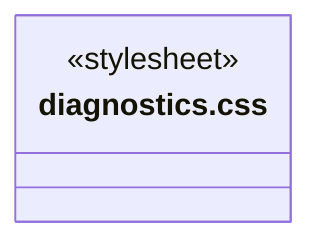
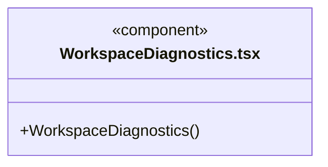
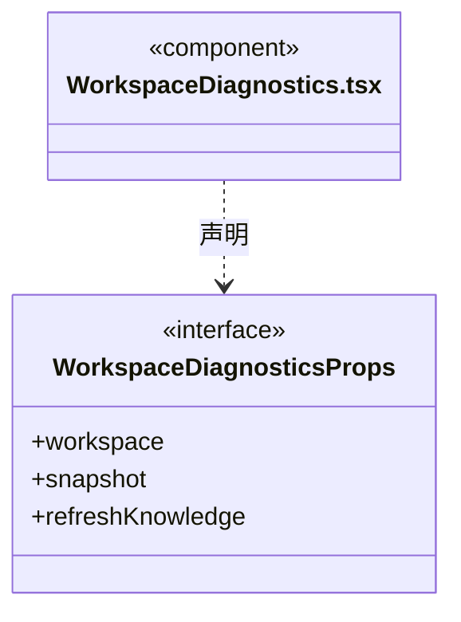
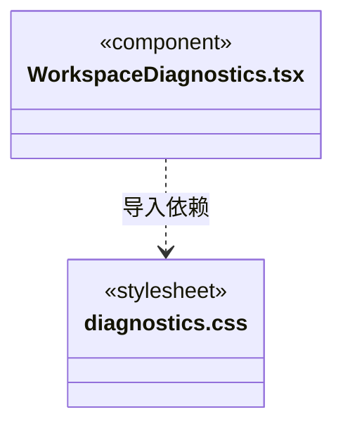

# src/view/diagnostics 架构

本目录只维护这一份说明。设计与契约直接编辑本文；文件清单、类图和导航由 [架构脚本](../../../scripts/source-architecture.mjs) 更新，生成区域之外的人工说明会保留。

## 封装意图

只读展示工作区运行状态和知识校验问题，不把工作区就绪视为知识校验通过。

## 类与模块的设计意图

下表依据源码声明及文件头说明定位封装。字段表示该实例持有的状态或协作引用，不表示它拥有被引用服务的生命周期；实际资源责任和调用限制见下文契约及源码注释。

| 类／模块 | 实现形式与实例字段 | 封装依据 |
| --- | --- | --- |
| [WorkspaceDiagnostics.tsx](WorkspaceDiagnostics.tsx) | 组件模块 | 身份、运行是否就绪与知识是否有效分别展示；只接纳当前工作区的快照，不把缺失或其它对象的检查当作通过。 |

## 接口设计契约

### 工作区诊断

WorkspaceDiagnostics 显示工作区身份、目录、实例和知识修订。只有 workspaceId 与 instanceId 都匹配的 Snapshot 才用于知识结果；其它快照不展示为已通过。运行未就绪时明确不能重新检查。结构检查无问题不代表业务语义或任务验收通过。只读刷新不修复或启动项目。

#### 统一排版（2026-11-16）

普通文字、按钮、状态和说明复用 components/interface.css 的 --font-ui 与 --weight-regular；结构短标题使用 --weight-medium。颜色和间距承担次要信息层级，不把说明文字缩小。代码使用 --font-code，真实 Markdown 标题保留语义层级。

## 开闭边界

本目录的职责及允许协作由[封装意图](#封装意图)限定，输入输出、状态与失败语义以[接口设计契约](#接口设计契约)为准。扩展从已有公开入口及实际装配位置进入；没有明确可替换契约的部分按真实影响修改和验证，不预建未使用的基类或插件入口。

<!-- architecture:generated:start -->

## 文件清单

| 文件 | 形式 | 当前职责 |
| --- | --- | --- |
| [ARCHITECTURE.md](ARCHITECTURE.md) | 说明文档 | 本目录的文件清单、真实声明、依赖与子封装导航。 |
| [WorkspaceDiagnostics.tsx](WorkspaceDiagnostics.tsx) | 组件模块 | 只读展示工作区内部运行状态和知识校验问题。 |
| [diagnostics.css](diagnostics.css) | 样式 | 工作区运行状态与知识校验详情的扩展面板样式。 |

## 架构类图

成员标记：`+` 公开、`-` 私有、`#` 受保护、`$` 静态；构造函数单独列出。文档和资源仅在文件清单中导航，不作为代码节点。

### diagnostics.css

### WorkspaceDiagnostics.tsx

直接依赖：[../../bridge/contracts/workspace.ts](../../bridge/contracts/workspace.ts)、[../components/Icon.tsx](../components/Icon.tsx)、[diagnostics.css](diagnostics.css)。

### 本目录调用边界

## 子目录导航

无子目录。

[返回上层](../ARCHITECTURE.md)。

每次修改本目录代码，同步维护文件头、关键契约说明及本图。未实现的治理、证据验收和自动编排能力不列入当前类图。

<!-- architecture:generated:end -->
