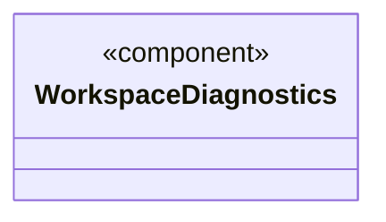

# src/view/diagnostics 架构

## 设计意图

只读展示工作区运行状态和知识校验问题，不把工作区就绪视为知识校验通过。

## 主要组成

| 组成 | 定位 |
| --- | --- |
| [WorkspaceDiagnostics](WorkspaceDiagnostics.tsx) | 只读展示工作区内部运行状态和知识校验问题。 |

<!-- architecture:generated:start -->

## 架构关系

[上层设计](../ARCHITECTURE.md)

<!-- architecture:generated:end -->
