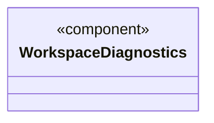

# src/view/diagnostics 架构

## 设计意图

只读呈现工作区运行状态与知识校验问题，为维护者提供可核对的诊断入口。

`WorkspaceDiagnostics` 消费后端公开数据并分别显示运行可用性和知识问题，不触发修复或启动任务。工作区已打开只表示生命周期状态，不能据此隐藏知识校验失败。

## 主要组成

| 组成 | 定位 |
| --- | --- |
| [WorkspaceDiagnostics](WorkspaceDiagnostics.tsx) | 只读展示工作区内部运行状态和知识校验问题。 |

<!-- architecture:generated:start -->

## 架构关系

[上层设计](../ARCHITECTURE.md)

<!-- architecture:generated:end -->
