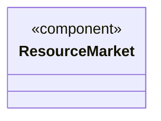

# 发现页

## 设计意图

统一管理四类资源的发布、版本下载和安装。

## 主要组成

| 组成 | 定位 |
| --- | --- |
| [ResourceMarket](MenuViews.tsx) | 以类别与资源 ID 合并发布版本和本机历史，显示商品卡与精确版本详情。签名安装、卸载和项目写入通过桌面桥接完成。 |

<!-- architecture:generated:start -->

## 架构关系

[上层设计](../ARCHITECTURE.md)

<!-- architecture:generated:end -->
