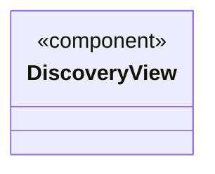

# 发现页

## 设计意图

浏览和筛选资源分类。

## 主要组成

| 组成 | 定位 |
| --- | --- |
| [DiscoveryView](MenuViews.tsx) | 浏览和筛选资源分类。 |

<!-- architecture:generated:start -->

## 架构关系

[上层设计](../ARCHITECTURE.md)

<!-- architecture:generated:end -->
