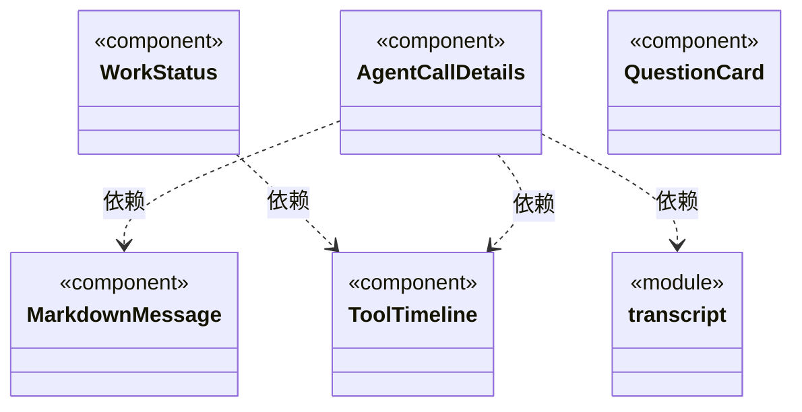

# src/view/execution-view 架构

## 设计意图

为主对话、成员任务和履历复用同一套执行正文与工具过程展示，保持表现与业务处置分离。

事件投影生成消息与工具事实，`ToolTimeline`、`MarkdownMessage`、`WorkStatus` 和 `QuestionCard` 分别展示过程、正文、状态和问题；Agent 调用详情按真实引用逐层读取。处置由调用页面注入，展开记录不意味着重新执行。

## 主要组成

| 组成 | 定位 |
| --- | --- |
| [MarkdownMessage](MarkdownMessage.tsx) | 将 Agent 消息渲染成排版后的正文、列表、表格与可复制代码块。 |
| [ToolTimeline](ToolTimeline.tsx) | 把工具申请、授权、运行、输出及完成记录合并成可展开的执行时间线。 |
| [WorkStatus](WorkStatus.tsx) | 移植 Cindy WorkGroupBlock 的用时和结果；主对话只显示行尾状态，成员详情仍可折叠查看执行轨道。 |
| [QuestionCard](QuestionCard.tsx) | 展示 Agent 的结构化问题，以选项卡及最后一项其它输入收集答案。 |
| [transcript](transcript.ts) | 将持久化执行事件投影为对话消息、工具证据与运行错误，目标返工反馈明确显示为系统消息。 |
| [AgentCallDetails](AgentCallDetails.tsx) | 按真实调用引用读取执行 Agent 对话，沿相同工具轨道逐层展开。 |

<!-- architecture:generated:start -->

## 架构关系

[上层设计](../ARCHITECTURE.md)

<!-- architecture:generated:end -->
