# src/view/execution-view 架构

本目录只维护这一份说明。设计与契约直接编辑本文；文件清单、类图和导航由 [架构脚本](../../../scripts/source-architecture.mjs) 更新，生成区域之外的人工说明会保留。

## 封装意图

主对话、成员任务和团队履历共用的消息、工具轨道、状态、问答及输入展示。只依赖公开通信契约和通用组件；查询、恢复和处置控制器由页面组合，不反向依赖 conversation、tasks 或 team。主对话、成员与历史共用的消息、工具轨道及运行状态；只消费公开快照和最小展示插槽，不依赖任务或会话控制器。原核实与恢复由页面显式组合，Markdown 的用户链接点击继续通过固定 Bridge。

## 类与模块的设计意图

下表依据源码声明及文件头说明定位封装。字段表示该实例持有的状态或协作引用，不表示它拥有被引用服务的生命周期；实际资源责任和调用限制见下文契约及源码注释。

| 类／模块 | 实现形式与实例字段 | 封装依据 |
| --- | --- | --- |
| [AgentCallDetails.tsx](AgentCallDetails.tsx) | 组件模块 | 调用详情独立于旧派发图；每次只读一个明确 run，模态详情在手机保持全宽，关闭返回原工具与焦点。 |
| [ComposerAttachments.tsx](ComposerAttachments.tsx) | 组件模块 | 点击读取当前工作区已保存的附件快照，避免预览与实际送入模型的文本不一致。 |
| [knowledge-tool-view.ts](knowledge-tool-view.ts) | 函数／契约模块 | 只接受工具名称匹配的严格完整输出及同一工作区身份；缺失、报错或混杂文本不能被猜成写入成功。保留每项诊断，不改变运行或业务目标状态。 |
| [MarkdownMessage.tsx](MarkdownMessage.tsx) | 组件模块 | 沿用 Cindy 的 react-markdown/GFM/高亮流水线及流式语法修复； |
| [MessageQueue.tsx](MessageQueue.tsx) | 组件模块 | 紧凑列表在悬停或焦点显示插入、编辑、删除，拖柄与键盘均可排序；界面不自行启动计时器或执行队列，排序只作用于尚未开始的消息，不中断当前工具。 |
| [QuestionCard.tsx](QuestionCard.tsx) | 组件模块 | 本地选择不触发发送；提交前完整校验，失败保留草稿，明确提交后才继续原任务。 |
| [repairStreamingMarkdown.ts](repairStreamingMarkdown.ts) | 函数／契约模块 | 直接移植 Cindy 的纯函数，避免流式半截标记使消息反复跳动；不修改持久化原文。 |
| [team-conversations.ts](team-conversations.ts) | 函数／契约模块 | 同一角色的执行实例可以变化，导航始终使用唯一逻辑 Session；只接受原办公室登记，不从名字猜身份。 |
| [tool-failure-view.ts](tool-failure-view.ts) | 函数／契约模块 | 原日志保持不变；只有调用方证实未放行时才转换提示，不能凭正文宣称副作用不存在。 |
| [tool-labels.ts](tool-labels.ts) | 函数／契约模块 | 将技术工具名翻译成正在发生的动作，只更改展示，不据名称推断执行成功或验收。 |
| [ToolTimeline.tsx](ToolTimeline.tsx) | 组件模块 | 计量遥测只在输入框状态区显示，不重复插入工具轨道；采用 Cindy 的工具生命周期展示方式，避免每个事件显示一份重复 JSON； |
| [transcript.ts](transcript.ts) | 函数／契约模块 | 确认插入才投影为用户消息，成员回注和人工决定接续保留系统来源。文字与工具按事件和明确调用关联排序，同一调用更新原位置；流式文本由完整 message 替换，不展示模型私有思维。 |
| [WorkStatus.tsx](WorkStatus.tsx) | 组件模块 | 真实动作名称与工具轨道共用，失败／拒绝在折叠外可见；本轮结束使用历史图标，不表示整体目标完成；状态变化不播放循环进度动画。只消费公开运行投影和可选详情插槽；折叠不加载恢复控制器、不查询、不停止任务或重放旧调用。 |

## 接口设计契约

<a id="contract"></a>

<a id="contract-图片附件预览"></a>

##### 图片附件预览

WorkStatus 的运行、失败、中断、停止分别使用语义图标；completed 显示 history 和“本轮结束”，不显示验收成功。停止和中断的文字仍由真实 RunSummary 决定；不再用持续旋转暗示可测量进度。队列保存/取消/继续沿用公共图标及原回调，拖动手柄使用 grip 替代字符图形，保留原拖动协议。

ComposerAttachments 对已保存图片读取 chat.preview，卡片显示40px缩略图，弹窗展示原图、来源和采集说明；移除仅改变待发送选择，不删除源文件。图片使用固定MIME的data URI，不加载原路径/外部URL，字节不写入草稿持久化。异步预览在卸载或换工作区后失效；坏快照显示失败，不伪造图片。

<a id="contract-共享执行展示边界"></a>

### 共享执行展示边界

公开助手正文包含反馈提交后的最终答复，不再被成功工具回执隐藏；空完整消息不能擦除已流出的文字。completionFeedback 供主对话只读兜底：本轮无结束正文时显示当前轮交付声明及限制，否则明确未记录最终反馈、操作数量与核实建议；不复用旧轮 taskProgress，不改日志、不追加模型调用或将结束视为验收。

本目录承接主对话、成员详情和团队履历的真实公共消费者。transcript 只投影公开日志；MarkdownMessage 保留流式修复、受控链接和复制；WorkStatus 与 ToolTimeline 只显示传入运行事实，回合结束不代表业务目标验收。

WorkStatus 接收可选 activityDetails；ToolTimeline 接收按原调用 ID 的 renderControls 和 renderDetails，由 tasks/ToolActivity 组合既有命令核实、影响观察及恢复上下文。ToolTimeline 只在展开时挂载详情，不拥有查询或恢复权。成员正文默认只读，不伪造缺少来源的核实入口。

AgentCallDetails 是独立的只读查询边界：仅接受 cbim_agent_call 的 tool.updated 或 tool.finished 中宿主持久引用，核对工作区、父 task/run 和工具 ID；loop.inspect 返回后再次核对目标 task/run 与首个 run.started 的相同引用。缺失、冲突或异源身份不拼接。查询重试不执行 Agent；每个已展开视图串行读取，运行结束或详情关闭停止轮询，迟到响应失效。递归调用复用同一工具详情，不沿旧派发图猜测关系；原生 dialog 保持手机全宽，返回调用方恢复焦点与原阅读位置，不提供执行 Agent 输入框。

QuestionCard、ComposerAttachments 和 MessageQueue 只保持已有展示和显式交互：本地选择不提交，附件预览仅显式读取已保存快照，排队操作由调用方回调执行。原 CSS 类名、事件顺序、身份核对、错误展示和原始回执保留。

<a id="contract-知识操作状态"></a>

#### 知识操作状态

knowledge-tool-view 仅接受原 finished 调用的完整、同工作区知识输出。预览的 structural:false 展示为警告，并逐项保留 validation.issues；提交的 committed 回执展示事务与知识版本，不能推导业务验收。缺失、异常、跨工作区和混杂文本均不推断成功。ToolTimeline 给控制插槽提供 attention；失败、中断或返回丢失突出核实入口，成功操作默认折叠。

<a id="contract-失败与熔断显示"></a>

##### 失败与熔断显示

ToolTimeline 在失败或未确认调用旁展示运行记录中的 nextStep；engine.status 的 label 缺省时使用 message/state，显示真实熔断原因。仅展示文本，不生成自动重试/核实动作，不改变原运行或业务验收状态。


<a id="contract-明确拒绝与旧参数错误"></a>

#### 明确拒绝与旧参数错误

ToolTimeline 按同一调用事件确认 tool.denied 且没有 tool.allowed/started/updated 时，只读渲染拒绝原因，并不调用核实控制插槽。tool-failure-view 兼容旧 message 内嵌的校验数组及当前 TOOL_INPUT_INVALID，展示缺失字段、格式说明与默认参数语义，不展示原始校验 JSON；原日志未修改。已放行或仅正文自称 rejected 的失败保持原核实入口，不能通过伪造正文隐藏可能发生的副作用。
<a id="contract-团队逻辑对话投影"></a>

##### 团队逻辑对话投影

`team-conversations.ts` 供侧栏、成员文字页和办公室共用，不依赖任一业务页面。只接受同工作区/主根的正式 TeamSession；角色的不同执行实例统一到同一人物/导航项，公开任务引用保留原身份，正文仍按原 task/run 读取。`teamConversationKey` 以工作区实例隔离本机动态缓存。该模块只投影，不创建会话或修改执行。

<a id="contract-同调用问答状态"></a>

#### 同调用问答状态

ToolTimeline 根据原工具的 agentCallState 显示等待调用方答复、执行中、已完成或执行未完成。waiting 的中间 tool.finished 不覆盖暂停状态；后续 tool.updated 的终态结束同一卡片。cbim_agent_reply 以普通工具显示“答复执行 Agent”，不新增频道或层级。
<a id="contract-原任务的对话定位"></a>

##### 原任务的对话定位

taskConversationTarget 只把当前 workspace/root 下唯一任务映射为已登记 TeamSession；主根及主 Agent 自执行回主对话，其他任务必须有唯一同 Agent 的登记。缺记录、跨会话或重复登记抛出明确错误，不能猜名字、复用另一执行实例或偷偷回主 Agent。纯函数只返回 sessionId/scopeId/taskId，页面切换和一次性定位代次由 Conversation/MemberConversation 拥有。


<a id="contract-统一排版2026-11-16"></a>

#### 统一排版（2026-11-16）

普通文字、按钮、状态和说明复用 components/interface.css 的 --font-ui 与 --weight-regular；结构短标题使用 --weight-medium。颜色和间距承担次要信息层级，不把说明文字缩小。代码使用 --font-code，真实 Markdown 标题保留语义层级。

## 开闭边界

本目录的职责及允许协作由[封装意图](#封装意图)限定，输入输出、状态与失败语义以[接口设计契约](#接口设计契约)为准。扩展从已有公开入口及实际装配位置进入；没有明确可替换契约的部分按真实影响修改和验证，不预建未使用的基类或插件入口。

<!-- architecture:generated:start -->

## 文件清单

| 文件 | 形式 | 当前职责 |
| --- | --- | --- |
| [ARCHITECTURE.md](ARCHITECTURE.md) | 说明文档 | 本目录的文件清单、真实声明、依赖与子封装导航。 |
| [AgentCallDetails.tsx](AgentCallDetails.tsx) | 组件模块 | 按真实 Agent 工具调用引用读取执行对话，并在同一种工具轨道中逐次展开子调用。 |
| [ComposerAttachments.tsx](ComposerAttachments.tsx) | 组件模块 | 按 Cindy ThumbnailStrip 的 56px 卡片、类型标识和角落移除按钮展示草稿附件。 |
| [MarkdownMessage.tsx](MarkdownMessage.tsx) | 组件模块 | 将 Agent 消息渲染成排版后的正文、列表、表格与可复制代码块。 |
| [MessageQueue.tsx](MessageQueue.tsx) | 组件模块 | 展示主进程持久化的待执行消息，提供插队、排序、移除及继续操作。 |
| [QuestionCard.tsx](QuestionCard.tsx) | 组件模块 | 展示 Agent 的结构化问题，以选项卡及最后一项其它输入收集答案。 |
| [ToolTimeline.tsx](ToolTimeline.tsx) | 组件模块 | 把工具申请、授权、运行、输出及完成记录合并成可展开的执行时间线。 |
| [WorkStatus.tsx](WorkStatus.tsx) | 组件模块 | 移植 Cindy WorkGroupBlock 的用时和结果；主对话只显示行尾状态，成员详情仍可折叠查看执行轨道。 |
| [agent-call-details.css](agent-call-details.css) | 样式 | 对应界面的布局与视觉样式。 |
| [knowledge-tool-view.css](knowledge-tool-view.css) | 样式 | 对应界面的布局与视觉样式。 |
| [knowledge-tool-view.ts](knowledge-tool-view.ts) | 源码模块 | 从已结束的原知识调用中提取预览诊断或已提交回执，供工具轨道和工作摘要展示。 |
| [message-queue.css](message-queue.css) | 样式 | 与输入框一体的紧凑队列，匹配参考图的单行消息、拖柄及悬停圆形操作。 |
| [questions.css](questions.css) | 样式 | 结构化问题卡片的主题、选中态和输入排版。 |
| [repairStreamingMarkdown.ts](repairStreamingMarkdown.ts) | 源码模块 | 显示正在流入的 Markdown 时临时补齐未闭合语法。 |
| [team-conversations.ts](team-conversations.ts) | 源码模块 | 将办公室长期子 Session 投影为共享的角色、状态与任务引用，供侧栏、成员对话和办公室使用。 |
| [tool-failure-view.ts](tool-failure-view.ts) | 源码模块 | 从已确认执行前拒绝的工具回包提取可读原因，兼容旧校验 JSON。 |
| [tool-labels.ts](tool-labels.ts) | 源码模块 | 工具轨道和实时活动预览共用的公开动作名称。 |
| [transcript.ts](transcript.ts) | 源码模块 | 将持久化执行事件投影为对话消息、工具证据与运行错误，目标返工反馈明确显示为系统消息。 |

## 架构类图

成员标记：`+` 公开、`-` 私有、`#` 受保护、`$` 静态；`function` 为函数值成员，`get`／`set` 为访问器。调用／构造／索引签名按匿名签名列出，不虚构方法名；`global.` 表示全局声明补充，非运行时嵌套类。构造函数单独列出，运行时私有字段保留 `#`。文档和资源仅在文件清单中导航，不作为代码节点。

### agent-call-details.css

[查看源码](agent-call-details.css)。

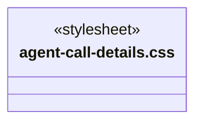

### AgentCallDetails.tsx

[查看源码](AgentCallDetails.tsx)。

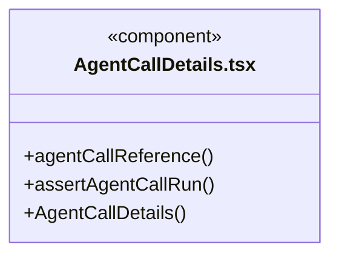

直接依赖：[../../bridge/contracts/execution.ts](../../bridge/contracts/execution.ts)、[../components/Icon.tsx](../components/Icon.tsx)、[MarkdownMessage.tsx](MarkdownMessage.tsx)、[ToolTimeline.tsx](ToolTimeline.tsx)、[agent-call-details.css](agent-call-details.css)、[transcript.ts](transcript.ts)。

### ComposerAttachments.tsx

[查看源码](ComposerAttachments.tsx)。

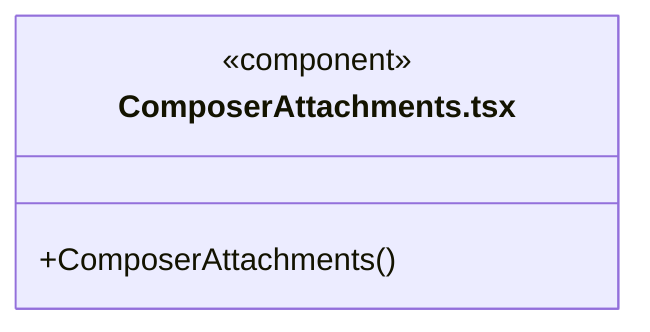

直接依赖：[../../bridge/contracts/chat.ts](../../bridge/contracts/chat.ts)、[../components/Icon.tsx](../components/Icon.tsx)。

### knowledge-tool-view.css

[查看源码](knowledge-tool-view.css)。

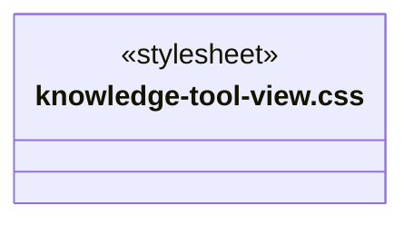

### knowledge-tool-view.ts

[查看源码](knowledge-tool-view.ts)。

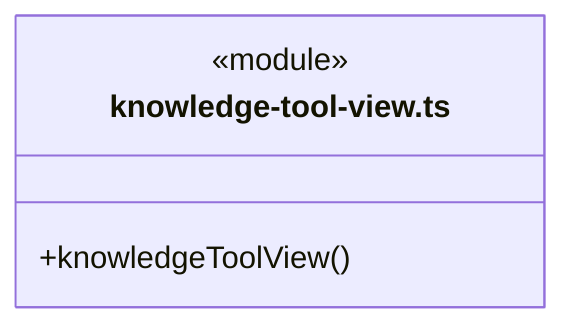

直接依赖：[../../bridge/contracts/knowledge-transactions.ts](../../bridge/contracts/knowledge-transactions.ts)。

### MarkdownMessage.tsx

[查看源码](MarkdownMessage.tsx)。

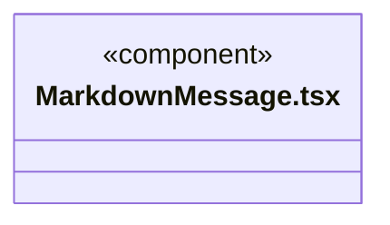
直接依赖：[repairStreamingMarkdown.ts](repairStreamingMarkdown.ts)。

### message-queue.css

[查看源码](message-queue.css)。

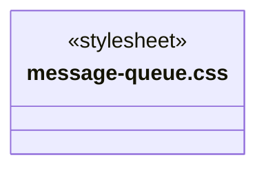

### MessageQueue.tsx

[查看源码](MessageQueue.tsx)。

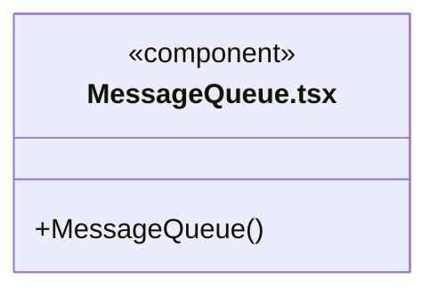

直接依赖：[../../bridge/contracts/execution.ts](../../bridge/contracts/execution.ts)、[../components/Icon.tsx](../components/Icon.tsx)、[message-queue.css](message-queue.css)。

### QuestionCard.tsx

[查看源码](QuestionCard.tsx)。

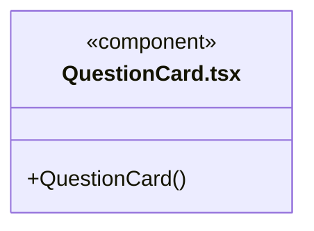

直接依赖：[../../bridge/contracts/execution.ts](../../bridge/contracts/execution.ts)、[questions.css](questions.css)。

### questions.css

[查看源码](questions.css)。

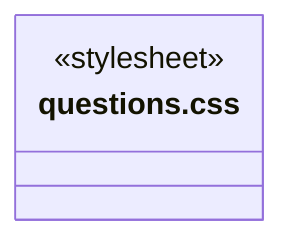

### repairStreamingMarkdown.ts

[查看源码](repairStreamingMarkdown.ts)。

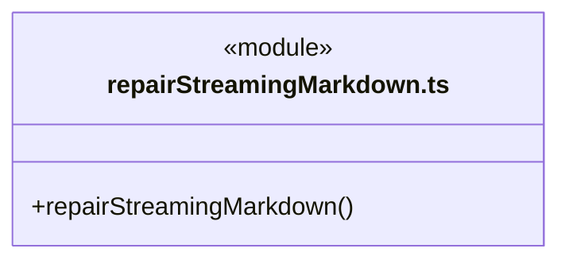


### team-conversations.ts

[查看源码](team-conversations.ts)。

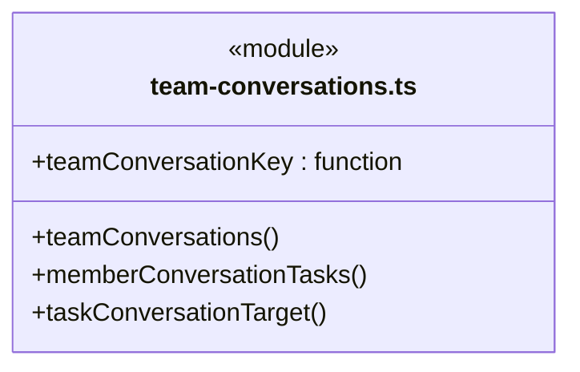

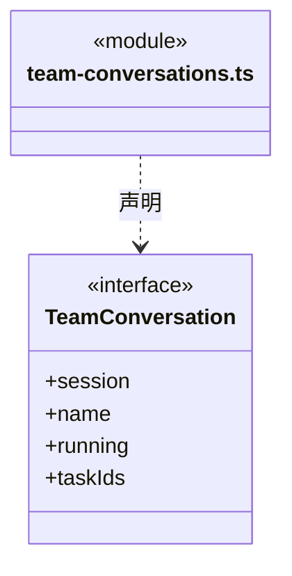

直接依赖：[../../bridge/contracts/dispatch.ts](../../bridge/contracts/dispatch.ts)。

### tool-failure-view.ts

[查看源码](tool-failure-view.ts)。

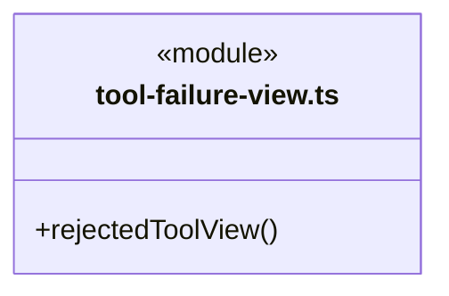

直接依赖：[../../bridge/contracts/execution.ts](../../bridge/contracts/execution.ts)。

### tool-labels.ts

[查看源码](tool-labels.ts)。

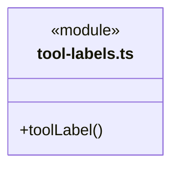


### ToolTimeline.tsx

[查看源码](ToolTimeline.tsx)。

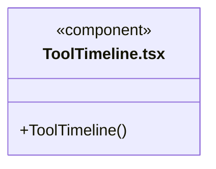

直接依赖：[../../bridge/contracts/execution.ts](../../bridge/contracts/execution.ts)、[../components/RepositoryScopeDetails.tsx](../components/RepositoryScopeDetails.tsx)、[knowledge-tool-view.css](knowledge-tool-view.css)、[knowledge-tool-view.ts](knowledge-tool-view.ts)、[tool-failure-view.ts](tool-failure-view.ts)、[tool-labels.ts](tool-labels.ts)。

### transcript.ts

[查看源码](transcript.ts)。

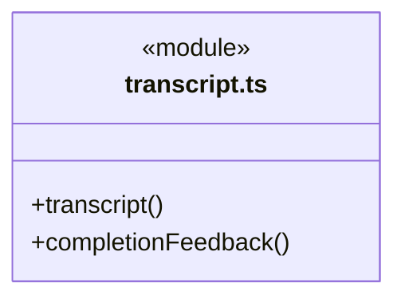

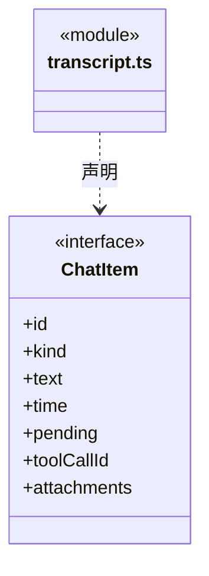

直接依赖：[../../bridge/contracts/execution.ts](../../bridge/contracts/execution.ts)、[../../bridge/contracts/models.ts](../../bridge/contracts/models.ts)。

### WorkStatus.tsx

[查看源码](WorkStatus.tsx)。

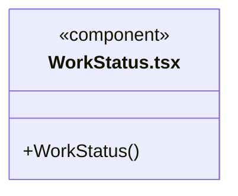

直接依赖：[../../bridge/contracts/execution.ts](../../bridge/contracts/execution.ts)、[../components/Icon.tsx](../components/Icon.tsx)、[ToolTimeline.tsx](ToolTimeline.tsx)、[tool-labels.ts](tool-labels.ts)。

### 本目录调用边界

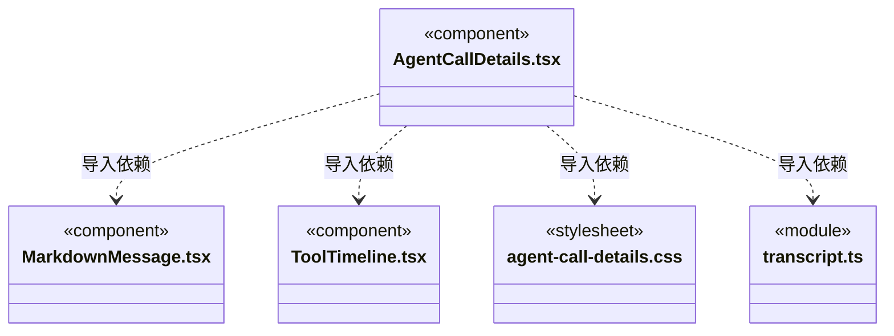

```mermaid
classDiagram
class N_src_view_execution_view_MarkdownMessage_tsx["MarkdownMessage.tsx"] {
  <<component>>
}
class N_src_view_execution_view_repairStreamingMarkdown_ts["repairStreamingMarkdown.ts"] {
  <<module>>
}
class N_src_view_execution_view_MessageQueue_tsx["MessageQueue.tsx"] {
  <<component>>
}
class N_src_view_execution_view_message_queue_css["message-queue.css"] {
  <<stylesheet>>
}
class N_src_view_execution_view_QuestionCard_tsx["QuestionCard.tsx"] {
  <<component>>
}
class N_src_view_execution_view_questions_css["questions.css"] {
  <<stylesheet>>
}
class N_src_view_execution_view_ToolTimeline_tsx["ToolTimeline.tsx"] {
  <<component>>
}
class N_src_view_execution_view_knowledge_tool_view_css["knowledge-tool-view.css"] {
  <<stylesheet>>
}
N_src_view_execution_view_MarkdownMessage_tsx ..> N_src_view_execution_view_repairStreamingMarkdown_ts : 导入依赖
N_src_view_execution_view_MessageQueue_tsx ..> N_src_view_execution_view_message_queue_css : 导入依赖
N_src_view_execution_view_QuestionCard_tsx ..> N_src_view_execution_view_questions_css : 导入依赖
N_src_view_execution_view_ToolTimeline_tsx ..> N_src_view_execution_view_knowledge_tool_view_css : 导入依赖
```

```mermaid
classDiagram
class N_src_view_execution_view_ToolTimeline_tsx["ToolTimeline.tsx"] {
  <<component>>
}
class N_src_view_execution_view_knowledge_tool_view_ts["knowledge-tool-view.ts"] {
  <<module>>
}
class N_src_view_execution_view_tool_failure_view_ts["tool-failure-view.ts"] {
  <<module>>
}
class N_src_view_execution_view_tool_labels_ts["tool-labels.ts"] {
  <<module>>
}
class N_src_view_execution_view_WorkStatus_tsx["WorkStatus.tsx"] {
  <<component>>
}
N_src_view_execution_view_ToolTimeline_tsx ..> N_src_view_execution_view_knowledge_tool_view_ts : 导入依赖
N_src_view_execution_view_ToolTimeline_tsx ..> N_src_view_execution_view_tool_failure_view_ts : 导入依赖
N_src_view_execution_view_ToolTimeline_tsx ..> N_src_view_execution_view_tool_labels_ts : 导入依赖
N_src_view_execution_view_WorkStatus_tsx ..> N_src_view_execution_view_ToolTimeline_tsx : 导入依赖
```

```mermaid
classDiagram
class N_src_view_execution_view_WorkStatus_tsx["WorkStatus.tsx"] {
  <<component>>
}
class N_src_view_execution_view_tool_labels_ts["tool-labels.ts"] {
  <<module>>
}
N_src_view_execution_view_WorkStatus_tsx ..> N_src_view_execution_view_tool_labels_ts : 导入依赖
```


## 子目录导航

无子目录。

[返回上层](../ARCHITECTURE.md)。

每次修改本目录代码，同步维护文件头、关键契约说明及本图。未实现的治理、证据验收和自动编排能力不列入当前类图。

<!-- architecture:generated:end -->
