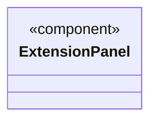

# 扩展面板

## 设计意图

维护当前窗口的扩展标签。

## 主要组成

| 组成 | 定位 |
| --- | --- |
| [ExtensionPanel](ExtensionPanel.tsx) | 维护当前窗口的扩展标签。 |

<!-- architecture:generated:start -->

## 架构关系

[上层设计](../ARCHITECTURE.md)

<!-- architecture:generated:end -->
