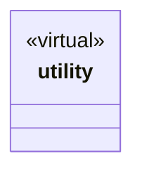

# src/view/foundations 架构

## 设计意图

提供不依赖页面、React 或通信的视图侧基础能力，避免公共机制反向认识业务界面。

当前由 `utility` 承载纯算法和实例数据结构，按需组合 Core 的便携能力。基础层只管理注入范围内的技术状态，页面仍决定业务身份、请求取消、保存和销毁时机。

## 主要组成

本层没有直接产品实现，由下方子模块组成；每个直接子模块作为一个虚拟封装，只在本层呈现整体职责与协作。

<!-- architecture:generated:start -->

## 架构关系

标注为 `virtual` 的节点是直接子模块的虚拟类封装；内部设计沿下方入口阅读。

## 子模块

| 虚拟封装 | 整体职责 |
| --- | --- |
| [utility](utility/ARCHITECTURE.md) | 复用视图侧异步代次、订阅、图布局和 JSON 存取机制，同时保持各控制器状态隔离。 |

[上层设计](../ARCHITECTURE.md)

<!-- architecture:generated:end -->
