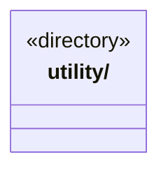

# src/view/foundations 架构

## 目录定位

前端域的独立基础类库；前端业务单向组合其公开能力，不依赖页面、bridge 或后端基础库，不持有业务状态与通信权限。

本文描述当前实现。通过分析目录边界后维护的 [源码架构脚本](../../../scripts/source-architecture.mjs) 同步清单和声明；代码变更时仍须核对职责、关键成员与关系。

## 代码清单

本层无直接代码文件。

## 架构类图

各图中的同名节点表示同一目录边界；跨组及完整直接依赖如下（无边不代表继承）：

本层无目录间直接导入关系。

## 子目录导航

- [utility/](utility/ARCHITECTURE.md)：前端通用工具按类别内聚：json.ts 提供保留现有排序与空值规则的 JSON 比较，events.ts 提供实例级同步订阅集合，async.ts 提供实例异步代次标记，graphs.ts 提供前端分层，storage.ts 提供注入式 JSON 记录读写，index.ts 是公开入口。订阅按函数身份去重、通知遍历当前集合且异常原样传播；代次只判断迟到资格，业务状态、失效时机、轮询与销毁留在控制器。JSON 排序已组合共享 Core，其余能力保留原实现和生命周期。

[返回上层](../ARCHITECTURE.md)。

每次修改本目录代码，同步维护文件头、关键契约说明及本图。未实现的治理、证据验收和自动编排能力不列入当前类图。

## 设计契约 v1 与落地范围

以下内容区分已接通能力与后续设计；以各节的实现状态为准，不将目标图当作现状图。维护源：[CONTRACT.md](CONTRACT.md)；生成类图时同步附加，勿直接修改本附录。

# 前端基础类库

前端与后端是独立的域，各自在域内沉淀公共能力。此目录只承载前端低频、可独立验证的机制，不依赖页面、业务控制器、bridge 或后端 foundations；不持有业务状态或通信权限。

当前只有 [utility](utility/CONTRACT.md)，通过其 `index.ts` 提供 JSON 比较、实例订阅集合、异步代次标记、图分层及本地 JSON 记录读写。异步代次只判断结果是否仍属于当前生命周期，不取消请求；订阅集合只持有监听器，状态发布、轮询和销毁仍归各控制器。图算法不持有坐标或业务边策略；存储只读写注入端口，不拥有记录身份与恢复决策。后续同类算法按类别内聚，不能把页面状态机、回执规则或持久化策略机械下沉。后端不反向消费此前端库，通信契约也不作为工具库的转发入口。
