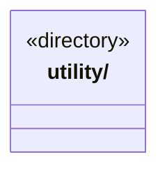

# src/view/foundations 架构

本目录只维护这一份说明。设计与契约直接编辑本文；文件清单、类图和导航由 [架构脚本](../../../scripts/source-architecture.mjs) 更新，生成区域之外的人工说明会保留。

## 封装意图

视图侧独立适配库；单向组合 Core 公开技术能力，不依赖页面、Bridge 或 Logic，不持有业务状态与通信权限。

## 类与模块的设计意图

本层没有直接源码声明，负责组合下级封装；各子系统的类、状态与公开入口见本文的[子目录导航](#子目录导航)。

## 接口设计契约

### 前端基础类库

View 与 Logic 按各自变化原因维护交互和业务适配，共享的技术契约与算法归 Core。此目录只承载视图侧可独立验证的机制，单向组合 Core 公开能力，不依赖页面、业务控制器、Bridge 或 Logic；不持有业务状态或通信权限。

当前只有 [utility](utility/ARCHITECTURE.md#contract)，通过其 `index.ts` 提供 JSON 比较、实例订阅集合、异步代次标记、图分层及本地 JSON 记录读写。异步代次只判断结果是否仍属于当前生命周期，不取消请求；订阅集合只持有监听器，状态发布、轮询和销毁仍归各控制器。图算法不持有坐标或业务边策略；存储只读写注入端口，不拥有记录身份与恢复决策。后续同类算法按类别内聚，不能把页面状态机、回执规则或持久化策略机械下沉。后端不反向消费此前端库，通信契约也不作为工具库的转发入口。

## 开闭边界

本目录的职责及允许协作由[封装意图](#封装意图)限定，输入输出、状态与失败语义以[接口设计契约](#接口设计契约)为准。扩展从已有公开入口及实际装配位置进入；没有明确可替换契约的部分按真实影响修改和验证，不预建未使用的基类或插件入口。

<!-- architecture:generated:start -->

## 文件清单

| 文件 | 形式 | 当前职责 |
| --- | --- | --- |
| [ARCHITECTURE.md](ARCHITECTURE.md) | 说明文档 | 本目录的文件清单、真实声明、依赖与子封装导航。 |

本层无直接代码文件。

## 架构类图

成员标记：`+` 公开、`-` 私有、`#` 受保护、`$` 静态；`function` 为函数值成员，`get`／`set` 为访问器。调用／构造／索引签名按匿名签名列出，不虚构方法名；`global.` 表示全局声明补充，非运行时嵌套类。构造函数单独列出，运行时私有字段保留 `#`。文档和资源仅在文件清单中导航，不作为代码节点。

各图中的同名节点表示同一目录边界；跨组及完整直接依赖如下（无边不代表继承）：

本层无目录间直接导入关系。

## 子目录导航

- [utility/](utility/ARCHITECTURE.md)：前端通用工具按类别内聚：json.ts 提供保留现有排序与空值规则的 JSON 比较，events.ts 提供实例级同步订阅集合，async.ts 提供实例异步代次标记，graphs.ts 提供前端分层，storage.ts 提供注入式 JSON 记录读写，index.ts 是公开入口。订阅按函数身份去重、通知遍历当前集合且异常原样传播；代次只判断迟到资格，业务状态、失效时机、轮询与销毁留在控制器。JSON 排序已组合共享 Core，其余能力保留原实现和生命周期。

[返回上层](../ARCHITECTURE.md)。

每次修改本目录代码，同步维护文件头、关键契约说明及本图。未实现的治理、证据验收和自动编排能力不列入当前类图。

<!-- architecture:generated:end -->
