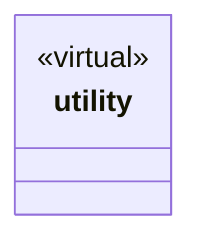

# src/view/foundations 架构

## 设计意图

视图侧独立适配库；单向组合 Core 公开技术能力，不依赖页面、Bridge 或 Logic，不持有业务状态与通信权限。

## 主要组成

本层由下列子模块组合，每个子模块作为独立的虚拟类封装参与本层协作。

<!-- architecture:generated:start -->

## 架构关系

标注为 `virtual` 的节点是直接子模块的虚拟类封装；内部设计沿下方入口阅读。

## 子模块

| 虚拟封装 | 整体职责 |
| --- | --- |
| [utility](utility/ARCHITECTURE.md) | 提供视图侧可复用的异步代次、订阅集合、图布局和 JSON 存取能力。实例对象隔离局部状态，纯算法组合 Core 工具，不持有页面业务或通信权限。 |

[上层设计](../ARCHITECTURE.md)

<!-- architecture:generated:end -->
