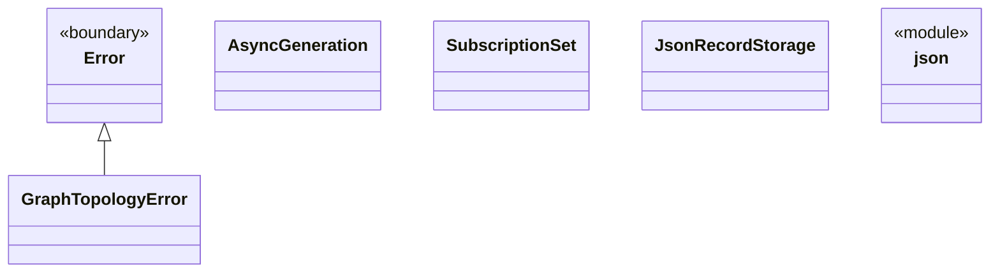

# src/view/foundations/utility 架构

## 设计意图

复用视图侧异步代次、订阅、图布局和 JSON 存取机制，同时保持各控制器状态隔离。

`AsyncGeneration` 标识结果代次，`SubscriptionSet` 管理同步通知，`JsonRecordStorage` 使用注入存储；graphs/json 函数处理纯数据，`GraphTopologyError` 报告结构问题。标记失效不取消请求，清空订阅不释放业务资源，持久命令的语义仍由页面控制器维护。

## 主要组成

| 组成 | 定位 |
| --- | --- |
| [AsyncGeneration](async.ts) | 按实例标识异步操作代次，拒绝旧结果覆盖当前视图。 |
| [SubscriptionSet](events.ts) | 管理实例内的同步订阅与退订，供局部状态发布使用。 |
| [GraphTopologyError](graphs.ts) | 报告视图图结构无法按拓扑布局的事实。 |
| [JsonRecordStorage](storage.ts) | 通过注入的存储接口读写 JSON 记录，不绑定具体页面。 |
| [json](json.ts) | 无状态比较 JSON 值，供视图核对请求、预览和回执。 |

<!-- architecture:generated:start -->

## 架构关系

外部继承／实现边界：`Error`。

[上层设计](../ARCHITECTURE.md)

<!-- architecture:generated:end -->
