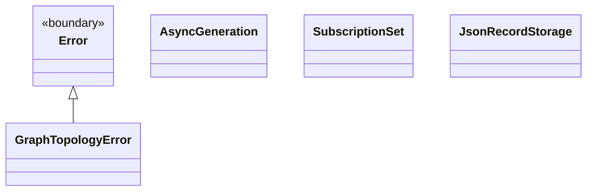

# src/view/foundations/utility 架构

## 设计意图

提供视图侧可复用的异步代次、订阅集合、图布局和 JSON 存取能力。实例对象隔离局部状态，纯算法组合 Core 工具，不持有页面业务或通信权限。

## 主要组成

| 组成 | 定位 |
| --- | --- |
| [AsyncGeneration](async.ts) | 按实例标识异步操作代次，拒绝旧结果覆盖当前视图。 |
| [SubscriptionSet](events.ts) | 管理实例内的同步订阅与退订，供局部状态发布使用。 |
| [GraphTopologyError](graphs.ts) | 报告视图图结构无法按拓扑布局的事实。 |
| [JsonRecordStorage](storage.ts) | 通过注入的存储接口读写 JSON 记录，不绑定具体页面。 |

<!-- architecture:generated:start -->

## 架构关系

外部继承／实现边界：`Error`。

[上层设计](../ARCHITECTURE.md)

<!-- architecture:generated:end -->
