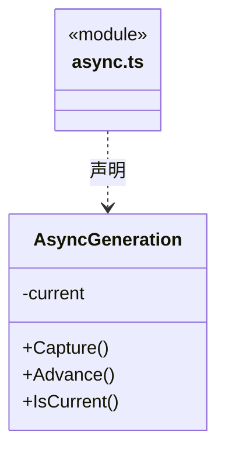
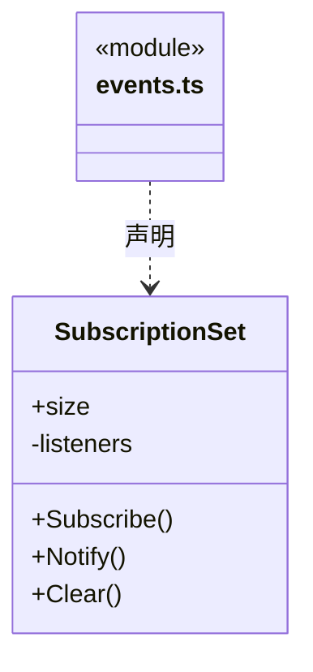
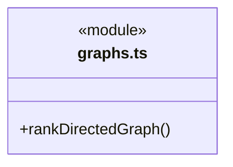
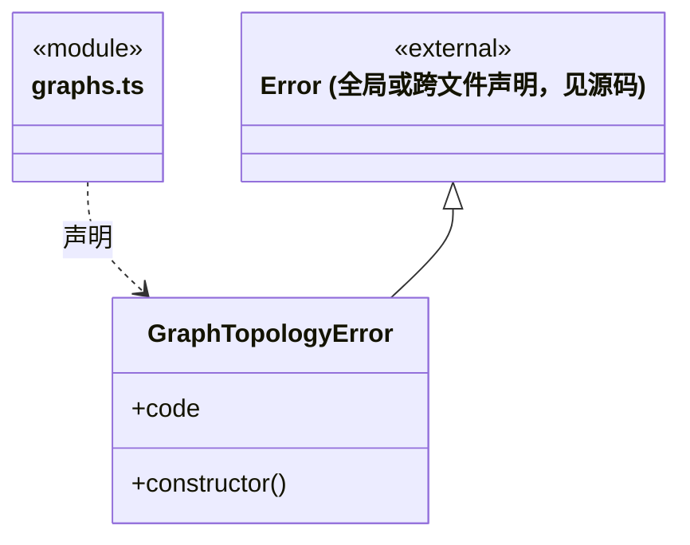
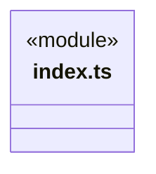
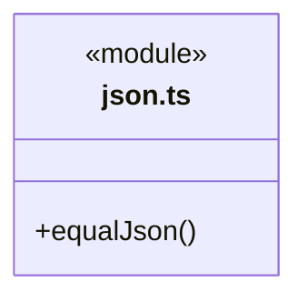
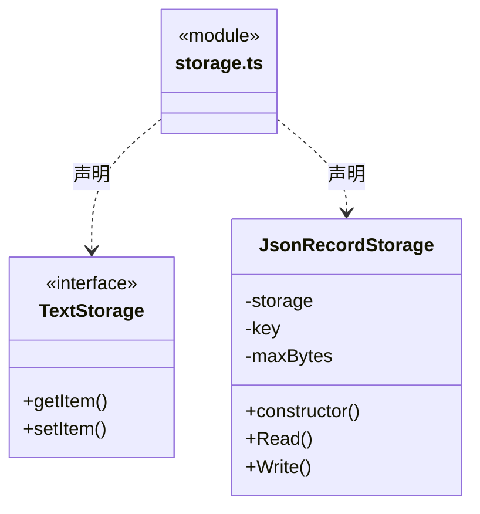
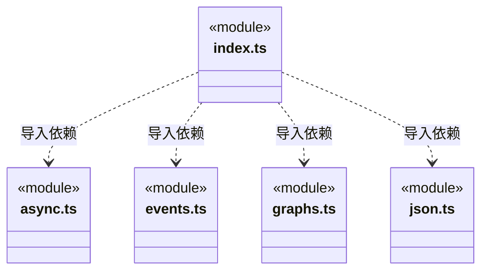
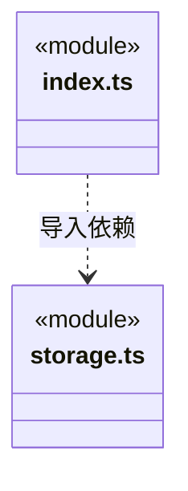

# src/view/foundations/utility 架构

本目录只维护这一份说明。设计与契约直接编辑本文；文件清单、类图和导航由 [架构脚本](../../../../scripts/source-architecture.mjs) 更新，生成区域之外的人工说明会保留。

## 封装意图

前端通用工具按类别内聚：json.ts 提供保留现有排序与空值规则的 JSON 比较，events.ts 提供实例级同步订阅集合，async.ts 提供实例异步代次标记，graphs.ts 提供前端分层，storage.ts 提供注入式 JSON 记录读写，index.ts 是公开入口。订阅按函数身份去重、通知遍历当前集合且异常原样传播；代次只判断迟到资格，业务状态、失效时机、轮询与销毁留在控制器。JSON 排序已组合共享 Core，其余能力保留原实现和生命周期。

## 类与模块的设计意图

下表依据源码声明及文件头说明定位封装。字段表示该实例持有的状态或协作引用，不表示它拥有被引用服务的生命周期；实际资源责任和调用限制见下文契约及源码注释。

| 类／模块 | 实现形式与实例字段 | 封装依据 |
| --- | --- | --- |
| [AsyncGeneration](async.ts) | 实例类；持有 `current` | 作用定位：提供前端异步协作的实例级代次标记，供控制器判断迟到结果是否仍可使用。 设计原因：生成与比较标记是稳定机制，何时作废、校验响应及发布状态仍由消费者决定。 职责边界：不持有请求、Promise 或业务状态，不取消工作、不管理定时器或资源释放。 |
| [SubscriptionSet](events.ts) | 实例类；持有 `listeners` | 作用定位：前端事件订阅工具，提供实例级、无参数的同步通知集合。 设计原因：控制器共用监听器注册和遍历机制，状态、轮询、页面生命周期仍由控制器持有。 职责边界：没有全局事件总线，不保存业务值，不启动读取或计时器，不捕获监听器异常。 |
| [GraphTopologyError](graphs.ts) | 实例类；持有 `code` | 作用定位：前端有向图的纯拓扑算法，不引用任务、画布或通信契约。 设计原因：拓扑分层与卡片几何分别变化；业务选择边并解释错误，算法仅处理节点和有向关系。 |
| [index.ts](index.ts) | 函数／契约模块 | 消费者通过稳定入口组合前端基础能力，类别文件保持私有；不借 bridge 复用后端工具。 |
| [json.ts](json.ts) | 函数／契约模块 | 组合共享 Core 的排序算法并保留前端比较策略，业务身份和接受条件仍由各控制器判断。 |
| [JsonRecordStorage](storage.ts) | 实例类；持有 `storage`、`key`、`maxBytes` | 不缓存、不自动删除或覆盖坏数据；每次读写调用注入端口，异常原样传播。 |

## 接口设计契约

### 前端通用工具库

本库保留视图侧适配，按数据或问题类别组织，不采用一函数一文件。公开入口为 index.ts，类别文件为私有实现。JSON 比较已组合共享 src/core/utility；其余能力暂留原实现。只依赖语言能力及共享 Core 公开入口，不依赖 React、页面、通信契约、Node 或后端业务，没有全局可变状态。

#### JSON 比较

`equalJson(left, right)` 调用共享 JsonUtils.OrderJsonValue，显式用 localeCompare 排列键、略去对象 undefined、保持数组顺序，再比较 JSON.stringify 输出。不修改输入，不生成身份、授权、哈希或持久化记录，不校验字段有效性。比较策略保留在视图适配，算法与后端共享。

真实消费者为岗位登记、模块责任、目标接续、人工决定、人工继续五个控制器。它们原有的同类本地算法收敛到此入口；身份、版本、原请求匹配、回执合法性及未知结果处理仍归各控制器。

#### 兼容边界

- 数组空位与 undefined 按原 JSON 序列化规则表示为 null；非有限数字同样遵循 JSON.stringify。顶层 undefined 等不可序列化值的比较沿用旧行为，不意味着合法 JSON。
- 循环、BigInt、读取属性或排序时的异常继续传播，不捕获为 false。不额外添加深度上限或危险键过滤；自有 `__proto__` 等字段按原实现保留。
- 只面向业务已约束的 JSON 形状数据，不是任意 JavaScript 对象的深相等工具。不要用于 Date、Map、自定义原型或 toJSON 的通用语义比较。
- `localeCompare` 依赖环境，可能让不同 Unicode 键比较为同序；保留稳定排序的原插入顺序，不借重构改变规则。因此不提供跨环境 canonical 保证。
- 原样 `JSON.stringify` 比较仍由原消费者保留；负责人视图的字典序及递归序列化/空值规则也未迁移，不能直接替换成此入口。

#### 实例订阅集合

`events.ts` 的 SubscriptionSet 只持有本实例无参数监听器，提供 subscribe、notify、size 和 clear。按函数身份去重，注册不立即通知；notify 同步按 Set 插入顺序遍历当前集合，不复制快照、不合并、不排队、不等待异步回调。监听器异常原样抛出并中断本轮，不自动删除失败监听器。

保留原控制器的 Set 语义：通知期间删除未执行项会跳过，新加入项可在同一轮被执行；重复注册不做引用计数，任一退订都会移除该函数，旧退订也能移除后来重新注册的同一函数。清空不通知、不封闭集合；嵌套通知仍同步执行。消费者须避免回调反复重加自身导致无限遍历，也应自行处理异步回调的拒绝。

19 个真实消费者包括岗位、模块责任、预算设置、运行监管、准入以及 tasks 中报告、接续、决定、恢复、重规划和用量控制器。状态先更新再通知的顺序保持；size 用于原 canRelease 判断，clear 仅清监听器。RuntimeFeed 和 AdmissionFeed 的首订阅读取、末退订停止计时、代次失效与单次在途读取仍由原控制器负责，不由集合创建或释放请求、定时器或业务资源。

#### 实例异步代次

async.ts 的 AsyncGeneration 提供 capture、advance、isCurrent。每实例持有一个 Symbol 标记：capture 不推进，advance 作废所有旧标记并返回新标记，isCurrent 只接纳本实例当前标记。标记不序列化、不比较大小、不作为业务身份；不同实例标记不会相互命中，没有全局计数器或共享状态。

12 个真实消费者分别为预算设置、运行监管、准入、命令核实、文件报告、执行报告、产物清单、负责人核实、请求额度、周期用量、运行定位及重规划预览。消费者决定推进与捕获时机，成功、失败、finally 中的检查保留在原位置；响应校验先于或后于标记检查的既有顺序不变。RuntimeFeed/AdmissionFeed 只在订阅生命周期推进，读取仍单次在途；重规划只作废预览，不影响冻结业务命令的迟到回执。

本机制不发送或取消请求，不吞掉错误，不管理忙碌状态、Promise 或定时器，不替代后端身份、版本或授权校验。React Hook 中混合生命周期的 ref、按业务键维护的代次 Map、用于业务键或公开令牌的数字序号没有迁移，不能把所有 generation 字段机械替换。

稳定候选是实例标记及相等判断；变化点是各页面的失效时机、响应校验和状态发布，继续局限在控制器。判断依据为上述消费者共同机制及不同生命周期，未统计历史变化频率。新增同类页面组合本类并定义自己的推进点，无需给基础库添加业务分支；若需要物理取消或按键排空，应另核实契约。

#### 依赖与验证

前端业务单向导入公开入口；基础库不能反向引用页面、bridge 或后端。后端独立沉淀自己的公共库，二者不建立共享工具依赖。增加同类 JSON 算法优先放入 `json.ts`，实际语义不同时保留明确契约，不预设配置开关。

单元测试归属 `view/foundations/utility`（测试文件仍保留 tests/unit/frontend 的历史路径），JSON 比较、订阅集合与异步代次分套件验证各自行为。消费者测试验证回执、提交、恢复、先更新后通知、轮询退订与迟到结果隔离；基础库不加载应用或消费者夹具。源码注释、类图和三宿主 AI 工作流随实现同步。

#### 有向图分层

私有类别 graphs.ts 的 rankDirectedGraph 接收节点 ID 与边二元组，返回最长前驱层级。输入不修改，孤立节点为 0，平行边逐条计数；GraphTopologyError 区分重复节点、缺端点与环。前端任务布局是实际消费者，边启用条件、任务身份、原错误文案、同层稳定顺序、像素与 SVG 路由仍留在 tasks。与后端图算法独立实现和测试。

#### 本地 JSON 记录

storage.ts 的 JsonRecordStorage 注入 TextStorage、键及字节上限，每次读写直接调用端口，不缓存或恢复。read 将 null/空串视为缺失，其余按 UTF-8 上限检查后 JSON.parse；write 先序列化、检查，再 setItem；超过上限使用调用方文案，读写/序列化错误原样传播。输入和返回仍须业务校验；只适用原来将空串视为缺失的消费者。岗位与模块负责人是当前消费者，128 条数、schema/身份、损坏锁定及先更新内存后写盘顺序均留在控制器。

#### 共享算法调用边界

本目录通过 Core 公开入口调用 `JsonUtils.OrderJsonValue`。静态类只承载原算法；本目录继续决定字段、比较器、错误映射及资源生命周期。函数改为静态方法不改变原持久化字节或失败语义。

## 开闭边界

本目录的职责及允许协作由[封装意图](#封装意图)限定，输入输出、状态与失败语义以[接口设计契约](#接口设计契约)为准。扩展从已有公开入口及实际装配位置进入；没有明确可替换契约的部分按真实影响修改和验证，不预建未使用的基类或插件入口。

<!-- architecture:generated:start -->

## 文件清单

| 文件 | 形式 | 当前职责 |
| --- | --- | --- |
| [ARCHITECTURE.md](ARCHITECTURE.md) | 说明文档 | 本目录的文件清单、真实声明、依赖与子封装导航。 |
| [async.ts](async.ts) | 源码模块 | 提供前端异步协作的实例级代次标记，供控制器判断迟到结果是否仍可使用。 |
| [events.ts](events.ts) | 源码模块 | 前端事件订阅工具，提供实例级、无参数的同步通知集合。 |
| [graphs.ts](graphs.ts) | 源码模块 | 前端有向图的纯拓扑算法，不引用任务、画布或通信契约。 |
| [index.ts](index.ts) | 源码模块 | 前端域通用工具函数与数据结构的公开入口，提供按类别组织的纯算法与实例数据结构。 |
| [json.ts](json.ts) | 源码模块 | 前端域的 JSON 比较工具，供页面控制器核对请求、预览和回执中的值。 |
| [storage.ts](storage.ts) | 源码模块 | 前端本地 JSON 记录的有界同步读写机制，通过注入端口使用存储。 |

## 架构类图

成员标记：`+` 公开、`-` 私有、`#` 受保护、`$` 静态；构造函数单独列出。文档和资源仅在文件清单中导航，不作为代码节点。

### async.ts

### events.ts

### graphs.ts

继承／实现来源：`Error` → `全局或跨文件声明，见源码`。

### index.ts

直接依赖：[async.ts](async.ts)、[events.ts](events.ts)、[graphs.ts](graphs.ts)、[json.ts](json.ts)、[storage.ts](storage.ts)。

### json.ts

直接依赖：[../../../core/utility/index.ts](../../../core/utility/index.ts)。

### storage.ts

### 本目录调用边界

## 子目录导航

无子目录。

[返回上层](../ARCHITECTURE.md)。

每次修改本目录代码，同步维护文件头、关键契约说明及本图。未实现的治理、证据验收和自动编排能力不列入当前类图。

<!-- architecture:generated:end -->
