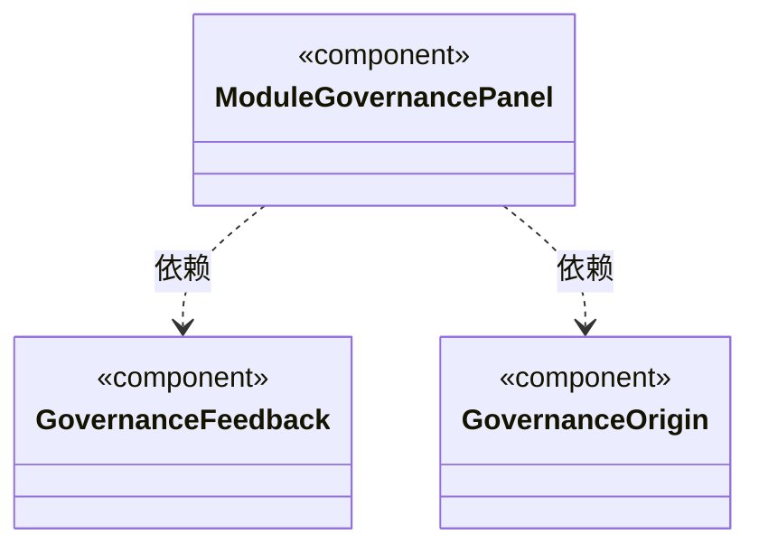

# src/view/governance 架构

## 设计意图

把模块知识治理转化为可审阅、可明确决定的界面，区分模型建议、人工意见和正式实施。

`ModuleGovernancePanel` 组合提案与差异，来源和反馈组件展示真实依据，本地 pending 记录用于查询原命令。保存意见与实施是独立操作，未知回包沿原身份核实，界面不自判知识已经提交。

## 主要组成

| 组成 | 定位 |
| --- | --- |
| [ModuleGovernancePanel](ModuleGovernancePanel.tsx) | 业务架构节点的模块知识治理面板，展示真实观察、精确提案与反馈来源、独立人工决定及实施结果。 |
| [GovernanceFeedback](GovernanceFeedback.tsx) | 展示治理意见与修订方案的精确关系，提供本机显式补证、异议和回应评价表单。 |
| [GovernanceOrigin](GovernanceOrigin.tsx) | 治理历史中呈现观察和提案的可信来源，区分本机明确提交、主 Agent 运行与未记录来源的旧数据。 |

<!-- architecture:generated:start -->

## 架构关系

[上层设计](../ARCHITECTURE.md)

<!-- architecture:generated:end -->
