# src/view/governance 架构

本目录只维护这一份说明。设计与契约直接编辑本文；文件清单、类图和导航由 [架构脚本](../../../scripts/source-architecture.mjs) 更新，生成区域之外的人工说明会保留。

## 封装意图

静态业务模块的知识治理面板。展示真实来源、精确差异、补证/异议与回应评价。审阅绑定来源版本，未评价不补造理解，人工决定与实施分开；原命令先保存再发送，未知只查询。 IPC 名称从冻结的治理动作形成有限联合，保留原命令未知查询。 操作联合与表单请求经对应Schema配对，原命令回执控制器不变。

## 类与模块的设计意图

下表依据源码声明及文件头说明定位封装。字段表示该实例持有的状态或协作引用，不表示它拥有被引用服务的生命周期；实际资源责任和调用限制见下文契约及源码注释。

| 类／模块 | 实现形式与实例字段 | 封装依据 |
| --- | --- | --- |
| [governance-feedback.ts](governance-feedback.ts) | 函数／契约模块 | 空评价保持未评价，批准不补造“已回应”；刷新后的来源或最新决定变化会使旧勾选失效，避免沿用已过期的审阅。 |
| [governance-pending.ts](governance-pending.ts) | 函数／契约模块 | 先可靠保存身份再发送，未知结果不能被新命令覆盖；不复制知识正文或批准凭据，也不自动重发。 |
| [GovernanceFeedback.tsx](GovernanceFeedback.tsx) | 组件模块 | 来源被替代与历史评价分开显示，用户未评价时不生成肯定状态；确认绑定本次看到的版本，表单本身不调用模型或实施知识变更。 |
| [GovernanceOrigin.tsx](GovernanceOrigin.tsx) | 组件模块 | 模型提出方案与人工批准是两种事实；显示原根会话、成员通道、run 和 toolCall，便于定位来源，不把缺少来源的旧记录补成用户签署。 |
| [ModuleGovernancePanel.tsx](ModuleGovernancePanel.tsx) | 组件模块 | 观察基线固定到正文和知识版本；批准与写入分开，面板刷新不覆盖草稿，未知请求只能查原回执，避免将旧批准用于新内容。 |

## 接口设计契约

### 模块知识治理面板

治理操作用公共 Icon 区分核实、预览、保存与实施；完整文字、预览内容、版本条件和已知/未知结果保持原契约，不因统一图形而合并操作。

界面只从明确选择的静态 Module 打开，不属于会话任务图。保护登记、观察、精确正文提案、人工决定与实施分别发送命令；批准不会自动写知识，结构验证与知识提交不会被显示为业务验收。

每个新操作清除上次的成功提示。当前回复丢失时，只显示当前错误和待确认状态，不同时保留旧命令的“已确认”提示；历史回执仍有原命令身份。

`GovernanceOrigin` 展示服务保存的观察与提案来源：本机明确提交、主 Agent 的根会话/实例/成员通道/run/toolCall，或者旧记录未保存来源。来源不是批准记录；模型提案继续经过独立桌面决定和实施。查看来源只展示身份，不启动或恢复原会话。历史中存在多人、多轮提案时仍按明确选定的原 proposalId 展示精确差异。

`GovernanceFeedback` 展示精确原意见与当前来源状态，并单独提供本机决定表单。补证随暂缓登记，异议随驳回登记；两者都须明确关注点、期望回应和具体意见。桌面可将原意见 ID 加入新提案草稿，只在明确提交新方案时发送，不能自填冻结证明。模型生成的修订方案使用相同展示。

回应评价默认为未评价，逐项选择并填写说明才提交；批准不补造 addressed，也不要求为批准伪造肯定评价。`governance-feedback.ts` 绑定所审阅的 proposal/basis、最新决定与来源版本；刷新这些事实后旧勾选立即失效，草稿仍保留。来源被替代时禁用新批准与实施，可不评价旧来源而单独驳回/暂缓；后端同队列仍负责最终检查。已提交知识保持真实成功记录，不按后来意见撤销。

反馈来源或评价在第一次 RPC 预受理被明确拒绝时可清本地待确认；已未知请求只能查原回执，不能因为之后来源过期就推断原操作没有保存。

`governance-pending.ts` 只持久化公开身份和原命令元数据，不持久化知识正文或批准证明。每工作区最多一个待确认命令，整体 64 条和 256 KiB 上限；先同步保存后发送，坏数据或存储失败不覆盖旧记录。迟到结果必须匹配完整原请求才可解除。重开仅恢复记录和查看当前状态，不自动重发；查不到回执不证明未受理。

`ModuleGovernancePanel` 从真实新观察载入正文，提案基线始终使用该观察的知识/保护版本；刷新列表不替换正在编辑的草稿。明确选择历史提案后展示完整前后正文、取舍、不变量和恢复说明。保存人工决定前须明确勾选已审阅；批准后还需另一次点击实施。只有原 journal 的 committed 回执显示知识已提交，pending、未提交、回滚和恢复异常分别表达，均不写作业务验收。

跨模块的待确认请求可以核实原回执，但不能把另一模块的观察、正文或提案装到当前面板。卸载/重开仅恢复元数据并查询状态，原实例退役且服务明确核实未受理才能解除没有回执的旧请求。

仅首次 RPC 返回明确的预受理拒绝码时可解除本次元数据；接收回执或刷新之后的失败、已未知/重开请求以及 IO/损坏/实施待核实均不使用此分支。后端须保证实施意图保存后的不确定错误统一为未知或返回真实事务状态，不能伪装成前置拒绝。

治理提交从已验证的 action 联合构造固定 IPC 名称，不能使用任意字符串；严格请求、待确认记录与原回执查询保持。

#### 模态可访问性

ModuleGovernancePanel 使用 ModalFrame 的原生焦点约束与入口返回。Escape 在 busy 时保持打开；关闭不会移除持久待确认记录或重发原命令。治理字段、版本、批准与实施语义保持原契约。

#### 统一排版（2026-11-16）

普通文字、按钮、状态和说明复用 components/interface.css 的 --font-ui 与 --weight-regular；结构短标题使用 --weight-medium。颜色和间距承担次要信息层级，不把说明文字缩小。代码使用 --font-code，真实 Markdown 标题保留语义层级。

## 开闭边界

本目录的职责及允许协作由[封装意图](#封装意图)限定，输入输出、状态与失败语义以[接口设计契约](#接口设计契约)为准。扩展从已有公开入口及实际装配位置进入；没有明确可替换契约的部分按真实影响修改和验证，不预建未使用的基类或插件入口。

<!-- architecture:generated:start -->

## 文件清单

| 文件 | 形式 | 当前职责 |
| --- | --- | --- |
| [ARCHITECTURE.md](ARCHITECTURE.md) | 说明文档 | 本目录的文件清单、真实声明、依赖与子封装导航。 |
| [GovernanceFeedback.tsx](GovernanceFeedback.tsx) | 组件模块 | 展示治理意见与修订方案的精确关系，提供本机显式补证、异议和回应评价表单。 |
| [GovernanceOrigin.tsx](GovernanceOrigin.tsx) | 组件模块 | 治理历史中呈现观察和提案的可信来源，区分本机明确提交、主 Agent 运行与未记录来源的旧数据。 |
| [ModuleGovernancePanel.tsx](ModuleGovernancePanel.tsx) | 组件模块 | 业务架构节点的模块知识治理面板，展示真实观察、精确提案与反馈来源、独立人工决定及实施结果。 |
| [governance-feedback.ts](governance-feedback.ts) | 源码模块 | 将本机治理决定草稿转换为明确提交的反馈与回应评价，并绑定实际审阅的提案和来源版本。 |
| [governance-pending.ts](governance-pending.ts) | 源码模块 | 模块知识治理写操作的有界本地待确认元数据，供面板卸载或应用重开后查询原命令。 |
| [module-governance.css](module-governance.css) | 样式 | 对应界面的布局与视觉样式。 |

## 架构类图

成员标记：`+` 公开、`-` 私有、`#` 受保护、`$` 静态；构造函数单独列出。文档和资源仅在文件清单中导航，不作为代码节点。

### governance-feedback.ts

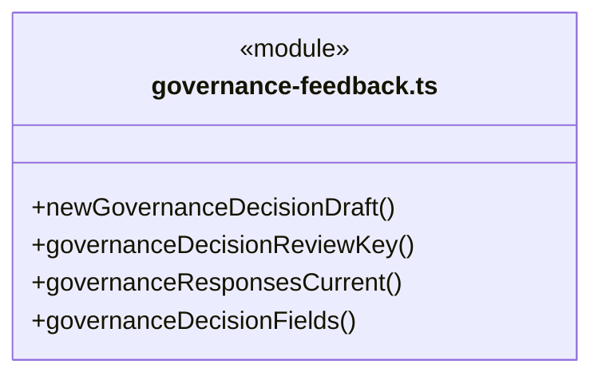

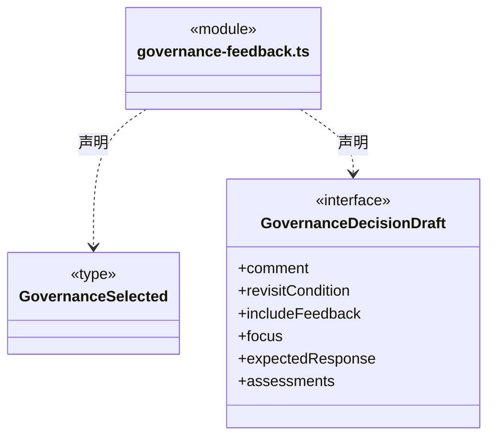

直接依赖：[../../bridge/contracts/governance.ts](../../bridge/contracts/governance.ts)。

### governance-pending.ts

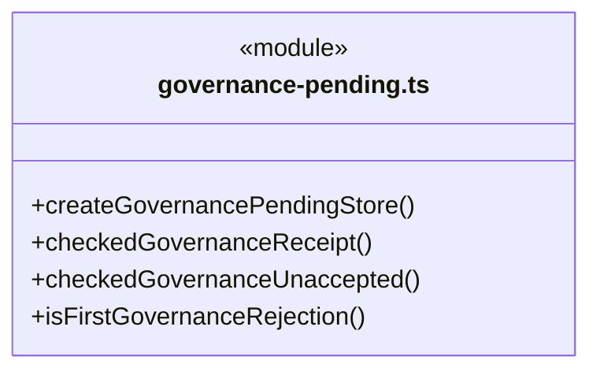

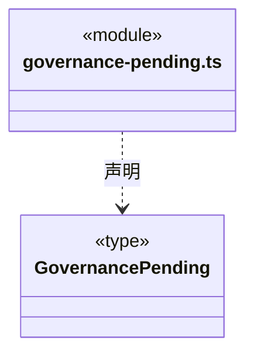

直接依赖：[../../bridge/contracts/governance.ts](../../bridge/contracts/governance.ts)。

### GovernanceFeedback.tsx

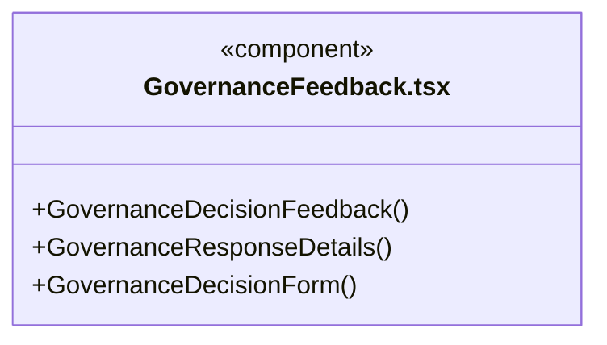

直接依赖：[../../bridge/contracts/governance.ts](../../bridge/contracts/governance.ts)、[governance-feedback.ts](governance-feedback.ts)。

### GovernanceOrigin.tsx

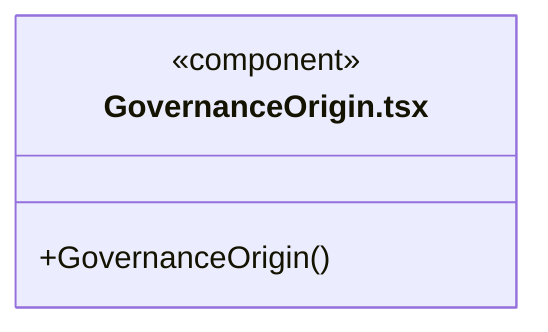

直接依赖：[../../bridge/contracts/governance.ts](../../bridge/contracts/governance.ts)。

### module-governance.css

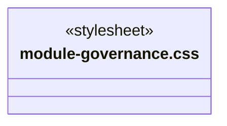

### ModuleGovernancePanel.tsx

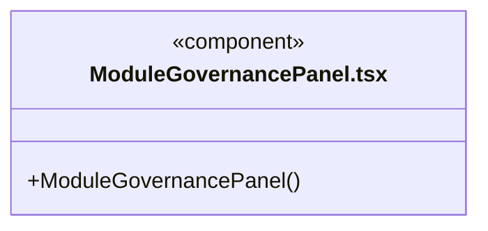

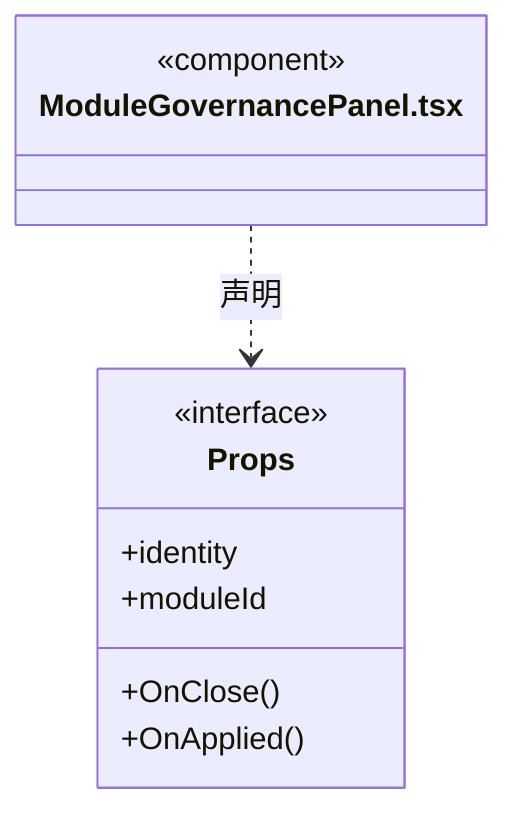

直接依赖：[../components/Icon.tsx](../components/Icon.tsx)、[../../bridge/contracts/ipc-call.ts](../../bridge/contracts/ipc-call.ts)、[../components/ModalFrame.tsx](../components/ModalFrame.tsx)、[../../bridge/contracts/governance.ts](../../bridge/contracts/governance.ts)、[governance-pending.ts](governance-pending.ts)、[GovernanceOrigin.tsx](GovernanceOrigin.tsx)、[GovernanceFeedback.tsx](GovernanceFeedback.tsx)、[governance-feedback.ts](governance-feedback.ts)、[module-governance.css](module-governance.css)。

### 本目录调用边界

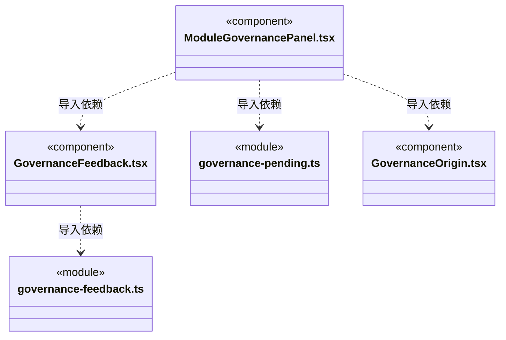

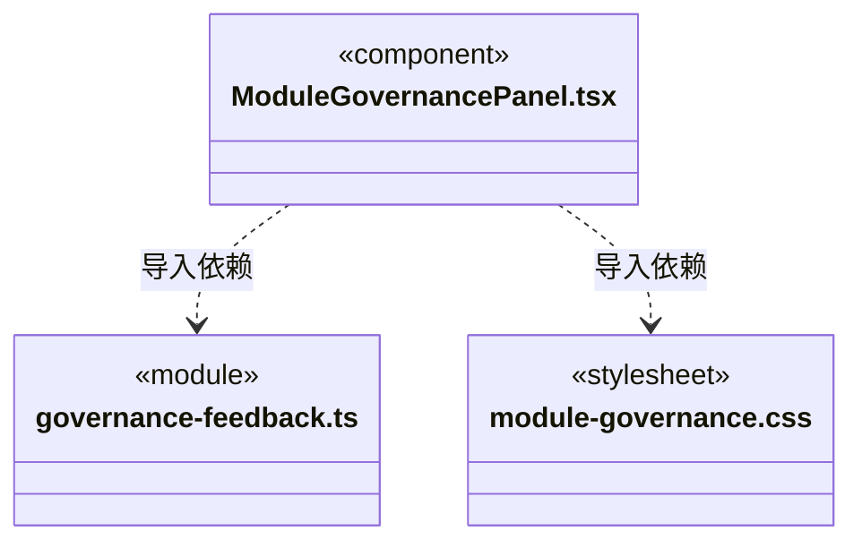

## 子目录导航

无子目录。

[返回上层](../ARCHITECTURE.md)。

每次修改本目录代码，同步维护文件头、关键契约说明及本图。未实现的治理、证据验收和自动编排能力不列入当前类图。

<!-- architecture:generated:end -->
