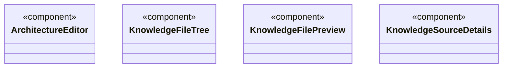

# src/view/knowledge 架构

## 设计意图

提供静态知识的语义编辑、文件预览和来源说明，让用户在明确基线下审阅修改。

`ArchitectureEditor` 组织对象表单与事务预览，文件树和预览组件使用真实快照，来源详情展示采纳依据。业务模块树属于 workspace，团队树属于 team；写入交给原知识事务，浏览或预览不隐式提交。

## 主要组成

| 组成 | 定位 |
| --- | --- |
| [ArchitectureEditor](ArchitectureEditor.tsx) | 团队与业务架构共用的语义对象编辑器，负责表单、删除影响预览和显式事务提交。 |
| [KnowledgeFileTree](KnowledgeFileTree.tsx) | 业务/团队共用的可展开知识目录与文件导航。 |
| [KnowledgeFilePreview](KnowledgeFilePreview.tsx) | 在业务和团队架构中预览实际知识文件，并通过原知识事务编辑。 |
| [KnowledgeSourceDetails](KnowledgeSourceDetails.tsx) | 为项目岗位和模块责任共用展示来源身份、未决状态与明确采纳预览。 |

<!-- architecture:generated:start -->

## 架构关系

[上层设计](../ARCHITECTURE.md)

<!-- architecture:generated:end -->
